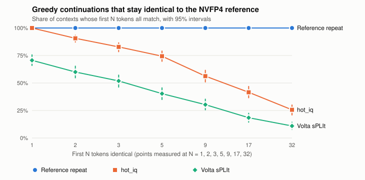
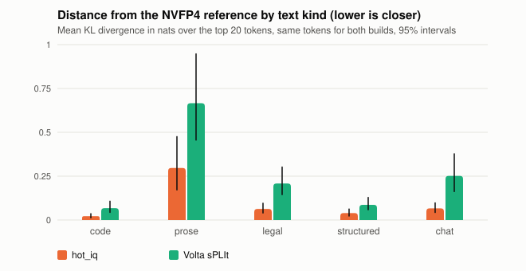
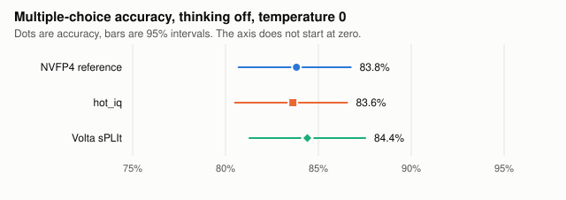

# Volta Max uPLIft FP4

## Volta Max uPLIft: as much of the routed work at NVIDIA's NVFP4 precision as fits on eight V100s, every routed expert on the cards in decode · 5,949 of 15,360 routed experts at exactly NVFP4 precision in the two-slot default · about 78 to 85 % of decode routes (predicted for two slots, 80 to 86 % measured on one) · same next token as NVIDIA's NVFP4 pack 95.1 % (Volta sPLIt 92.2 %, first release) · 192.3 tok/s with three requests together on the three-slot option (1.62x one stream) · 97.3 tok/s legal-style, 123.2 general (short sets, one request at a time on the two-slot default) · 8x V100 from 2018 · slower than Volta sPLIt

[-76B900?style=for-the-badge)](#how-close-to-nvfp4)
[-76B900?style=for-the-badge)](#serving-several-requests-at-once-window-18)
[-1F6FEB?style=for-the-badge)](#serving-several-requests-at-once-window-18)
[](#speed-bench-2026-11-12-final-build)
[](#speed-bench-2026-11-12-final-build)
[](#speed-bench-2026-11-12-final-build)
[](https://huggingface.co/ProprietaryLegal/Volta-Max-uPLIft-FP4-DeepSeek-V4.1-Flash-1017-hot_iq-8xV100-SXM2-PP2xTP4)
[](#what-did-not-work-or-is-not-yet-good)

Built by **Nick Mermiges, Esq.**, founder of [PLI Labs](https://proprietarylegal.ai/labs.html) · [proprietarylegal.ai](https://proprietarylegal.ai)

[](https://proprietarylegal.ai) [](https://proprietarylegal.ai/labs.html) [](LICENSE) [](#hardware) [](https://github.com/ProprietaryLegal/Volta-sPLIt-DeepSeek-V4.1-Flash-1017-8xV100-SXM2-PP2xTP4) [](https://huggingface.co/ProprietaryLegal/Volta-Max-uPLIft-FP4-DeepSeek-V4.1-Flash-1017-hot_iq-8xV100-SXM2-PP2xTP4) [](https://github.com/ProprietaryLegal/Volta-Full-NVFP4-DeepSeek-V4.1-Flash-8xV100)

[](#how-close-to-nvfp4)

**Volta Max uPLIft is the build that puts as much of the routed work at NVIDIA's NVFP4 precision as fits on eight V100
cards, with every routed expert held on the cards.** The configuration key is `hot_iq`. Every routed expert's compressed
IQ2-class record is placed on the cards first. Then experts are promoted to their NVFP4 weights in order of use per
byte, one by one, until the next one does not fit. This maximizes use, not the count. Packing the cheapest promotions
first would fit 6,377 to 6,379 experts at NVFP4 against 6,087, but less-used ones, so it could not carry more of the
work at NVFP4 (to within one expert's share on each pipeline stage, [below](#hot_iq-on-the-mixed-tally-the-build-of-this-release)). Use and work here are the mixed
tally's counts of decode routes, measured in-sample. On the mixed tally of this release that puts 6,087 of the 15,360 routed experts at exactly the
precision of NVIDIA's [DeepSeek-V4.1-Flash-1017-NVFP4](https://huggingface.co/nvidia/DeepSeek-V4.1-Flash-1017-NVFP4) pack,
unchanged. In the measured sets 79.0 to 85.0 % of decode routes ran on those experts (route counters, in-sample,
[below](#hot_iq-on-the-mixed-tally-the-build-of-this-release)). The other 15.0 to 21.0 % ran on ISTA-DASLab's IQ2-class
records. In decode all experts are in VRAM: no routed expert is read over PCIe. In the first release prompt reading
read the compressed experts at NVFP4 precision from records staged in host RAM (`native_staged`). Since
2026-11-12 the default reads them from their IQ2-class records on the cards (fast prompt reading, quality not
established) and serves two prompt slots, which places 5,949 experts at NVFP4
([update of 2026-11-12](#update-2026-11-12-two-prompt-slots-by-default-fast-prompt-reading-and-four-kernels)).

**How close to NVIDIA's NVFP4 pack** (MEASURED 2026-11-11, 320 contexts and 513 MMLU questions, rules fixed before
any capture, [details](#how-close-to-nvfp4)). `hot_iq` picks the same next token as the NVFP4 reference on 95.1 % of
compared tokens, Volta sPLIt on 92.2 %. Its KL divergence from the reference is 0.079 nats against Volta sPLIt's
0.196, and on the tokens both builds still share with the reference it removes 63 % of Volta sPLIt's KL divergence.
It changes 1.6 % of the multiple-choice answers, Volta sPLIt 15.4 %. 37 of Volta sPLIt's 79 changed answers are on
the 38 questions the reference left unanswered: on the 475 it answered, the changed shares are 1.7 % and 8.8 %
(counted after scoring, outside the preregistered rules).

The pack is served on eight V100-SXM2-32GB cards (two 4-card NVLink boards, pipeline parallel 2 x tensor parallel 4).
The promoted ("hot") routed experts run at the precision of DeepSeek's official weights: NVFP4 folds exactly to MXFP4 (4.25 bits
per weight), which the v100-skinny QPN kernel runs as W4A16. Two related builds serve the same model on the same
cards ([Related builds](#related-builds)). [Volta Full NVFP4](https://github.com/ProprietaryLegal/Volta-Full-NVFP4-DeepSeek-V4.1-Flash-8xV100) runs every routed expert at NVFP4
precision, the less-used ones from host RAM over PCIe, and is slower. Our earlier build,
[Volta sPLIt](https://github.com/ProprietaryLegal/Volta-sPLIt-DeepSeek-V4.1-Flash-1017-8xV100-SXM2-PP2xTP4), runs every routed
expert from a compressed IQ2-class record and is faster. The three-tier mode was an earlier step on the way to this
build, with part of the experts in host RAM. Its measurements are in the [history](docs/history.md).

**One download:** the [hot_iq package on Hugging Face](https://huggingface.co/ProprietaryLegal/Volta-Max-uPLIft-FP4-DeepSeek-V4.1-Flash-1017-hot_iq-8xV100-SXM2-PP2xTP4) (556 GB) holds
every weight file this build serves, the tier map that says which experts are hot, and the serving profile. Its
upload was complete on 2026-11-11, and its small-file update of 2026-11-12 ([package history](https://huggingface.co/ProprietaryLegal/Volta-Max-uPLIft-FP4-DeepSeek-V4.1-Flash-1017-hot_iq-8xV100-SXM2-PP2xTP4/commits/main))
added the serving files of this build: one profile template and one tier map per option. Start it with
[engine/configs/serve_hot_iq.sh](engine/configs/serve_hot_iq.sh) as [Reproduce](#reproduce) describes.

This repository is a public record of work in progress: the measurements, the code of the build as measured, what
worked and what did not. The steps that led to this build, the three-tier mode and the first `hot_iq` profiles
on the first tally (2026-11-09 and the earlier results of 2026-11-10), are dated rows of the
[measurement log](#measurement-log), with their tables and checks in [docs/history.md](docs/history.md). They stay
as published.
The build is slower than Volta sPLIt in decode speed and in prompt reading speed. We publish it now because
the method works, the numbers are measured, and the next steps are planned piece by piece. New results are added as
dated rows in the [measurement log](#measurement-log).

## Update 2026-11-12: two prompt slots by default, fast prompt reading and four kernels

Six changes were measured on the eight cards on 2026-11-11 and 2026-11-12 and are in this repository's engine and
templates. Each was measured under a rule fixed before its data, with public prompts only. Details and receipts:
[docs/measurements.md](docs/measurements.md#prompt-slots-fast-prompt-reading-and-four-kernels-2026-11-12).

- **Two prompt slots are the published default.** The server keeps two requests' prompts and decodes both at once.
  With three requests running together on the three-slot profile it delivers **192.3 tok/s in all, 1.62x one
  stream** (118.9 tok/s). Two requests on the two-slot default give 159.0 tok/s in all (1.34x). The one- and
  three-slot profiles ship as options (window 18 measured one to three). A four-slot profile was measured on 2026-11-12, before the prompt-reading
  kernels, and is not shipped. [Serving several requests at once](#serving-several-requests-at-once-window-18)
  has the full table, the price in NVFP4 experts and the limits.
- **Fast prompt reading is the default.** Prompt reading now reads each compressed expert from its IQ2-class record on
  the card, in place of its NVFP4 record staged from host RAM. Near 200K tokens a first read took 86 to 119 s
  (nine long chats, all ended normally), against 155 to 165 s for the native reading of the first release, measured
  on another day and build. **Quality not established**: it changes the output from the first token, the closeness
  figures of this page were all measured with native reading, and the window's rule made no verdict (its native arm
  was not run, and its memory check failed on stage 1 by 64 MiB, which the slot profiles answer with 192 MiB more
  reserve). Native reading stays available as the `native-slots1` option.
- **Fused IQ tail (patch G1).** One Triton launch does the weighted sum of the compressed experts' step. Token for
  token the same output. About 1.3 ms less per decode round on second runs in two windows (first-run verdict: no
  measurable change, the first runs of a boot carry 2 to 3 ms of noise).
- **SwiGLU kernel.** One Triton launch computes V4.1's limited SwiGLU of the NVFP4 experts in decode. Token for token
  the same output. About 1.3 ms less per decode round on second runs (first-run verdict: no measurable change).
- **Two request-path switches from Volta sPLIt (window 16).** The launcher exports `VLLM_V41_SYSTEM_IN_PLACE=1`,
  so a system message sent in the middle of a chat stays where it was sent and the server keeps the prompt it
  holds: a follow-up turn that adds one to a 30,779-token chat reused 30,752 tokens and took 0.45 s, against
  14.84 s with the switch off. And `VLLM_V41_TOPK_SEG=1024`, the segment width of the decode top-k kernel. Token
  for token the same output with the switches off and on, decode speed no measurable change ([details](docs/measurements.md#two-request-path-switches-window-16)).
- **Two prompt-reading kernels (window 17).** A one-launch SwiGLU and the RB 4 expert kernel, which handles 32
  token rows per block of weights it loads instead of 16. Both run only while a prompt is read and give the same
  output bits as the path they replace (one card, 90 cases each, then token-exact on eight cards). Second reads
  of a 215,847-token prompt took 4.43 s less (89.3 to 89.8 s against 93.7 to 94.2 s, noise 0.50 s). First reads:
  no measurable change by the rule (-8.9 and -4.2 s, inside a noise floor of 11.6 s). Peak memory on the fullest
  card 31,736 MiB against 31,688 MiB. The RB 4 kernel's compiled library is not in this repository, its source
  and build script are ([engine/kernels/prefill-rb4/](engine/kernels/prefill-rb4/README.md), [details](docs/measurements.md#two-prompt-reading-kernels-window-17)).
- **Speed bench on the final build (window 18).** One request at a time on the two-slot default: short sets
  123.2 tok/s general and 97.3 legal-style, code 150 to 180 tok/s from 1K to 256K prompts, first
  token 108.4 s after 256K. The previous public bench, the kernel build of 2026-11-11 (one slot, native reading),
  gave 101.1 and 81.1 tok/s and a first token 207.9 s after 256K: build against build, not one change
  ([before and after](#before-and-after)). On the bench boot the cards of stage 1 went 2 MiB over the build's
  memory line, with no out-of-memory line ([speed bench](#speed-bench-2026-11-12-final-build)).

**The Hugging Face package as uploaded on 2026-11-11 held the build of the first release**, which does not boot on this engine: its
profile template lacks the keys `nvfp4_8r_swiglu`, `nvfp4_8r_iq_tail`, `nvfp4_8r_prefill_swiglu` and
`nvfp4_8r_prefill_rb`, and its tier map is the first release's,
which the planner refuses at the budgets of two or more slots. On 2026-11-12 the package moved to this update with
small files only: one profile template and one tier map per option (`serve/` and `tier_maps/`), the first
release's `tier_map.json` kept as its record. No weight file changed ([package history](https://huggingface.co/ProprietaryLegal/Volta-Max-uPLIft-FP4-DeepSeek-V4.1-Flash-1017-hot_iq-8xV100-SXM2-PP2xTP4/commits/main)).

### Serving several requests at once (window 18)

MEASURED 2026-11-12, 175 W and 1,522 MHz per card, on the installed build of this update (the switches of window 16 and
the kernels of window 17 included), under a rule fixed before its data ([rule](docs/acceptance/WINDOW18-accept-rule.md), WINDOW W18 VALID). Three boots, one,
two and three prompt slots, each with fast prompt reading, the fused IQ tail and the SwiGLU kernel, by window 15's
procedure. Each level runs the three public short prompts, thinking off, temperature 0, 1,024 tokens out per request,
started together. Aggregate tok/s = all tokens over the time from the first start to the last end. One request = the
three prompts one after another. Run 2 of each level is the reading, declared before the data. The tier maps of the three boots equal window
15's for the same slot count (tier counts and digests), so the expert counts and predicted shares above still hold.


Aggregate tok/s (ratio to one slot, one stream), mean decode tok/s of each request, ms per decode round:

| Slots | 1 request | 2 together | 3 together |
|---|---|---|---|
| 1 | 118.9 (1.00x), 137.0, 25.08 |  |  |
| **2 (default)** | 124.2 (1.04x), 143.2, 24.90 | **159.0 (1.34x)**, 107.5, 27.23 |  |
| 3 | 123.5 (1.04x), 138.5, 24.87 | 164.8 (1.39x), 108.4, 27.20 | **192.3 (1.62x)**, 87.8, 38.68 |

The engine runs one request per step, and the two pipeline stages hold two steps. A second request fills the stage
that idles with one, so two requests add 33.4 % on the three-slot profile and a third adds 16.7 %. Each request gets
slower as more share the stages: 138.5 tok/s alone, 108.4 with two and 87.8 with three (three-slot profile, means).
Window 15 also measured four slots, on 2026-11-12 before the prompt-reading kernels (that profile is not shipped): a
fourth request added 2.6 % to three. The run-1
table, the per-request ranges and the receipts are in
[docs/measurements.md](docs/measurements.md#prompt-slots-and-the-final-bench-window-18).

- **Same output.** Every request with others running gave the same token ids as the same prompt alone on the same
  boot: 4 of 4, 8 of 8 and 14 of 14.
- **Memory.** Every card at most 31,754 MiB (stage 0, one slot) against the 31,998 MiB line, no out-of-memory line on
  any slot boot. Margins to the line on stage 0: 244, 296 and 742 MiB for one to three slots. Stage 1: 1,072 to 1,180 MiB. These samples cover
  short requests and one 209K-token read per boot, not the 500K read or the 216K tool loop. The bench boot of the
  same window (two slots, one request at a time) went 2 MiB over the line on stage 1
  ([speed bench](#speed-bench-2026-11-12-final-build)).
- **One long read and one short request.** A 209,175-token prompt, then a short request 10 s later. With one
  slot the short request waits 76.73 s for the read, then decodes at 82.4 tok/s. With two or three slots it
  starts in 4.73 to 9.41 s but decodes at 9.4 to 9.7 tok/s while the read goes on, and the read takes 30.9 to 39.3 s
  longer. Both end later than with one slot, so slots do not help a short request during a long read.
- **The price in NVFP4 experts.** Each slot keeps its own state and CUDA graphs, so fewer experts fit at NVFP4: 6,215,
  5,949, 5,663 and 5,376 of the 15,360 routed experts for one to four slots (tier lines at boot). The share of decode
  routes that run at exactly NVFP4 precision falls with them. PREDICTED (not measured) from the slope of that share per
  GiB of budget, method error about ±1.3 points:

| Kind of text | 1 slot, R1 profile: measured | 1 slot (window 15) | **2 slots (default)** | 3 slots | 4 slots |
|---|---|---|---|---|---|
| general | 80.3 % | about 79.9 % | about 78.2 to 78.3 % | about 76.6 to 76.8 % | about 74.9 to 75.3 % |
| legal-style | 84.4 % | about 84.1 % | about 82.6 to 82.7 % | about 81.1 to 81.4 % | about 79.6 to 80.0 % |
| source loop | 86.4 % | about 85.7 % | about 84.5 to 84.6 % | about 83.4 to 83.5 % | about 82.2 to 82.5 % |
| US Code loop | 85.4 % | about 85.1 % | about 83.7 to 83.8 % | about 82.4 to 82.5 % | about 81.0 to 81.3 % |

The boots placed as many HOT experts as predicted or slightly more, so the measured shares should sit at or slightly
above these ranges. No route counter ran on a slot profile.

**Quality not established** for every slot profile: they hold fewer NVFP4 experts than any configuration with a
closeness or long-chat test, and none of those tests ran on them. They also read prompts the fast way.

## Update 2026-11-11: a faster route-plan kernel and a larger NVFP4 tier map

Two changes were measured on the eight cards on 2026-11-11 (card clock ceiling 1,475 MHz) and are in this
repository's engine. **The Hugging Face package was unchanged by this update**, and every figure outside this section, the
[speed bench rerun](#speed-bench-rerun-2026-11-11-kernel-build) and the dated rows of 2026-11-11 below is for the build of the first release (stage-1 reserve 7.5 GiB, route plan built by
the chain of tensor operations). The package moved on to the build of 2026-11-12 with its small-file update of that day
([update of 2026-11-12](#update-2026-11-12-two-prompt-slots-by-default-fast-prompt-reading-and-four-kernels)).

- **Stage-1 reserve 7.50 to 7.00 GiB (plan R1).** The freed half GiB per card holds 205 more NVFP4 experts on
  stage 1, 2,459 instead of 2,254 (tier digest `9473486077c6`), so 6,292 of the 15,360 routed experts in all,
  against 6,087. Decode routes on NVFP4 experts: general 80.3 %, legal-style 84.4 %, source loop 86.4 %, US Code
  loop 85.4 % (route counters, in-sample), against 79.0, 83.3, 85.0 and 84.3 %. Short-set and 31K-loop speeds are
  unchanged within run noise. The 500K-token read and the 216K tool loop ran with no out-of-memory error, and the
  closeness check on the replaced 12-prompt set passed (first different token no earlier on 11 of 12 prompts,
  smaller mean log-probability difference on 9). The full closeness test of [How close to NVFP4](#how-close-to-nvfp4)
  was not rerun on this tier map.
- **Group-plan kernel (plan 03 part B).** One Triton launch now builds the route plan of the expert launches, the
  same int32 tensors bit for bit as the chain of tensor operations it replaces. Output was identical token for token
  to the chain's in every compare, so the quality results of the chain build carry over. Two windows ran under one
  rule fixed before their data ([the rule](docs/acceptance/WINDOW11-accept-rule.md),
  [the replication](docs/acceptance/WINDOW11-replication.md)), and both count:
  - window 11: decode 34.29 and 34.01 ms per round on the chain arms, 28.54 and 30.79 on the kernel arms, whole
    request 84.6 to 85.9 tok/s against 93.5 to 101.6. Mean difference -4.12 ms against a noise floor of 3.43 set by
    one slow kernel run: NO MEASURABLE CHANGE by the rule.
  - window 11c, the one replication, declared before its data: chain 33.90 and 33.88 ms per round, kernel 29.17 and
    28.53, whole request 85.5 to 85.9 tok/s against 98.3 to 101.2. Mean difference -4.94 ms against a noise floor of
    1.14: ACCEPT.
  - Both windows: R1's tiers, three public prompts of 1,024 tokens each, temperature 0, thinking off. The kernel
    was not measured on the first release's tiers.
  - Memory gate on the kernel profile: PASS (500K-token read and 216K tool loop, no out-of-memory error, peak 31,694
    MiB per card on stage 0 and 30,994 on stage 1).
- **Speed bench rerun on the kernel build** (R1's tiers and the group-plan kernel, one run of Volta sPLIt's speed
  bench, MEASURED 2026-11-11 at 1,475 MHz): thinking off, decode 149.6 and 122.5 tok/s on code after 1K and 256K prompts (first bench 123.3 and 103.8), legal 84.7 and 78.5 (71.9 and 61.8), first token after a 256K prompt 207.9 s (209.6 s). Short sets on the bench boot: general 101.1 tok/s (28.29 ms per round) and legal-style 81.1 (28.07 ms) on the rerun's boot, against 87.0 (34.73 ms) and 67.3 (34.41 ms) on the first bench's boot.
  On the rerun's boot the 216K tool loop's final request ended with stop reason `end_turn` after 1,146 tokens. Counting it, that request has run to the limit in 1 of 2 runs with the group-plan kernel, 2 of 4 on R1's tiers and 3 of 6 on every build of this repository so far. Low-priority single-thread file jobs ran on the host for about 10 minutes, from 12:26 to 12:38 UTC, near the start of the long-prompt part (requests 10 to 40 of 169: long-off 1K to 8K). An upload of this package's last files to the Hugging Face Hub, about 7 MB/s on average by its own log, ran beside the bench from its start until 12:59 UTC (requests 1 to 69 of 169: long-off 1K to 64K). The 216K tool loop and the short sets ran after both. The rerun is not paired with the first bench: tier map, dispatch, clock and day
  differ at once, so the paired dispatch-only figures are those of windows 11 and 11c above. No closeness figure is
  claimed for the kernel build beyond its token-exact output against the chain on the same tiers. Tables:
  [Speed bench rerun](#speed-bench-rerun-2026-11-11-kernel-build).

The engine now requires `nvfp4_8r_group_plan` in the profile: `kernel` (the [package template](engine/configs/hot_iq.yaml.template)
of this repository) or `chain` (every profile in [engine/configs/](engine/configs/), and the configuration of every
published figure before this section). The package as uploaded has no such key, so
[serve_hot_iq.sh](engine/configs/serve_hot_iq.sh) asks for `NVFP4_GROUP_PLAN=chain` or `kernel` when it starts that
package. That switch was checked on the CPU with a stand-in for `run_serve.sh` (both templates, seven cases), not
yet in an eight-card boot. This page describes the package in that state: 7.50 GiB tiers, the first release's
template, no group-plan key. Details and receipts: [docs/measurements.md](docs/measurements.md#2026-11-11-r1-tiers-and-the-group-plan-kernel).

## How close to NVFP4

`hot_iq` runs the experts that carry most of the decode work (79 to 85 % of decode routes, in-sample) at exactly
NVIDIA's NVFP4 precision and the rest from smaller IQ2-class records, so every routed expert fits on eight 32 GB
Tesla V100 cards. This section measures how far that moves the model's output from the NVFP4 pack, and compares it
with Volta sPLIt, the build that runs every routed expert from IQ2-class records. The reference throughout is **NVIDIA's NVFP4 pack**
served on the same cards with every routed expert at its own NVFP4 precision. That pack is itself a quantization of
the original model, so these figures say how close `hot_iq` is to the NVFP4 pack, not to the unquantized model.

### What is exact by construction

| Fact | Value | Evidence |
|---|---|---|
| Experts kept at NVFP4 precision (hot) | layers 0 to 19: 3,833 of 7,680. Layers 20 to 39: 2,254 of 7,680 | boot log tier lines on all four ranks of each stage of the exported package's boot (2026-11-11), tier digests 8e7829184090 and 5b09c0383a80 |
| Hot experts equal NVIDIA's values | the NVFP4 to MXFP4 fold is exact: 44,696,862,720 values bit-equal, relative L2 error 0 | the fold check ([Volta Full NVFP4](https://github.com/ProprietaryLegal/Volta-Full-NVFP4-DeepSeek-V4.1-Flash-8xV100#what-this-is)) |
| Decode routes that land on hot experts (the share of the work done at exactly NVFP4 precision) | general text 79.0%, legal-style 83.3%, source code loop 85.0%, US Code loop 84.3% | route counters while serving the texts the hot experts were chosen from (in-sample) |
| Prompt reading, native (the first release and the `native-slots1` option) | every expert, hot or not, is computed from its full NVFP4 record | the engine's prompt-reading path |
| Prompt reading, fast (the default since 2026-11-12) | hot experts from their NVFP4 records, compressed experts from their IQ2-class records | the engine's prompt-reading path |

With native reading, the reading of every figure in this section, the first token of every answer comes from the
same weights as the reference. Only later tokens can be touched by the IQ records, on the 15 to 21% of expert
routes that are not hot. With fast reading the IQ records also touch the prompt and the first token, and no
closeness test has run with it: quality not established.

### What was measured

The test, its rules and its scripts are in [`quality/closeness-test/`](quality/closeness-test/README.md). The rules were fixed and
their scripts hashed before any capture ([pre-registration](quality/closeness-test/PREREGISTRATION.txt)). Every figure
below is reported as measured, with a 95% bootstrap interval. Temperature 0, thinking off, one request at a time.
The receipts (hashes, log-probabilities, counts and timing, no text), the scorer's output
[score-v1.json](quality/closeness-test/score-v1.json) and the run decisions
([DECISIONS.md](quality/closeness-test/DECISIONS.md), a scrubbed public copy) are in the same folder.

- **Captures.** MEASURED, all at the 1,475 MHz clock cap. Volta sPLIt on its production boot, 2026-11-10 from
  21:32 UTC. `hot_iq` on a boot of the exported package (the files now on Hugging Face), 2026-11-11 from 01:58 UTC. The reference on its own boot,
  2026-11-11 from 02:44 UTC. Two amendments to the capture budgets are recorded before any score: the Volta sPLIt arm
  and the `hot_iq` arm were each captured in two parts on one boot (15 and up to 75 minutes, decided 2026-11-10 at
  21:36 UTC, and 30 and up to 20 minutes, decided 2026-11-11 at 02:05 UTC), each from a timing line only. No script,
  rule or constant changed. The scorer accepted both continuations, which re-captured the first 10 contexts
  identically. The Volta sPLIt arm was captured on 2026-11-10, before three later changes to the Volta sPLIt build.
  This test makes no claim about their effect.

- **320 contexts** of code, prose, legal-style, structured and chat text from
  public sources, none of them used to choose the hot experts ([sources](quality/closeness-test/SOURCES.md)). Each build
  writes 32 tokens greedily. Tokens 2 to 32 are compared while the text still equals the reference's.
- **513 MMLU questions**, 9 from each of 57 subjects, answered as `Answer: X`.
- **The noise floor.** The reference was run twice on 50 contexts and 50 questions. It was
  identical on all 50 repeated contexts and all 50 repeated questions, so the noise floor is zero.

### Next-token closeness

| Measure | hot_iq | Volta sPLIt | Reference repeat (noise floor) |
|---|---|---|---|
| Contexts | 320 | 320 | 50 |
| Tokens compared (after the first, up to the first difference) | 4818 | 2455 | 1550 |
| Same next token as the reference | 95.1% (94.4% to 95.7%) | 92.2% (90.7% to 93.4%) | 100.0% (100.0% to 100.0%) |
| Mean log-probability gap on the reference's token (nats) | 0.1163 (0.1009 to 0.1342) | 0.2451 (0.2053 to 0.2959) | 0.0000 (0.0000 to 0.0000) |
| Mean KL divergence from the reference, top 20 (nats, lower bound) | 0.0794 (0.0687 to 0.0915) | 0.1958 (0.1648 to 0.2329) | 0.0000 (0.0000 to 0.0000) |
| All 32 tokens identical | 25.6% (20.9% to 30.0%) | 10.9% (7.8% to 14.4%) | 100.0% (100.0% to 100.0%) |
| First token identical (prompt reading, control) | 100.0% (100.0% to 100.0%) | 70.6% (65.9% to 75.6%) | 100.0% (100.0% to 100.0%) |

On the tokens where both builds still matched the reference, measured on exactly the same tokens:

| Measure (same tokens for both builds) | hot_iq | Volta sPLIt | Volta sPLIt minus hot_iq | Verdict |
|---|---|---|---|---|
| Next token differs from the reference | 4.3% (3.4% to 5.4%) | 7.8% (6.5% to 9.4%) | 3.5% (2.4% to 4.7%) | HOT_IQ CLOSER |
| Mean log-probability gap (nats) | 0.1035 (0.0803 to 0.1324) | 0.2351 (0.1942 to 0.2869) | 0.1316 (0.0992 to 0.1690) | HOT_IQ CLOSER |
| Mean KL divergence, top 20 (nats, lower bound) | 0.0693 (0.0536 to 0.0873) | 0.1887 (0.1570 to 0.2274) | 0.1194 (0.0921 to 0.1521) | HOT_IQ CLOSER |

`hot_iq` removes 63.3% (95% interval 55.0% to 70.5%) of Volta sPLIt's KL divergence from the NVFP4 reference, and
56.0% (95% interval 47.3% to 63.8%) of its log-probability gap.

By text kind, on the same shared tokens:

| Text kind | Contexts | Tokens compared | hot_iq KL | Volta sPLIt KL | hot_iq same token | Volta sPLIt same token |
|---|---|---|---|---|---|---|
| code | 64 | 626 | 0.0219 (0.0125 to 0.0359) | 0.0675 (0.0434 to 0.1071) | 97.3% (95.5% to 98.5%) | 96.2% (93.9% to 97.6%) |
| prose | 64 | 223 | 0.2967 (0.1717 to 0.4755) | 0.6661 (0.4558 to 0.9473) | 89.2% (83.4% to 93.3%) | 79.8% (71.6% to 86.1%) |
| legal | 64 | 368 | 0.0631 (0.0402 to 0.0955) | 0.2082 (0.1448 to 0.3017) | 94.0% (90.2% to 96.3%) | 89.9% (84.4% to 93.4%) |
| structured | 64 | 591 | 0.0395 (0.0226 to 0.0625) | 0.0865 (0.0586 to 0.1285) | 97.5% (95.6% to 98.6%) | 94.9% (92.0% to 96.7%) |
| chat | 64 | 359 | 0.0664 (0.0430 to 0.0974) | 0.2516 (0.1623 to 0.3773) | 95.8% (93.5% to 97.7%) | 91.1% (86.8% to 93.9%) |



### How long the output stays identical

Each build's 32 greedy tokens were compared with the reference's until the first token that differs. `hot_iq`
stayed identical through all 32 tokens on 25.6% (95% interval 20.9% to 30.0%) of contexts, Volta sPLIt on
10.9% (95% interval 7.8% to 14.4%). The median first differing token was 13.0 (95% interval 10.0 to 15.5)
for `hot_iq` and 4.0 (95% interval 3.0 to 4.0) for Volta sPLIt. Context by context,
hot_iq stayed identical longer on 200 contexts, Volta sPLIt on 31, and the two diverged at the same token on 89.


### Multiple choice

| Build | Accuracy | Minus the reference | Answer differs from the reference | No answer |
|---|---|---|---|---|
| NVFP4 reference | 83.8% (80.7% to 86.7%) |  |  | 38 |
| hot_iq | 83.6% (80.5% to 86.5%) | -0.2% (-1.4% to 0.8%) | 1.6% (0.6% to 2.7%) | 38 |
| Volta sPLIt | 84.4% (81.3% to 87.5%) | 0.6% (-2.3% to 3.5%) | 15.4% (12.3% to 18.5%) | 1 |

The reference answered 83.8% (95% interval 80.7% to 86.7%) correctly. `hot_iq`'s answer differed from the
reference's on 1.6% (95% interval 0.6% to 2.7%) of the questions, Volta sPLIt's on
15.4% (95% interval 12.3% to 18.5%). Against the reference, `hot_iq`'s accuracy is
NOT DISTINGUISHABLE FROM THE REFERENCE AT THIS SAMPLE SIZE, and Volta sPLIt's is NOT DISTINGUISHABLE FROM THE REFERENCE AT THIS SAMPLE SIZE.

**Counted after scoring, outside the rules fixed in advance** (answers only, from the receipts,
[script](quality/closeness-test/after-scoring/mc_no_answer_counts.py)). The reference and `hot_iq` gave no answer on
the same 38 questions. 37 of Volta sPLIt's 79 changed answers fall on those 38 questions, where Volta sPLIt answered
and the reference did not. On the 475 questions the reference answered, `hot_iq` changed 8 answers (1.7 %) and
Volta sPLIt 42 (8.8 %).



### Verdicts, by the rules fixed in advance

| Question | Verdict |
|---|---|
| Is `hot_iq` closer to the NVFP4 reference than Volta sPLIt (KL divergence, shared tokens)? | HOT_IQ CLOSER |
| The same, by log-probability gap | HOT_IQ CLOSER |
| The same, by next-token disagreement | HOT_IQ CLOSER |
| Does `hot_iq` change fewer multiple-choice answers than Volta sPLIt? | HOT_IQ CLOSER |
| `hot_iq` against the reference's own repeat (KL divergence) | DIFFERS FROM THE REFERENCE |
| Volta sPLIt against the reference's own repeat (KL divergence) | DIFFERS FROM THE REFERENCE |

"Indistinguishable at this sample size" means the 95% interval reaches the noise floor. It does not mean equal. A
difference smaller than this test can resolve may still exist.

### What these numbers show and what they do not

They show how often `hot_iq` picks the same next token as NVIDIA's NVFP4 pack on these cards, how far its
probabilities move, how long its greedy output stays the same, and how many multiple-choice answers change, each
next to the same figures for Volta sPLIt and next to the reference's own repeatability.

They do not show closeness to the unquantized model (the reference is NVIDIA's quantization). They do not cover
sampling at a temperature above 0, thinking, or long answers, because every test here is greedy, without thinking,
and at most 32 tokens. The KL divergence is computed over each build's top 20 tokens, so it is a lower bound of the
full value. The prompts are short (about 100 to 250 tokens). The figures come from one hardware layout, eight V100
cards in two pipeline stages, where the reference's NVFP4 weights are computed by this engine, not by NVIDIA's own
hardware path. With 513 questions, an accuracy difference of less than about 4 points
cannot be resolved, which is why the share of changed answers is reported beside accuracy.

The earlier check on the replaced 12-prompt set, which this build passed, is in [Quality](#quality).

## hot_iq on the mixed tally: the build of this release

The full speed bench of this build, prompts of 1K to 256K tokens and five kinds of text, is
[Tokens per second](#tokens-per-second).

MEASURED 2026-11-10 on the 8-card host, one request at a time, temperature 0, card clock ceiling 1,425 MHz (the
2026-11-09 rows of the measurement log ran at 1,522 MHz). Profile: `hot_iq`, one prompt slot, card reserves 4.5 / 7.5 GiB, prompts
read with the full-precision records (`native_staged`). Tiers from the mixed tally: 3,833 hot and 3,847 compressed
experts on stage 0, 2,254 and 5,426 on stage 1 (tier digests `8e7829184090` and `5b09c0383a80`, no host tier).
The planner keeps every compressed record on the cards, then promotes experts in order of use per byte added and
stops at the first promotion that does not fit, so less than one promotion's bytes of the budget stay unused. This
is not the largest number of NVFP4 experts that fits. A promotion costs the native record less the compressed
record it replaces, and the compressed record is IQ1_M, IQ2_XXS or IQ2_XS by layer, so the cost differs by layer
(2.32 to 2.94 MB per card). Promoting the cheapest experts first, whatever their use, would fit 3,982 or 3,983 on
stage 0 and 2,395 or 2,396 on stage 1, 6,377 to 6,379 in all against 6,087. This is arithmetic from the record
sizes in the GGUF header and the planner's budget. The logs give the budget to 0.01 GiB, and rerunning the planner
on the private tally narrows it to the 2.9 MB (stage 0) and 2.5 MB (stage 1) that give the logged tiers. Whether
one more expert of a cheaper layer would still fit after the last promotion is INCONCLUSIVE at that precision.
Ranking by use per byte and stopping at the first promotion that does not fit is the standard greedy for this
packing problem, and its total use is within one expert's use of the fractional optimum, which bounds every packing
with or without the rule of one hot and one compressed expert per layer. So at these budgets no other choice of hot
experts, the cheapest-first count included, carries more of the mixed tally's routed use at NVFP4 (an in-sample
measure, like the route shares above) than the planner's choice plus one expert's share, on each of the two stages.

| Measure | Result |
|---|---|
| Short prompts, general set | 83.6 tok/s (36.25 ms per round) |
| Short prompts, legal-style set | 64.7 tok/s (35.78 ms per round) |
| Short prompts, both sets, on the bench boot | general 87.0 tok/s (34.73 ms per round), legal-style 67.3 (34.41 ms) ([two boots](#two-boots-two-pairs-of-short-set-speeds)) |
| Tool loop at 31K tokens, source code | 90.9 tok/s (40.09 ms per round) |
| Tool loop at 31K tokens, US Code Title 28 | 87.8 tok/s (38.18 ms per round) |
| Tool loop at 216K tokens, run 1: first read | 216,255 tokens in 168.72 s (about 1,280 tok/s) |
| Tool loop at 216K tokens, run 1: seven follow-ups | 7 of 7 kept the whole previous prompt, first token median 9.36 s, decode mean 90.4 tok/s, final answer ended normally (1,385 tokens) |
| Tool loop at 216K tokens, run 2, on the bench boot | first read 166.22 s, 7 of 7 follow-ups kept the previous prompt, first token median 9.47 s, decode mean 99.8 tok/s over all seven, 93.9 over the six that ended with a tool call. The final request ran to the 32,000-token limit inside thinking with no final answer: 1 of 2 runs at the limit ([The 216K tool loop](#the-216k-tool-loop)) |
| Decode routes on compressed records (route counters) | general 21.0 %, legal-style 16.7 %, source loop 15.0 %, US Code loop 15.7 % |
| Closeness to the all-official-precision reference, replaced 12-prompt set, thinking off | PASS by the rule fixed before the run (8 of 12 on each part): first different token 11 for, 1 against, and mean difference 8 for, 4 against, 0 undecided |
| Long thinking chats 0, 1 and 2 (198,307 to 216,245 tokens), thinking on | 0 of 3 at the 32,000-token limit: final answers of 3,057, 1,262 and 1,592 tokens. 95 % Wilson interval for the share at the limit: 0.000 to 0.561 |

Short-set tok/s is output tokens over the whole request time, the wait for the first token included. Tool-loop tok/s
is decode only, the mean over the follow-ups. Every row is at the 1,425 MHz ceiling. The headline pair is run 1's
boot ([two boots](#two-boots-two-pairs-of-short-set-speeds)). The route shares are counted by the engine's route counters
(`nvfp4_8r_stats.py`, off by default) on a separate boot of the same profile.

**In-sample.** The mixed tally weights four kinds of text equally: one private, and three made from this
repository's public prompt sets (the general short set, the source-code tool loops at 31K and 216K tokens, and the
legal-style short set with the US Code tool loop). So the speeds and route shares above are in-sample: they show
how the hot set serves the text it was chosen from. Chats 1 and 2 of the long thinking test take later sections of
the public source text and are held out. The tally is not published. The package's `tier_map.json` carries only
whether each expert is hot or compressed.

**Closeness.** The reference is the same NVFP4 pack with every routed expert at official precision (the profile
published as [Volta Full NVFP4](https://github.com/ProprietaryLegal/Volta-Full-NVFP4-DeepSeek-V4.1-Flash-8xV100)), and the yardstick is Volta sPLIt. Per prompt, this build's first token that differs from the reference must
come no earlier than Volta sPLIt's, and its mean absolute log-probability difference must be no larger. The
replaced 12-prompt set is the 12-prompt set of the earlier checks ([history](docs/history.md#quality)) with its
five undecidable prompts replaced, as planned there, by a selection rule fixed in advance that reads no result of this build. The rule of 8 of 12 was
not changed.

**Long thinking chats.** These are chats 0, 1 and 2 of the termination test
([history](docs/history.md#long-thinking-answers-the-termination-test)). The rule fixed before the run: no more chats at the limit
than the host-tier profile on the same tally, which ran chat 0 to the limit (1 of 3, not accepted, quality not
established). The test's six further chats and its runs at sampling settings were not made, so three chats bound
the share at the limit only below 0.56.

**Three prompt slots** (`hot_iq` on the mixed tally, MEASURED 2026-11-10, not accepted, quality not established):
general 81.9 tok/s (35.23 ms per round) and legal-style 68.7 tok/s (34.42 ms) with fewer hot experts (3,346 and
1,886). In three 30K chats taking turns, 6 of 6 follow-ups kept their own chat's prompt (first token median 8.08 s).

**How it compares** (same host, [history](docs/history.md#tokens-per-second)): Volta sPLIt decoded 118 to 119 tok/s
on the legal-style set and 137 to 138 on the general set on 2026-11-09. The three-tier mode on the first tally
decoded 57 to 58 and 51 to 52 the same day, and the three-tier accepted configuration 58.4 and 51.5 in the
comparison run of 2026-11-10. Prompt by prompt against Volta sPLIt's published bench: [Beside Volta sPLIt](#beside-volta-split). [Volta Full NVFP4](https://github.com/ProprietaryLegal/Volta-Full-NVFP4-DeepSeek-V4.1-Flash-8xV100) states its own speeds.

**Limits.**

- The hot set is fixed. No expert is promoted during a chat, and text unlike the tally's four kinds may route more
  often to compressed records.
- The 216K tool loop's final request ran to the 32,000-token limit in 1 of 2 runs on this build
  ([The 216K tool loop](#the-216k-tool-loop)), and again on the final build's bench boot of 2026-11-12: 2 of 3 runs with the group-plan kernel, 4 of 7 on every build so far
  ([final bench](#the-216k-tool-loop-on-the-final-builds-boot)).
- Memory: on the final build's bench boot (two-slot default, one request at a time, 2026-11-12) the cards of stage 1
  reached 32,000 MiB against the build's own 31,998 MiB line (the card's 32,510 MiB less 512), 2 MiB over it and
  510 MiB below the card's capacity, in 38 of 359 samples, all during prompts of 8K to 256K tokens. No out-of-memory
  line in any of the 169 requests. The one-, two- and three-slot boots of the same window stayed under the line
  ([final bench](#speed-bench-2026-11-12-final-build)).
- Compressed records are not official precision: on synthetic inputs an expert's IQ2-class record is far from its
  official record (relative L2 0.60 to 0.69, [What did not work](#what-did-not-work-or-is-not-yet-good)).
- Prompts are read with the full-precision records of all experts. The compressed experts' records are staged from
  pinned host RAM (180.8 GB). The faster reading variant of plan 04 part B is not used: in its tests of 2026-11-10
  its first read of one long chat stopped the host or a card three times out of three. Replays on one card and on
  two cards completed without a fault. The cause is not yet known.
- The engine reads the package's `tier_map.json` in place of a tally (the tier-map change of this release). Its
  CPU check passed: the map gives the measured tiers and digests on all 40 layers, and in layers 0 and 20 (first
  tensor-parallel rank) every expert record of the package is byte-equal to the record that was measured. On eight
  cards (2026-11-11) a boot of the exported package was ready after 263 s with no traceback, its tier lines and both
  tier digests equal the measured boot's on all eight ranks, and its greedy output on the 12 + 5 check prompts was
  token for token identical to the measured build's (1,024 tokens each, mean log-probability difference 0.0).

## Tokens per second

The speed bench of the build of this release. MEASURED 2026-11-10: `hot_iq` on the mixed tally, one prompt slot,
reserves 4.5 / 7.5 GiB, one request at a time, card clock ceiling 1,425 MHz, 169 requests, all completed. The
prompts and the method are those of [Volta sPLIt's speed bench](https://github.com/ProprietaryLegal/Volta-sPLIt-DeepSeek-V4.1-Flash-1017-8xV100-SXM2-PP2xTP4#long-prompts-1k-to-256k), and the run checks
each document's token count against Volta sPLIt's. Each prompt is a real document of its kind cut to exactly that
many tokens: code = vLLM's Python source, structured = LegalBench items as JSON lines, legal = a public CC BY legal
corpus, then LegalBench prompt texts, prose = War and Peace, chat = a chat-style instruction over Les Misérables.
Long prompts: greedy, 1,024 tokens out, a random cache salt so no prompt is served from the prefix cache. Decode =
(tokens - 1) / (last token - first token), timed by the benchmark program. Prompt reading = prompt tokens / first-token time. The
mixed tally includes general, source-code and legal-style text ([In-sample](#hot_iq-on-the-mixed-tally-the-build-of-this-release)), so these kinds are not held out.
To rerun it against one idle server, `harness/run/benchvolta.sh URL` (with `LANE` set to the build's root) writes the
receipts and `harness/run/bench_volta_summary.py RECEIPT_DIR` prints these tables, given the kit's public documents in
`--kitdata`, checked against their SHA-256 sums, which this repository does not carry.


**What holds up.** Decode falls slowly with prompt length: code 123.3 tok/s after a 1K prompt and 103.8 after
256K, legal 71.9 and 61.8, prose and chat 59.6 to 67.9 at every length (thinking off, mean of 2 runs). The greedy
output of the two runs was byte-identical in 45 of 45 cells, and the largest difference between the two runs of a
cell was 6.3 tok/s.

**What does not.** Prompt reading is slow. It rises with length and tops out at 1,243 to 1,276 tok/s at 256K. The
first token comes 5.60 s after a 1K prompt, 106.4 s after 128K and 209.6 s after 256K. Every prompt is read with
the official records of all experts, the compressed experts' records staged from pinned host RAM
([Limits](#hot_iq-on-the-mixed-tally-the-build-of-this-release)). On 2026-11-10 this build was slower than Volta sPLIt in every thinking-off cell, every prompt-reading cell,
every first-token time and every short-prompt row of the bench ([below](#beside-volta-split)). With thinking on (one
run per cell in both benches), code at 4K, 8K, 16K and 256K decoded 1.9 to 8.2 tok/s faster than Volta sPLIt's
cells, and the other 41 thinking-on cells were slower. The final build of 2026-11-12, at 1,522 MHz, gives its first token sooner than Volta sPLIt's bench at every length from 1K to 256K (108.4 s against 118.7 s at 256K) and still decodes slower in every code and legal cell and every short-prompt row
([final bench](#speed-bench-2026-11-12-final-build)).

### Long prompts: 1K to 256K

| prompt | first token | prompt reading | code | structured | legal | prose | chat |
|---|---:|---:|---:|---:|---:|---:|---:|
| 1K | 5.60 s | 175-247 tok/s | 123.3 | 130.7 | 71.9 | 59.9 | 60.4 |
| 2K | 7.02 s | 274-324 tok/s | 118.9 | 119.5 | 65.2 | 64.5 | 67.9 |
| 4K | 9.12 s | 437-454 tok/s | 120.9 | 114.9 | 62.5 | 63.5 | 66.0 |
| 8K | 13.3 s | 595-622 tok/s | 127.0 | 126.4 | 69.7 | 67.8 | 63.7 |
| 16K | 19.3 s | 812-868 tok/s | 126.6 | 123.0 | 69.7 | 60.2 | 64.5 |
| 32K | 31.4 s | 1,030-1,055 tok/s | 119.3 | 124.4 | 66.7 | 61.8 | 67.2 |
| 64K | 56.1 s | 1,161-1,188 tok/s | 116.9 | 117.6 | 68.0 | 59.6 | 66.7 |
| 128K | 106.4 s | 1,221-1,263 tok/s | 115.4 | 116.9 | 67.9 | 59.9 | 61.8 |
| 256K | 209.6 s | 1,243-1,276 tok/s | 103.8 | 110.0 | 61.8 | 60.5 | 63.3 |

Thinking off, 90 requests, each cell the mean of 2 runs. First token = median of the five kinds. Prompt reading
= range over the five kinds. Thinking on (45 requests, one per cell) and prompt reading by kind are in
[docs/measurements.md](docs/measurements.md#speed-bench-1k-to-256k).

### Beside Volta sPLIt

The same prompts and method on the same host, not the same clock or day: Volta sPLIt's figures are its published
bench of 2026-11-05 at a 1,522 MHz ceiling, this build's are of 2026-11-10 at 1,425 MHz. Each cell is this build /
Volta sPLIt, thinking off, mean of 2 runs.

| prompt | first token | prompt reading | code | legal |
|---|---:|---:|---:|---:|
| 1K | 5.60 s / 1.22 s | 175-247 / 820-948 | 123.3 / 215.0 | 71.9 / 117.6 |
| 2K | 7.02 s / 1.95 s | 274-324 / 1,024-1,082 | 118.9 / 203.6 | 65.2 / 114.8 |
| 4K | 9.12 s / 3.26 s | 437-454 / 1,245-1,264 | 120.9 / 194.9 | 62.5 / 111.6 |
| 8K | 13.3 s / 6.94 s | 595-622 / 1,178-1,188 | 127.0 / 207.9 | 69.7 / 109.1 |
| 16K | 19.3 s / 10.4 s | 812-868 / 1,574-1,583 | 126.6 / 201.8 | 69.7 / 105.6 |
| 32K | 31.4 s / 17.2 s | 1,030-1,055 / 1,894-1,913 | 119.3 / 200.5 | 66.7 / 116.5 |
| 64K | 56.1 s / 30.9 s | 1,161-1,188 / 2,111-2,132 | 116.9 / 194.1 | 68.0 / 108.3 |
| 128K | 106.4 s / 59.2 s | 1,221-1,263 / 2,198-2,220 | 115.4 / 182.8 | 67.9 / 110.9 |
| 256K | 209.6 s / 118.7 s | 1,243-1,276 / 2,197-2,222 | 103.8 / 160.0 | 61.8 / 103.1 |

### Short prompts, by text type

| kind of output | greedy (T=0) | sampled (T=1) | tokens per round, T=0 | Volta sPLIt greedy | Volta sPLIt sampled |
|---|---:|---:|---:|---:|---:|
| code | **127.2** (125.0-127.4) | 127.4 (113.8-129.5) | 4.39 | 213.1 | 196.8 |
| structured (JSON) | **129.5** (125.6-129.7) | 127.5 (126.1-129.5) | 4.45 | 209.4 | 205.4 |
| legal | **74.9** (74.9-75.0) | 68.0 (67.7-69.7) | 2.59 | 115.7 | 108.4 |
| prose | **65.2** (64.6-65.2) | 60.7 (58.2-60.8) | 2.26 | 98.0 | 87.2 |
| chat | **59.9** (59.9-60.1) | 58.4 (55.8-61.0) | 2.06 | 96.2 | 93.8 |
| thinking on, 4 prompts, token-weighted | - | **92.4** (84.7-130.8 per prompt) | - | - | 132.3 |

The bench's short prompts, up to 1,024 tokens with a natural stop, thinking off, median of 3 runs with range. Greedy repeats were
byte-identical for every kind. Volta sPLIt: its published bench of 2026-11-05 at 1,522 MHz, same prompts. These are
not the short sets of the [build section](#hot_iq-on-the-mixed-tally-the-build-of-this-release), which count the wait for the first token.

### The 216K tool loop

**The final request of the 216K tool loop ran to the limit on the bench boot.** In this tool loop (216,255-token prompt, thinking on) the first read took 166.22 s and all seven follow-ups kept the previous prompt (first token median 9.47 s, decode mean 99.8 tok/s over the seven and 93.9 tok/s over the six that ended with a tool call (83.4 to 99.6)). The final request then ran to the 32,000-token limit inside thinking and gave no final answer (stop reason `max_tokens`, 5.44 tokens per round). On the earlier boot of the same profile the same loop's final answer ended normally (1,385 tokens). So on this build that loop's final request has run to the limit in 1 of 2 runs. Chats 0, 1 and 2 of the long thinking test on the mixed tally ([above](#hot_iq-on-the-mixed-tally-the-build-of-this-release)) are separate requests of 216,245, 198,307 and 204,871 tokens and are not counted here.

### Two boots, two pairs of short-set speeds

The short sets (three prompts each, output tokens over the whole request time) ran on two boots of this profile,
both at 1,425 MHz: general 83.6 tok/s and legal-style 64.7 on the boot of the tool loops and long thinking chats,
general 87.0 (34.73 ms per round) and legal-style 67.3 (34.41 ms) at the end of the speed bench. The headline and
the badges carry the first pair, the lower one.

### Speed bench rerun 2026-11-11 (kernel build)

One run of each cell set (169 of 169 requests, status DONE), the prompts, method and request order of the first bench. Each cell is first bench / rerun (first bench: 7.50 GiB tiers, chain dispatch, 2026-11-10, 1,425 MHz / rerun: R1 tiers (7.00 GiB), group-plan kernel, 2026-11-11, 1,475 MHz). Not paired: the two runs differ in tier map, dispatch, clock ceiling and day at once, so a cell's difference is not the kernel's alone. The paired, dispatch-only comparison is windows 11 and 11c. Low-priority single-thread file jobs ran on the host for about 10 minutes, from 12:26 to 12:38 UTC, near the start of the long-prompt part (requests 10 to 40 of 169: long-off 1K to 8K). An upload of this package's last files to the Hugging Face Hub, about 7 MB/s on average by its own log, ran beside the bench from its start until 12:59 UTC (requests 1 to 69 of 169: long-off 1K to 64K). The 216K tool loop and the short sets ran after both.

#### Long prompts: 1K to 256K, thinking off

| prompt | first token | prompt reading | code | structured | legal | prose | chat |
|---|---:|---:|---:|---:|---:|---:|---:|
| 1K | 5.60 s / 5.49 s | 175-247 / 175-257 tok/s | 123.3 / 149.6 | 130.7 / 148.0 | 71.9 / 84.7 | 59.9 / 76.0 | 60.4 / 71.8 |
| 2K | 7.02 s / 6.81 s | 274-324 / 282-333 tok/s | 118.9 / 148.6 | 119.5 / 148.3 | 65.2 / 78.9 | 64.5 / 73.7 | 67.9 / 76.3 |
| 4K | 9.12 s / 8.94 s | 437-454 / 441-464 tok/s | 120.9 / 153.0 | 114.9 / 155.6 | 62.5 / 82.4 | 63.5 / 70.4 | 66.0 / 78.4 |
| 8K | 13.3 s / 13.1 s | 595-622 / 594-634 tok/s | 127.0 / 152.9 | 126.4 / 144.7 | 69.7 / 79.3 | 67.8 / 73.2 | 63.7 / 72.8 |
| 16K | 19.3 s / 19.2 s | 812-868 / 842-880 tok/s | 126.6 / 148.2 | 123.0 / 148.5 | 69.7 / 82.8 | 60.2 / 79.5 | 64.5 / 76.1 |
| 32K | 31.4 s / 31.4 s | 1,030-1,055 / 997-1,065 tok/s | 119.3 / 153.4 | 124.4 / 147.9 | 66.7 / 81.9 | 61.8 / 74.1 | 67.2 / 79.6 |
| 64K | 56.1 s / 56.0 s | 1,161-1,188 / 1,158-1,200 tok/s | 116.9 / 144.7 | 117.6 / 148.6 | 68.0 / 80.5 | 59.6 / 73.7 | 66.7 / 79.3 |
| 128K | 106.4 s / 105.7 s | 1,221-1,263 / 1,220-1,274 tok/s | 115.4 / 130.2 | 116.9 / 141.5 | 67.9 / 73.4 | 59.9 / 74.0 | 61.8 / 79.5 |
| 256K | 209.6 s / 207.9 s | 1,243-1,276 / 1,252-1,285 tok/s | 103.8 / 122.5 | 110.0 / 139.0 | 61.8 / 78.5 | 60.5 / 66.4 | 63.3 / 75.9 |

Thinking off, each cell the mean of 2 runs. First bench: 90 requests, largest difference between the two runs of a cell 6.3 tok/s, greedy output byte-identical in 45 of 45 cells. Rerun: 90 requests, largest difference between the two runs of a cell 23.3 tok/s, greedy output byte-identical in 45 of 45 cells.

#### Beside Volta sPLIt

Each cell is first bench / rerun / Volta sPLIt's published bench of 2026-11-05 at a 1,522 MHz ceiling, thinking off, mean of 2 runs.

| prompt | first token | prompt reading | code | legal |
|---|---:|---:|---:|---:|
| 1K | 5.60 s / 5.49 s / 1.22 s | 175-247 / 175-257 / 820-948 | 123.3 / 149.6 / 215.0 | 71.9 / 84.7 / 117.6 |
| 2K | 7.02 s / 6.81 s / 1.95 s | 274-324 / 282-333 / 1,024-1,082 | 118.9 / 148.6 / 203.6 | 65.2 / 78.9 / 114.8 |
| 4K | 9.12 s / 8.94 s / 3.26 s | 437-454 / 441-464 / 1,245-1,264 | 120.9 / 153.0 / 194.9 | 62.5 / 82.4 / 111.6 |
| 8K | 13.3 s / 13.1 s / 6.94 s | 595-622 / 594-634 / 1,178-1,188 | 127.0 / 152.9 / 207.9 | 69.7 / 79.3 / 109.1 |
| 16K | 19.3 s / 19.2 s / 10.4 s | 812-868 / 842-880 / 1,574-1,583 | 126.6 / 148.2 / 201.8 | 69.7 / 82.8 / 105.6 |
| 32K | 31.4 s / 31.4 s / 17.2 s | 1,030-1,055 / 997-1,065 / 1,894-1,913 | 119.3 / 153.4 / 200.5 | 66.7 / 81.9 / 116.5 |
| 64K | 56.1 s / 56.0 s / 30.9 s | 1,161-1,188 / 1,158-1,200 / 2,111-2,132 | 116.9 / 144.7 / 194.1 | 68.0 / 80.5 / 108.3 |
| 128K | 106.4 s / 105.7 s / 59.2 s | 1,221-1,263 / 1,220-1,274 / 2,198-2,220 | 115.4 / 130.2 / 182.8 | 67.9 / 73.4 / 110.9 |
| 256K | 209.6 s / 207.9 s / 118.7 s | 1,243-1,276 / 1,252-1,285 / 2,197-2,222 | 103.8 / 122.5 / 160.0 | 61.8 / 78.5 / 103.1 |

#### Short prompts, by text type

| kind of output | greedy (T=0) | sampled (T=1) | tokens per round, T=0 | Volta sPLIt greedy | Volta sPLIt sampled |
|---|---:|---:|---:|---:|---:|
| code | 127.2 (125.0-127.4) / 158.3 (154.9-158.6) | 127.4 (113.8-129.5) / 149.6 (148.3-163.7) | 4.39 / 4.47 | 213.1 | 196.8 |
| structured (JSON) | 129.5 (125.6-129.7) / 160.0 (155.5-160.1) | 127.5 (126.1-129.5) / 156.0 (152.8-157.8) | 4.45 / 4.48 | 209.4 | 205.4 |
| legal | 74.9 (74.9-75.0) / 89.0 (88.8-89.1) | 68.0 (67.7-69.7) / 88.0 (85.1-93.0) | 2.59 / 2.51 | 115.7 | 108.4 |
| prose | 65.2 (64.6-65.2) / 76.3 (75.8-76.3) | 60.7 (58.2-60.8) / 74.2 (72.9-76.9) | 2.26 / 2.16 | 98.0 | 87.2 |
| chat | 59.9 (59.9-60.1) / 76.1 (76.0-76.3) | 58.4 (55.8-61.0) / 70.8 (67.3-74.3) | 2.06 / 2.13 | 96.2 | 93.8 |
| thinking on, 4 prompts, token-weighted | - | 92.4 (84.7-130.8 per prompt) / 108.0 (96.5-145.6 per prompt) | - | - | 132.3 |

Up to 1,024 tokens with a natural stop, thinking off, median of 3 runs with range. Volta sPLIt's columns are its published bench of 2026-11-05.

#### Short sets on the bench boot

General 101.1 tok/s (28.29 ms per round) and legal-style 81.1 (28.07 ms) on the rerun's boot, against 87.0 (34.73 ms) and 67.3 (34.41 ms) on the first bench's boot. Three prompts each, output tokens over the whole request time.

#### The 216K tool loop on the rerun's boot

First read 165.55 s for 216,255 tokens (first bench boot 166.22 s). Follow-ups that kept the previous prompt: 7 of 7, first token median 9.24 s (9.47 s), decode mean 107.8 tok/s over the 7 (99.8). On the rerun's boot the 216K tool loop's final request ended with stop reason `end_turn` after 1,146 tokens. Counting it, that request has run to the limit in 1 of 2 runs with the group-plan kernel, 2 of 4 on R1's tiers and 3 of 6 on every build of this repository so far.

### Speed bench 2026-11-12 (final build)

MEASURED 2026-11-12, 175 W and 1,522 MHz per card, window 18 ([rule](docs/acceptance/WINDOW18-accept-rule.md)): the build of this update as published, two prompt slots (the default), fast prompt reading, the fused IQ tail, the SwiGLU kernel, the two request-path switches and the two prompt-reading kernels. One request at a time with a fresh cache salt each, so the slots do not change what it measures. 169 of 169 requests, status DONE, the prompts, method and request order of the first bench. Each cell is kernel build / final build (kernel build: one slot, native prompt reading, 2026-11-11, 1,475 MHz). Not paired: the two runs differ in slots, tier map, prompt reading, kernels, switches, clock and day at once, so a cell's difference is not one change's alone. Fast prompt reading changes the output from the first token: quality not established. The chart and the tables above are the first release's bench and the kernel build's, kept as their record.

**Memory on the bench boot: 2 MiB over the line.** The highest sample on the cards of stage 1 was 32,000 MiB, against the 31,998 MiB line this build is held to (the card's 32,510 MiB less 512): 2 MiB over the line and 510 MiB below the card's capacity. It came in 38 of 359 samples, all while prompts of 8K to 256K tokens were served. Stage 0 peaked at 31,736 MiB. No out-of-memory line in any of the 169 requests, and all 169 finished. The rule of window 18 counts this boot as a memory FAIL. The one-, two- and three-slot boots of the same window stayed under the line.

Decode, thinking off, one request at a time, 1K to 256K: code 150 to 180 tok/s (kernel build 122 to 153), legal 86 to 106 (73 to 85). First token after a 128K prompt 54.3 s (kernel build 105.7 s), after 256K 108.4 s (207.9 s).

#### Before and after

Against the previous public bench, the kernel build of 2026-11-11. Both are one request at a time. The profile
differs (one slot then, the two-slot default now), and so do the tier map, prompt reading, the kernels, the two
switches and the clock ceiling, so this compares build with build, not the effect of one change.

| | before: kernel build, 2026-11-11 | after: final build, 2026-11-12 |
|---|---:|---:|
| profile | one slot, native prompt reading, 1,475 MHz | two-slot default, fast prompt reading, fused IQ tail, SwiGLU kernel, both switches, both prompt-reading kernels, 175 W and 1,522 MHz |
| general short set | 101.1 tok/s (28.29 ms per round) | 123.2 tok/s (25.10 ms) |
| legal-style short set | 81.1 tok/s (28.07 ms) | 97.3 tok/s (24.92 ms) |
| first token after 1K / 32K / 128K / 256K | 5.49 / 31.4 / 105.7 / 207.9 s | 1.00 / 16.0 / 54.3 / 108.4 s |
| prompt reading at 256K | 1,252 to 1,285 tok/s | 2,329 to 2,430 tok/s |
| decode 1K to 256K, code, thinking off | 122 to 153 tok/s | 150 to 180 tok/s |
| decode 1K to 256K, legal, thinking off | 73 to 85 tok/s | 86 to 106 tok/s |
| 216K tool loop, first read | 165.55 s | 86.87 s |
| 216K tool loop, follow-ups: first token median, decode mean | 9.24 s, 107.8 tok/s | 3.54 s, 126.8 tok/s |


#### Long prompts: 1K to 256K, thinking off

| prompt | first token | prompt reading | code | structured | legal | prose | chat |
|---|---:|---:|---:|---:|---:|---:|---:|
| 1K | 5.49 s / 1.00 s | 175-257 / 987-1,174 tok/s | 149.6 / 150.1 | 148.0 / 169.2 | 84.7 / 105.5 | 76.0 / 81.2 | 71.8 / 88.2 |
| 2K | 6.81 s / 1.67 s | 282-333 / 1,180-1,294 tok/s | 148.6 / 167.1 | 148.3 / 188.4 | 78.9 / 97.2 | 73.7 / 82.9 | 76.3 / 82.6 |
| 4K | 8.94 s / 2.97 s | 441-464 / 1,305-1,425 tok/s | 153.0 / 180.3 | 155.6 / 162.3 | 82.4 / 85.9 | 70.4 / 80.4 | 78.4 / 81.0 |
| 8K | 13.1 s / 6.23 s | 594-634 / 1,076-1,341 tok/s | 152.9 / 177.0 | 144.7 / 166.0 | 79.3 / 87.3 | 73.2 / 85.5 | 72.8 / 78.4 |
| 16K | 19.2 s / 9.51 s | 842-880 / 1,678-1,788 tok/s | 148.2 / 155.0 | 148.5 / 170.7 | 82.8 / 93.8 | 79.5 / 85.1 | 76.1 / 89.4 |
| 32K | 31.4 s / 16.0 s | 997-1,065 / 1,896-2,149 tok/s | 153.4 / 165.1 | 147.9 / 164.5 | 81.9 / 93.4 | 74.1 / 78.2 | 79.6 / 81.0 |
| 64K | 56.0 s / 28.4 s | 1,158-1,200 / 2,196-2,355 tok/s | 144.7 / 170.3 | 148.6 / 162.8 | 80.5 / 86.9 | 73.7 / 84.4 | 79.3 / 84.7 |
| 128K | 105.7 s / 54.3 s | 1,220-1,274 / 2,295-2,448 tok/s | 130.2 / 151.4 | 141.5 / 153.3 | 73.4 / 87.3 | 74.0 / 78.4 | 79.5 / 75.5 |
| 256K | 207.9 s / 108.4 s | 1,252-1,285 / 2,329-2,430 tok/s | 122.5 / 154.6 | 139.0 / 150.0 | 78.5 / 93.5 | 66.4 / 80.8 | 75.9 / 71.2 |

Thinking off, each cell the mean of 2 runs. Kernel build: 90 requests, largest difference between the two runs of a cell 23.3 tok/s, greedy output byte-identical in 45 of 45 cells. Final build: 90 requests, largest difference 54.6 tok/s, greedy output byte-identical in 45 of 45 cells.

#### Beside Volta sPLIt

Each cell is final build / Volta sPLIt's published bench of 2026-11-05 at a 1,522 MHz ceiling, thinking off, mean of 2 runs.

| prompt | first token | prompt reading | code | legal |
|---|---:|---:|---:|---:|
| 1K | 1.00 s / 1.22 s | 987-1,174 / 820-948 | 150.1 / 215.0 | 105.5 / 117.6 |
| 2K | 1.67 s / 1.95 s | 1,180-1,294 / 1,024-1,082 | 167.1 / 203.6 | 97.2 / 114.8 |
| 4K | 2.97 s / 3.26 s | 1,305-1,425 / 1,245-1,264 | 180.3 / 194.9 | 85.9 / 111.6 |
| 8K | 6.23 s / 6.94 s | 1,076-1,341 / 1,178-1,188 | 177.0 / 207.9 | 87.3 / 109.1 |
| 16K | 9.51 s / 10.4 s | 1,678-1,788 / 1,574-1,583 | 155.0 / 201.8 | 93.8 / 105.6 |
| 32K | 16.0 s / 17.2 s | 1,896-2,149 / 1,894-1,913 | 165.1 / 200.5 | 93.4 / 116.5 |
| 64K | 28.4 s / 30.9 s | 2,196-2,355 / 2,111-2,132 | 170.3 / 194.1 | 86.9 / 108.3 |
| 128K | 54.3 s / 59.2 s | 2,295-2,448 / 2,198-2,220 | 151.4 / 182.8 | 87.3 / 110.9 |
| 256K | 108.4 s / 118.7 s | 2,329-2,430 / 2,197-2,222 | 154.6 / 160.0 | 93.5 / 103.1 |

#### Short prompts, by text type

| kind of output | greedy (T=0) | sampled (T=1) | tokens per round, T=0 | Volta sPLIt greedy | Volta sPLIt sampled |
|---|---:|---:|---:|---:|---:|
| code | 158.3 (154.9-158.6) / 172.9 (170.4-173.2) | 149.6 (148.3-163.7) / 173.8 (162.1-178.4) | 4.47 / 4.35 | 213.1 | 196.8 |
| structured (JSON) | 160.0 (155.5-160.1) / 191.9 (187.5-192.4) | 156.0 (152.8-157.8) / 183.7 (179.1-187.9) | 4.48 / 4.75 | 209.4 | 205.4 |
| legal | 89.0 (88.8-89.1) / 103.2 (103.2-103.2) | 88.0 (85.1-93.0) / 95.6 (90.3-102.1) | 2.51 / 2.59 | 115.7 | 108.4 |
| prose | 76.3 (75.8-76.3) / 85.9 (85.7-86.1) | 74.2 (72.9-76.9) / 82.6 (80.3-83.5) | 2.16 / 2.16 | 98.0 | 87.2 |
| chat | 76.1 (76.0-76.3) / 81.5 (81.3-81.6) | 70.8 (67.3-74.3) / 80.1 (79.1-82.6) | 2.13 / 2.03 | 96.2 | 93.8 |
| thinking on, 4 prompts, token-weighted | - | 108.0 (96.5-145.6 per prompt) / 116.1 (99.9-173.8 per prompt) | - | - | 132.3 |

Up to 1,024 tokens with a natural stop, thinking off, median of 3 runs with range. Greedy repeats were byte-identical for every kind. Volta sPLIt's columns are its published bench of 2026-11-05.

#### Short sets on the bench boot

General 123.2 tok/s (25.10 ms per round) and legal-style 97.3 (24.92 ms) on the final build's bench boot (one request at a time on the two-slot default), against 101.1 (28.29 ms) and 81.1 (28.07 ms) on the kernel build's. Three prompts each, output tokens over the whole request time.

#### The 216K tool loop on the final build's boot

One request at a time on the two-slot default. First read 86.87 s for 216,255 tokens (kernel build 165.55 s). Follow-ups that kept the previous prompt: 7 of 7, first token median 3.54 s (9.24 s), decode mean 126.8 tok/s over the 7 (107.8). On the final build's boot the 216K tool loop's final request ran to the 32,000-token limit (stop reason `max_tokens`) and gave no final answer. Counting it, that request has run to the limit in 2 of 3 runs with the group-plan kernel and 4 of 7 on every build of this repository so far.

## What this is

**The question.** DeepSeek-V4.1-Flash-1017 has 384 routed experts in each of 40 layers. At the official MXFP4
precision they take about 269 GiB (ESTIMATED: 384 x 35.4M weights x 40 x 4.25 / 8 bytes). Eight 32 GB V100s have
256 GiB of HBM in total, before attention weights, KV cache and the drafter. Volta sPLIt fits the model by serving
compressed IQ2-class experts. This build asks how much of the routed work can run at the official precision with every routed expert still on the cards.

**The pack.** NVIDIA's NVFP4 pack stores the routed experts in NVFP4 (FP8 scale per 16 values). Its card says the
conversion from DeepSeek's MXFP4 was lossless. We fold it back to MXFP4 (one power-of-two scale per 32 values) and
check the folded values against the NVFP4 formula: they are bit-equal. The check, its counts and the pack recipe are
stated in [Volta Full NVFP4](https://github.com/ProprietaryLegal/Volta-Full-NVFP4-DeepSeek-V4.1-Flash-8xV100#what-this-is), which serves every expert from these packs. The
pack builder and its checks are also in this repository ([harness/benchmarks/nvfp4_8r/](harness/benchmarks/nvfp4_8r/)).

**Three tiers (an earlier step).** With the less-used experts in host RAM (as Volta Full NVFP4 serves them), reading an expert from host RAM costs about 1.0 to 1.4 ms per expert per layer (MEASURED, one card).
So a middle "warm" tier runs the less-used experts from the IQ2-class records Volta sPLIt already uses, which are
about half the size and fit on the cards. Hot experts run at official precision on the cards; warm experts
run from IQ2-class records on the cards in decode (their official records stay in host RAM for prompt reading);
the coldest experts run at official precision from host RAM. Boot of 2026-11-09 (MEASURED): stage 0 has 4,107 hot,
3,213 warm and 360 host experts; stage 1 2,695, 4,379 and 606. The warm tier carries 3.74 % (stage 0) and 9.29 %
(stage 1) of decode routes by the private tally (aggregates only), and the host tier 0 % by that tally. So this mode
is not "full precision": 3.7 to 9.3 % of routed-expert calls run from compressed records. Its measurements are
in the [history](docs/history.md).

**No host tier: Max uPLIft (`hot_iq`), the build of this release.** The three-tier step and Volta Full NVFP4 keep
experts in host RAM.
This build keeps every routed expert on the cards in decode: every compressed record goes on the cards first, and
experts are promoted to official precision in order of use per byte until the next one does not fit
([above](#hot_iq-on-the-mixed-tally-the-build-of-this-release)).

**Everything else is Volta sPLIt's.** Attention, the dense layers, the shared expert, the Engram tables, the DSpark
drafter, the PP2 x TP4 split and the switch set are served exactly as in Volta sPLIt (same engine, same GGUF for the
non-expert tensors). Only the routed-expert path is new.

<!-- pli:blurb:start -->

> Published by [PLI Labs](https://proprietarylegal.ai/labs.html), the open research arm of [Proprietary Legal Intelligence](https://proprietarylegal.ai). PLI builds AI systems around a legal organization's own work product, combining retrieval, staged workflows, validation, and attorney review. Visit [proprietarylegal.ai](https://proprietarylegal.ai) to explore our work and discuss what your organization needs.

<!-- pli:blurb:end -->

## What runs

| | |
|---|---|
| GPUs | 8x V100-SXM2-32GB on two 4-card SXM2 boards, NVLink inside each board; four PLX switches, each on its own x16 Gen3 root port, two cards per switch at Gen3 x8 (MEASURED from sysfs) |
| Host RAM | 363 GiB available with no server running (MEASURED). `hot_iq` keeps the compressed experts' official records, 180.8 GB, in pinned host RAM for prompt reading, plus the Engram tables |
| Routed experts | [nvidia/DeepSeek-V4.1-Flash-1017-NVFP4](https://huggingface.co/nvidia/DeepSeek-V4.1-Flash-1017-NVFP4) @ `480550d3`, folded to MXFP4 (E8M0 scale per 32) packs per layer and TP rank for the hot experts. Compressed experts: the GSQ-RCO records below |
| Other weights | as Volta sPLIt: [ISTA-DASLab GSQ-RCO GGUF](https://huggingface.co/ISTA-DASLab/DeepSeek-V4.1-Flash-1017-GSQ-RCO-GGUF) for attention, dense and shared-expert tensors (Q5_K 4.76 GiB, Q8_0 0.36 GiB, BF16 0.26 GiB, F32 0.15 GiB by tensor bytes, MEASURED from the file header) and the IQ4_NL Engram tables; its routed-expert records are IQ1_M 55.37 GiB, IQ2_XXS 45.68 GiB and IQ2_XS 21.95 GiB; config, tokenizer and DSpark drafter (FP8) from [deepseek-ai/DeepSeek-V4.1-Flash-1017](https://huggingface.co/deepseek-ai/DeepSeek-V4.1-Flash-1017) |
| Expert kernel | v100-skinny's QPN kernel as packaged in 1Cat-vLLM ([#742](https://github.com/1CatAI/1Cat-vLLM/pull/742)): `skinny_moe_qpn_sm70`, E8M0 scale mode, W4A16, FP16 `mma.sync`, V4.1's limited SwiGLU and the weighted sum in FP32, CUDA graphs for 1 to 6 rows. Since 2026-11-12 the prompt-reading path runs it at RB 4 (32 token rows per weight load, same output bits, [engine/kernels/prefill-rb4/](engine/kernels/prefill-rb4/README.md)) |
| Prompt reading | default since 2026-11-12: fast, the compressed experts from their IQ2-class records on the cards, with a prompt-reading workspace of 0.33 / 0.34 GiB per card (quality not established). Option `native-slots1` and the first release: the compressed experts' official records in pinned host RAM, staged into two 32-expert HBM buffers on a copy stream, one staging pair per card |
| Compressed experts | Volta sPLIt's IQ expert op over the IQ2-class records kept on the cards |
| Engine | the Volta sPLIt engine (1Cat-vLLM #1277 + its patch series and production patches) plus this build: nine new files (the native expert path with the tier-map reader, the tier planner, the route counters, the group-plan kernel, the SwiGLU kernels of decode and prompt reading, the fused IQ tail, fast prompt reading, the RB 4 prompt-reading launcher and tally mixing) and three changed files ([engine/](engine/)) |
| Layout | PP2 x TP4: layers 0-19 and the Engram lookup on one board, layers 20-39, the head and the drafter on the other |
| Card reserve | per stage, from measured peaks plus about 0.5 GiB: 4.5 GiB per card on stage 0, 7.5 GiB on stage 1 (the package as uploaded). The two-slot default keeps 4.32 / 7.00 GiB (4,643,356,672 / 7,517,241,344 bytes) plus the fast-reading workspace of 0.33 / 0.34 GiB: the one-slot fast-reading reserves, 160 MiB more per extra slot on both stages for its CUDA graphs and 192 MiB more on stage 1 for the fast-reading peak ([templates](engine/configs/)) |
| Context | max-model-len 524,288. Default since 2026-11-12: two prompt slots (`max-num-seqs 2`), options one and three. The first release served one request at a time |
| Serving profiles | the published default since 2026-11-12: the [package profile template](engine/configs/hot_iq.yaml.template), a copy of [two slots](engine/configs/hot_iq-slots2.yaml.template) (`hot_iq` on the mixed tally, fast prompt reading, group-plan kernel, SwiGLU kernel, fused IQ tail, the two prompt-reading kernels, tiers from the package's `tier_maps/slots2.json`), started by [serve_hot_iq.sh](engine/configs/serve_hot_iq.sh). Options: [one slot](engine/configs/hot_iq-slots1.yaml.template), [three](engine/configs/hot_iq-slots3.yaml.template) and [`native-slots1`](engine/configs/hot_iq-native-slots1.yaml.template) (one slot, native reading, the R1 tiers, the prompt-reading kernels' fallbacks `chain` and `rb2`). Quality of the slot profiles and of fast reading: not established. The package as uploaded carries the first release's template: reserves 4.5 / 7.5 GiB, native reading, no group-plan, SwiGLU or IQ-tail key. Earlier steps, whose profiles read a tally: [three-tier](engine/configs/serve-nvfp4-pp2-t3.yaml) (`hot_iq_host`), [`hot_iq`](engine/configs/serve-nvfp4-pp2-t3n.yaml) (no host tier, first tally, speeds measured, quality not established, not accepted), [three prompt slots](engine/configs/serve-nvfp4-pp2-t3-a3.yaml) (`max-num-seqs 3`, reserves 5.3 / 8.1 GiB), [its one-slot control](engine/configs/serve-nvfp4-pp2-t3-a1r.yaml) (same reserves, one slot), and [no host tier with three prompt slots](engine/configs/serve-nvfp4-pp2-t3n-a3.yaml) (`hot_iq`, `max-num-seqs 3`, reserves 5.3 / 8.1 GiB, measured, not accepted). The first-tally `hot_iq` profiles are not accepted (see above). The two host-tier slot profiles are measured (rows of 2026-11-10 in the [measurement log](#measurement-log)): three slots on the accepted tiers are not accepted (quality not established), and the one-slot control ran the traced tool loop. The all-NVFP4 profile [serve-nvfp4-pp2.yaml](engine/configs/serve-nvfp4-pp2.yaml) is Volta Full NVFP4's ([Related builds](#related-builds)). It stays here because the closeness test boots it as the reference |

## What worked

MEASURED on the dates given.

| Item | Result |
|---|---|
| Prompt slots (2026-11-12, windows 15 and 18) | two requests together 159.0 tok/s on two slots (1.34x one stream), three together 192.3 on three slots (1.62x), four together 198.3 on four (1.67x, window 15, before the prompt-reading kernels). Same token ids as each prompt alone on every boot, memory PASS on every slot boot. Quality not established ([details](#serving-several-requests-at-once-window-18)) |
| Fast prompt reading (2026-11-11, window 13b) | nine long chats of 191,812 to 319,936 tokens read with no fault, every final answer ended normally, first read 86 to 119 s near 200K tokens. Quality not established, memory check failed by 64 MiB ([update](#update-2026-11-12-two-prompt-slots-by-default-fast-prompt-reading-and-four-kernels)) |
| Two request-path switches from Volta sPLIt (2026-11-12, window 16), exported by the launcher: `VLLM_V41_SYSTEM_IN_PLACE=1` and `VLLM_V41_TOPK_SEG=1024` | the first keeps a system message that arrives in the middle of a chat where it was sent, so the prompt the server already holds still matches and is not read again. The second sets the segment width of the decode top-k kernel to 1024. Result: token-exact with the switches off and on. A follow-up turn that adds a system message to a 30,779-token chat reused 30,752 of those tokens (99.9 %) and took 0.45 s. With the switch off it reused none and took 14.84 s. Decode speed: no measurable change ([details](docs/measurements.md#two-request-path-switches-window-16)) |
| Two prompt-reading kernels (2026-11-12, window 17): one-launch SwiGLU and the RB 4 expert kernel | Same output bits as before (checked on one card, then token-exact on eight). Second reads of a 215,847-token prompt took 4.43 s less (89.3 to 89.8 s against 93.7 to 94.2 s). The first-read rule found no measurable change because first reads are noisy (noise floor 11.6 s). Peak memory on the fullest card 31,736 MiB against 31,688 MiB. Both run only while a prompt is read. Two new required profile keys: `nvfp4_8r_prefill_swiglu: kernel` and `nvfp4_8r_prefill_rb: rb4` ([details](docs/measurements.md#two-prompt-reading-kernels-window-17)) |
| Fused IQ tail and SwiGLU kernel (2026-11-11 and 11-12, windows 12, 14 and 14c) | token for token the same output, about 1.3 ms less per decode round each on second runs. No measurable change by the first-run rule |
| `hot_iq` on the mixed tally (2026-11-10) | the build of this release: closeness PASS on the replaced 12-prompt set, 0 of 3 long thinking chats at the limit, 64.7 tok/s legal-style and 83.6 general on the short sets (in-sample, [above](#hot_iq-on-the-mixed-tally-the-build-of-this-release)) |
| The native expert path | the exact NVFP4 to MXFP4 fold, the scale range on Volta, the QPN expert layer on one card and the bit-equal hot and host split (MEASURED 2026-11-09) are shared with Volta Full NVFP4 and stated there ([What worked](https://github.com/ProprietaryLegal/Volta-Full-NVFP4-DeepSeek-V4.1-Flash-8xV100#what-worked)) |
| Dropping the host tier (2026-11-09) | the host-tier profile's slow general text was host-RAM reads: without a host tier (`hot_iq`) general text decodes at 33.4 ms per round against 58.0 to 59.4 ms with it. Speed only: that profile is not accepted (its quality is not established) |
| Earlier steps | the three-tier mode, the first-tally profiles and three prompt slots: [history](docs/history.md#what-worked) |

## What did not work or is not yet good

MEASURED on the dates given.

| Item | Result |
|---|---|
| Slower than Volta sPLIt | on the mixed tally 64.7 tok/s legal-style and 83.6 general (2026-11-10, 1,425 MHz) against Volta sPLIt's 118 to 119 and 137 to 138 (2026-11-09, 1,522 MHz) ([How it compares](#hot_iq-on-the-mixed-tally-the-build-of-this-release)). In the speed bench, slower in every thinking-off cell, every prompt-reading cell and every short-prompt row against Volta sPLIt's bench of 2026-11-05 at 1,522 MHz ([Beside Volta sPLIt](#beside-volta-split)). On the final build (2026-11-12, 1,522 MHz) decode is still slower in every code and legal cell and every short-prompt row, and the first token comes sooner than Volta sPLIt's at every length ([final bench](#speed-bench-2026-11-12-final-build)) |
| Slow prompt reading (first release) | 1,243 to 1,276 tok/s at 256K, first token 5.60 s after a 1K prompt, 106.4 s after 128K and 209.6 s after 256K (speed bench, 2026-11-10, 1,425 MHz, [Tokens per second](#tokens-per-second)). On the final build (2026-11-12, 1,522 MHz): 2,329 to 2,430 tok/s at 256K, first token 54.3 s after 128K and 108.4 s after 256K ([final bench](#speed-bench-2026-11-12-final-build)) |
| The 216K tool loop's final request | ran to the 32,000-token limit inside thinking on the bench boot, ended normally on the earlier boot: 1 of 2 runs at the limit (2026-11-10, [The 216K tool loop](#the-216k-tool-loop)). It ran to the limit again on the final build's bench boot of 2026-11-12: 2 of 3 runs with the group-plan kernel, 4 of 7 on every build so far |
| Prompt reading | in the first release prompts were read with the official records of all experts, and the faster variant's first read of one long chat stopped the host or a card three times out of three. After a change to the host's power delivery it read nine of nine long chats with no fault (2026-11-11), and it is the default since 2026-11-12. Its quality is not established, and its first long-chat window failed its memory check by 64 MiB on stage 1 ([update of 2026-11-12](#update-2026-11-12-two-prompt-slots-by-default-fast-prompt-reading-and-four-kernels)) |
| Slots and a long read | with two or three slots a short request sent during a 209K-token read starts in about 7 s but decodes at about 9.6 tok/s until the read ends, and the read takes about 35 s longer. Both end later than with one slot ([window 18](#serving-several-requests-at-once-window-18)) |
| HOT-path decode kernel (2026-11-12, closed, not done) | the earlier 1.45 ms per round was an upper bound on headroom, not a prediction. Measured on one card, the candidate launch variants predicted 0.000 ms per round by a rule fixed before the data, and the remaining cast fold 0.066 ms per round, below what an eight-card run can resolve. No eight-card run was spent on it ([details](docs/measurements.md#hot-path-decode-kernel-closed-not-done)) |
| RB 8 for prompt reading (2026-11-12, one card) | 64 rows per weight load gives the same bits but is slower: the kernel needs 204 registers per thread and 41,728 bytes of shared memory per block, and on the evenly routed prompt shape its second timed half ran up to 1.39 times the old kernel's per-cycle time. Not shipped ([details](docs/measurements.md#two-prompt-reading-kernels-window-17)) |
| Memory on the final bench boot (2026-11-12, two slots) | the cards of stage 1 reached 32,000 MiB, 2 MiB over the build's 31,998 MiB line and 510 MiB below the card's capacity, during prompts of 8K to 256K tokens, with no out-of-memory line in any of the 169 requests. The one-, two- and three-slot boots stayed under the line ([final bench](#speed-bench-2026-11-12-final-build)) |
| Compressed records are not official precision | on synthetic inputs an expert's IQ2-class record is far from its official record (relative L2 0.60 to 0.69 in layers 5, 12 and 27, MEASURED 2026-11-09) |
| The hot set is fixed | it is chosen once, from the mixed tally. Text unlike the tally's four kinds may route more often to compressed records |
| Earlier steps | what did not work in the three-tier mode, the first-tally profiles and the prompt-reading variant: [history](docs/history.md#what-did-not-work-or-is-not-yet-good) |

## Next

Since the update of 2026-11-12: two prompt slots, fast prompt reading, the fused IQ tail, the SwiGLU kernel, the
two request-path switches and the two prompt-reading kernels are done ([update](#update-2026-11-12-two-prompt-slots-by-default-fast-prompt-reading-and-four-kernels)). The HOT-path decode kernel is closed without a change
([What did not work](#what-did-not-work-or-is-not-yet-good)). Their open
questions are quality: a closeness test with fast reading and on the slot profiles' tiers.
The speed bench on the final build has run (window 18, [speed bench](#speed-bench-2026-11-12-final-build)).

Earlier, as published on 2026-11-11: the ranked campaign and the research notes behind it follow in the next update. Each piece is built and measured
alone, biggest expected improvement first. Done so far: three prompt slots work (no host tier, "What worked"; on the
accepted tiers they are measured but not accepted, quality not established), our router now sends earlier thinking
back unchanged, the termination test for long thinking answers exists and has run, the load failure of the
prompt-reading variant of plan 04 is fixed, and `hot_iq` on the mixed tally passed its closeness check on the
replaced 12-prompt set and its long thinking chats and is the build of this release ([above](#hot_iq-on-the-mixed-tally-the-build-of-this-release)). The full speed bench
of that build has run ([Tokens per second](#tokens-per-second)), and so has the closeness test against the NVFP4
reference ([How close to NVFP4](#how-close-to-nvfp4)). Next, first: that reading variant at the accepted tiers on eight cards,
with the fix for its memory shortfall (built, checked on one card, in this snapshot's engine file), the cause of its
faults on one long chat, and a fused kernel for SwiGLU. The fused kernel for route grouping is done (plan 03 part B, [update of 2026-11-11](#update-2026-11-11-a-faster-route-plan-kernel-and-a-larger-nvfp4-tier-map)). The detailed plans are in [docs/plans/](docs/plans/), and the measured research on
where the time goes is [docs/research/LANE-RESEARCH.md](docs/research/LANE-RESEARCH.md). Our target is 80 to 100
tok/s at official expert precision on these eight cards.

## Quality

**Closeness test against the NVFP4 reference (MEASURED 2026-11-11): HOT_IQ CLOSER on all four comparisons with
Volta sPLIt fixed in advance** (KL divergence, log-probability gap and next-token disagreement on the shared tokens,
changed multiple-choice answers). Against the reference's own repeat, both builds DIFFER FROM THE REFERENCE by KL
divergence. Multiple-choice accuracy is not distinguishable from the reference's at 513 questions for either build.
Figures, intervals and limits: [How close to NVFP4](#how-close-to-nvfp4).

**Max uPLIft (`hot_iq` on the mixed tally): PASS on the replaced 12-prompt set.** MEASURED 2026-11-10, greedy,
thinking off, 1,024 tokens each. The reference is the same NVFP4 pack with every routed expert at official
precision, booted from the profile published as [Volta Full NVFP4](https://github.com/ProprietaryLegal/Volta-Full-NVFP4-DeepSeek-V4.1-Flash-8xV100). The yardstick is Volta sPLIt.
The rule, fixed before the run: per prompt, this build's first token that differs from the reference must come no
earlier than Volta sPLIt's, and the mean absolute log-probability difference of the chosen token, averaged over the
tokens before the first difference, must be no larger. Each part must hold on at least 8 of the 12 prompts. The set
is the twelve prompts written for the earlier checks (code 3, JSON 2, general prose 3, legal-style prose 2,
reasoning 2), with the five on which Volta sPLIt shares no prefix with the reference replaced from a pool written for
this check, by a selection rule fixed in advance that reads no result of this build. First different token no
earlier: 11 for, 1 against. Smaller mean log-probability difference: 8 for, 4 against, 0 undecided. Both parts
reach 8. The per-prompt figures are in [docs/measurements.md](docs/measurements.md). The program of the wider set is
not in this snapshot. Its receipts hold token ids and log-probabilities only.

**Earlier checks.** The three-tier mode passed a three-prompt check against the same reference on 2026-11-09, and
the first scoring of the 12-prompt set on 2026-11-10 was INCONCLUSIVE for every configuration then measured
([history](docs/history.md#quality)).

The hot experts are value-exact to DeepSeek's official MXFP4 experts ([the fold](https://github.com/ProprietaryLegal/Volta-Full-NVFP4-DeepSeek-V4.1-Flash-8xV100#what-this-is)). NVIDIA's own
accuracy table for the pack, measured with vLLM on 4x GB300 (UPSTREAM), is within run noise of the MXFP4 source, for
example GPQA-D 92.93 against 92.77 and AA-LCR 80.19 against 80.41. Those figures are NVIDIA's, on NVIDIA's serving
stack, not this build.

## Measurement log

One row per measurement, newest first. Later results are added at the top with their date; the tables above are
updated when a row changes them. Details: [docs/measurements.md](docs/measurements.md). Rows of the all-NVFP4
profile (two-tier) are Volta Full NVFP4's, in its [measurement log](https://github.com/ProprietaryLegal/Volta-Full-NVFP4-DeepSeek-V4.1-Flash-8xV100#measurement-log). In rows before
the mixed tally, "the accepted configuration" and "the accepted tiers" mean the three-tier profile.

| Date | Build or profile | Test | Result | Basis |
|---|---|---|---|---|
| 2026-11-12 | `hot_iq`, final build: the speed bench on the two-slot default, then one to three prompt slots (repository only) | window 18, run 2 declared, 175 W and 1,522 MHz | bench, one request at a time: short sets 123.2 general and 97.3 legal-style tok/s, code 150 to 180 tok/s 1K to 256K, memory 2 MiB over the line on stage 1, no out-of-memory line. Slots: one 118.9 tok/s, two together 159.0 (1.34x), three together 192.3 (1.62x). Token-exact, memory PASS on every slot boot. Quality not established | [bench](#speed-bench-2026-11-12-final-build), [slots](#serving-several-requests-at-once-window-18), [rule](docs/acceptance/WINDOW18-accept-rule.md) |
| 2026-11-12 | `hot_iq`, R1 budget, two-slot default, fast reading, fused IQ tail, SwiGLU kernel: the two prompt-reading kernels (`kernel`, `rb4`) against the old path (`chain`, `rb2`) (repository only) | window 17, boots old, new, new, old, a 215,847-token prompt read twice per boot, 175 W | second reads 4.45 and 4.41 s faster (noise 0.50 s), first reads -8.9 and -4.2 s inside a noise floor of 11.6 s: NO MEASURABLE CHANGE by the first-read rule, the second-read gain resolved. Token-exact, peak 31,736 against 31,688 MiB. Installed. Quality not established (fast reading) | [measurements](docs/measurements.md#two-prompt-reading-kernels-window-17) |
| 2026-11-12 | `hot_iq`, R1 tiers, one slot, fast reading, fused IQ tail, SwiGLU kernel: switches `VLLM_V41_SYSTEM_IN_PLACE` and `VLLM_V41_TOPK_SEG=1024` off against on (repository only) | window 16, boots off, on, on, off | token-exact with the switches off and on. A follow-up turn that adds a system message to a 30,779-token chat reused 30,752 of those tokens (99.9 %) and took 0.45 s. With the switch off it reused none and took 14.84 s. Decode speed: no measurable change. Both ACCEPT, installed in the launcher | [measurements](docs/measurements.md#two-request-path-switches-window-16) |
| 2026-11-12 | HOT-path decode kernel, one card | launch variants and cast fold, rule fixed before the data | 0.000 ms per round predicted for the launch variants, 0.066 ms for the cast fold, below what eight cards resolve. Closed, no eight-card run | [measurements](docs/measurements.md#hot-path-decode-kernel-closed-not-done) |
| 2026-11-12 | `hot_iq`, R1 budget, fast reading, fused IQ tail, SwiGLU kernel, 1 to 4 prompt slots (repository only) | window 15: aggregate throughput by slots and requests running together, run 2 declared | one slot 118.7 tok/s. Two together on two slots 160.1 (1.35x), three together on three 194.0 (1.63x), four together on four 198.3 (1.67x). Token-exact on every boot, memory PASS (stage 0 margins 292 to 624 MiB), 6,215 / 5,949 / 5,663 / 5,376 HOT experts. Quality not established | [window 15](docs/measurements.md#prompt-slots-window-15), [rule](docs/acceptance/WINDOW15-accept-rule.md) |
| 2026-11-12 | `hot_iq`, R1 tiers, fast reading, fused IQ tail against the torch tail (repository only) | window 14c, paired A B B A | p1 -3.449, p2 -1.333 ms per round, noise floor 2.220: NO MEASURABLE CHANGE. Second runs -1.297 ms per round, cross-boot repeat 0.070. Token for token identical | [docs/measurements.md](docs/measurements.md#fused-iq-tail-patch-g1-windows-14-and-14c) |
| 2026-11-11 | `hot_iq`, R1 tiers, fast reading, fused IQ tail against the torch tail (repository only) | window 14, paired A B B A | p1 -3.167, p2 +0.085 ms per round, noise floor 2.616: NO MEASURABLE CHANGE. Second runs -1.273 ms per round, cross-boot repeat 0.111. Token for token identical, 12 MiB less per card | [docs/measurements.md](docs/measurements.md#fused-iq-tail-patch-g1-windows-14-and-14c) |
| 2026-11-11 | `hot_iq`, R1 tiers, fast (iq) prompt reading, one slot (repository only) | window 13b: nine long chats, 191,812 to 319,936 tokens, thinking on | 9 of 9 final answers ended normally, every follow-up kept the prompt. First read 85.71 to 118.90 s near 200K tokens. Memory FAIL by 64 MiB on stage 1, no out-of-memory line. No verdict: native arm not run. Quality not established | [docs/measurements.md](docs/measurements.md#fast-prompt-reading-windows-13b-and-9d) |
| 2026-11-11 | `hot_iq`, R1 tiers, SwiGLU kernel against the chain (repository only) | window 12, paired A B B A | p1 -2.634, p2 -3.847 ms per round, noise floor 2.605: NO MEASURABLE CHANGE. Second runs -1.279 and -1.288 ms per round. Token for token identical | [docs/measurements.md](docs/measurements.md#swiglu-kernel-window-12) |
| 2026-11-11 | `hot_iq` on the mixed tally, R1 tiers, group-plan kernel, one slot (repository only) | speed bench rerun, 169 requests, short sets and the 216K tool loop on the bench boot | thinking off, decode 149.6 and 122.5 tok/s on code after 1K and 256K prompts (first bench 123.3 and 103.8), legal 84.7 and 78.5 (71.9 and 61.8), first token after a 256K prompt 207.9 s (209.6 s). Short sets general 101.1 tok/s (28.29 ms per round) and legal-style 81.1 (28.07 ms) on the rerun's boot, against 87.0 (34.73 ms) and 67.3 (34.41 ms) on the first bench's boot. On the rerun's boot the 216K tool loop's final request ended with stop reason `end_turn` after 1,146 tokens. Counting it, that request has run to the limit in 1 of 2 runs with the group-plan kernel, 2 of 4 on R1's tiers and 3 of 6 on every build of this repository so far. | [Speed bench rerun](#speed-bench-rerun-2026-11-11-kernel-build) |
| 2026-11-11 | `hot_iq` on the mixed tally, R1 tiers, group-plan kernel against the chain (repository only, not the package as uploaded) | window 11c, the one replication of window 11, paired A B B A | decode 33.90 / 33.88 ms per round on the chain, 29.17 / 28.53 on the kernel, mean difference -4.94 ms, noise floor 1.14: ACCEPT. Whole request 85.5 to 85.9 tok/s against 98.3 to 101.2. Token for token identical in every compare ([update](#update-2026-11-11-a-faster-route-plan-kernel-and-a-larger-nvfp4-tier-map)) | MEASURED, three public prompts, greedy, thinking off, 1,475 MHz. Rule fixed before the data ([docs/acceptance/](docs/acceptance/)). Report with the next row |
| 2026-11-11 | `hot_iq` on the mixed tally, R1 tiers, group-plan kernel against the chain (repository only) | window 11, paired A B B A | decode 34.29 / 34.01 ms per round on the chain, 28.54 / 30.79 on the kernel, mean difference -4.12 ms, noise floor 3.43 from one slow kernel run: NO MEASURABLE CHANGE. Whole request 84.6 to 85.9 tok/s against 93.5 to 101.6. Token for token identical in every compare | MEASURED, same rule and method, 1,475 MHz |
| 2026-11-11 | `hot_iq` on the mixed tally, R1 tiers, group-plan kernel (repository only) | memory gate: 500K-token read and 216K tool loop | both completed, no out-of-memory error, peak 31,694 MiB per card on stage 0 and 30,994 on stage 1: PASS. Tool loop decode mean 115.0 tok/s (100.4 on the chain at the same tiers, one run each, not a paired comparison). The loop's final request ran to the 32,000-token limit inside thinking in both runs | MEASURED, 1,475 MHz |
| 2026-11-11 | `hot_iq` on the mixed tally, stage-1 reserve 7.00 GiB (R1, repository only, not the package as uploaded) | tiers, route shares, speed, memory, closeness check | stage 1 2,459 hot / 5,221 compressed (digest `9473486077c6`), 6,292 NVFP4 experts in all. Decode routes on NVFP4 experts 80.3 / 84.4 / 86.4 / 85.4 % (general, legal-style, source loop, US Code loop, in-sample). Short sets 81.6 and 65.4 tok/s (general, legal-style), 31K loops 96.1 and 85.0, unchanged within noise. 500K read and 216K loop with no out-of-memory error. Closeness check on the replaced 12-prompt set PASS (11 and 9 of 12). Full closeness test not rerun | MEASURED, chain, 1,475 MHz |
| 2026-11-11 | `hot_iq`, a boot of the exported package (the build of this release) | closeness to the NVFP4 reference, 320 contexts | same next token 95.1 % (Volta sPLIt 92.2 %), KL divergence 0.0794 nats (0.1958), all 32 tokens identical on 25.6 % of contexts (10.9 %). On the shared tokens HOT_IQ CLOSER by KL divergence, log-probability gap and next-token disagreement. Both builds DIFFER FROM THE REFERENCE against its repeat ([How close to NVFP4](#how-close-to-nvfp4)) | MEASURED, greedy, thinking off, rules fixed before any capture, 1,475 MHz. Volta sPLIt captured 2026-11-10 |
| 2026-11-11 | `hot_iq`, a boot of the exported package | closeness to the NVFP4 reference, 513 MMLU questions | accuracy 83.6 % (reference 83.8 %, Volta sPLIt 84.4 %), not distinguishable from the reference. Changed answers 1.6 % (Volta sPLIt 15.4 %): HOT_IQ CLOSER. Counted after scoring: on the 475 questions the reference answered, 1.7 % and 8.8 % ([Multiple choice](#multiple-choice)) | MEASURED, greedy, thinking off, 1,475 MHz |
| 2026-11-11 | `hot_iq`, a boot of the exported package | same output as the measured build | 12 + 5 check prompts, 1,024 tokens each: token for token identical, mean log-probability difference 0.0, both checks SAME | MEASURED, greedy, thinking off, 1,475 MHz |
| 2026-11-11 | `hot_iq`, a boot of the exported package on eight cards | boot check | ready after 263 s, 0 tracebacks, tier lines (3,833 / 3,847 and 2,254 / 5,426 hot / compressed) and tier digests `8e7829184090` and `5b09c0383a80` equal the measured boot's on all eight ranks: PASS | MEASURED, 1,475 MHz |
| 2026-11-10 | `hot_iq` on the mixed tally, one slot (the build of this release) | speed bench, long prompts 1K to 256K, thinking off | code 123.3 tok/s at 1K to 103.8 at 256K, legal 71.9 to 61.8, prose and chat 59.6 to 67.9. First token 5.60 s at 1K, 106.4 s at 128K, 209.6 s at 256K. Greedy output byte-identical in 45 of 45 cells ([Tokens per second](#tokens-per-second)) | MEASURED, public text, 2 runs per cell, 1,425 MHz |
| 2026-11-10 | `hot_iq` on the mixed tally, one slot | speed bench, long prompts 1K to 256K, thinking on | code 102.3 to 136.8 tok/s, structured 107.1 to 122.5, legal 67.8 to 81.8, prose 60.3 to 67.9, chat 54.6 to 66.6. First token 5.76 s at 1K to 210.2 s at 256K ([table](docs/measurements.md#speed-bench-1k-to-256k)) | MEASURED, public text, 1 run per cell, 1,425 MHz |
| 2026-11-10 | `hot_iq` on the mixed tally, one slot | speed bench, prompt reading by kind | 175 to 247 tok/s at 1K, 1,030 to 1,055 at 32K, 1,221 to 1,263 at 128K, 1,243 to 1,276 at 256K ([table](docs/measurements.md#speed-bench-1k-to-256k)) | MEASURED, public text, 2 runs per cell, 1,425 MHz |
| 2026-11-10 | `hot_iq` on the mixed tally, one slot | speed bench, short prompts by kind | greedy: code 127.2 tok/s, structured 129.5, legal 74.9, prose 65.2, chat 59.9. Sampled 58.4 to 127.5. Greedy repeats byte-identical ([table](#short-prompts-by-text-type)) | MEASURED, public text, 3 runs per cell, 1,425 MHz |
| 2026-11-10 | `hot_iq` on the mixed tally, one slot | speed bench, four prompts, thinking on, sampled | 92.4 tok/s token-weighted (84.7 to 130.8 per prompt) | MEASURED, public text, 1,425 MHz |
| 2026-11-10 | `hot_iq` on the mixed tally, one slot, bench boot | tool loop, 216,255-token prompt, run 2 | first read 166.22 s, 7 of 7 follow-ups kept the prompt, first token median 9.47 s, decode mean 99.8 tok/s over all seven, 93.9 over the six that ended with a tool call. The final request ran to the 32,000-token limit inside thinking with no final answer (5.44 tokens per round). With run 1 (row below): 1 of 2 runs at the limit ([The 216K tool loop](#the-216k-tool-loop)) | MEASURED, public text, temperature 0, 1,425 MHz |
| 2026-11-10 | `hot_iq` on the mixed tally, one slot, bench boot | short sets | general 87.0 tok/s (34.73 ms per round), legal-style 67.3 (34.41). The headline carries the other boot's pair (row below) | MEASURED, public text, temperature 0, 1,425 MHz |
| 2026-11-10 | `hot_iq` on the mixed tally, one slot (the build of this release) | short sets, 31K tool loops | general 83.6 tok/s (36.25 ms per round), legal-style 64.7 (35.78), source loop 90.9 (40.09), US Code loop 87.8 (38.18). In-sample ([above](#hot_iq-on-the-mixed-tally-the-build-of-this-release)) | MEASURED, public text, temperature 0, 1,425 MHz |
| 2026-11-10 | `hot_iq` on the mixed tally, one slot | tool loop, 216,255-token prompt, run 1 | first read 168.72 s, 7 of 7 follow-ups kept the prompt, first token median 9.36 s, decode mean 90.4 tok/s, final answer ended normally (1,385 tokens). Run 2 ran to the limit (row above) | MEASURED, public text, temperature 0, 1,425 MHz |
| 2026-11-10 | `hot_iq` on the mixed tally, one slot | closeness, replaced 12-prompt set | PASS: first different token 11 for, 1 against, and mean difference 8 for, 4 against, 0 undecided ([Quality](#quality)) | MEASURED, greedy, thinking off, rule (8 of 12) fixed before the run |
| 2026-11-10 | `hot_iq` on the mixed tally, one slot | long thinking chats 0, 1 and 2 of the termination test | 0 of 3 at the 32,000-token limit (final answers 3,057, 1,262 and 1,592 tokens), 95 % Wilson interval 0.000 to 0.561. The six further chats and the sampling settings were not run | MEASURED, public text, temperature 0 |
| 2026-11-10 | `hot_iq` on the mixed tally, one slot | decode routes on compressed records | general 21.0 %, legal-style 16.7 %, source loop 15.0 %, US Code loop 15.7 % | MEASURED, route counters on a separate boot |
| 2026-11-10 | `hot_iq` on the mixed tally, three slots: NOT accepted (quality not established) | short sets, three 30K chats taking turns | general 81.9 tok/s (35.23 ms per round), legal-style 68.7 (34.42). 6 of 6 follow-ups kept their own chat's prompt, first token median 8.08 s | MEASURED, public text |
| 2026-11-10 | host tier on the mixed tally, one slot: NOT accepted (quality not established) | long thinking chats 0, 1 and 2 | chat 0 ran to the 32,000-token limit, chats 1 and 2 ended normally (1 of 3) | MEASURED, public text, temperature 0 |
| 2026-11-10 | IQ records in prompt reading (plan 04 part B) at the accepted tiers: NOT accepted (quality not established) | first read of chat 0 (216,245 tokens) | booted with the accepted configuration's hot, warm and host experts, then ran out of card memory on stage 0 in the second chunk of the read (a request for 108 MiB with 64.75 MiB free). The server ended by itself. INFERENCE from the code, nothing run: both reading modes peak at the same point and the variant is short by the workspace it keeps from load. The fix is built and checked on one card of the test host (MEASURED 2026-11-10: results bit-equal to the previous file at four chunk sizes, peak of the reading call 1.30 GB to 0.67 GB at 8,188 rows). It is in this snapshot's engine file (the `hot_iq` measurements on the mixed tally ran with that file), and the variant has not yet run at the accepted tiers with it | MEASURED, boot log and one-card receipt |
| 2026-11-10 | IQ records in prompt reading (plan 04 part B), one slot, reserves 5.3 / 8.1 GiB: NOT accepted (quality not established) | closeness, wider set | INCONCLUSIVE on the 12-prompt set: first different token 10 for, 2 against, and mean difference 5 for, 1 against, 6 undecided ([history](docs/history.md#quality)) | MEASURED, greedy, rule (8 of 12) fixed before the run |
| 2026-11-10 | IQ records in prompt reading (plan 04 part B), one slot, reserves 5.3 / 8.1 GiB: NOT accepted (quality not established) | termination test, chats 1 and 2 (198,307 and 204,871 tokens), second boot | both final answers ended normally (749 and 1,491 tokens). First reads 102.12 s and 103.0 s (accepted configuration: 155.56 s and 161.39 s). 7 of 7 follow-ups kept the prompt in each chat, first token median 4.42 s and 4.26 s. With chat 0 the variant stands at 1 of 3 at the limit (95 % Wilson interval 0.061 to 0.792) | MEASURED, public text, temperature 0 |
| 2026-11-10 | accepted tiers under the load setting (a profile that pins them, not in this snapshot) | termination test, chat 0 (216,245 tokens) | the same hot, warm and host experts as the accepted configuration. First read 167.64 s. The final answer ended normally with 6,417 tokens, and all eight requests gave the token counts of the two earlier runs. On this chat the setting did not change the token counts | MEASURED, public text, temperature 0 |
| 2026-11-10 | IQ records in prompt reading (plan 04 part B), one slot, reserves 5.3 / 8.1 GiB: NOT accepted (quality not established) | termination test, chat 0 (216,245 tokens) | first read 107.82 s (accepted configuration: 164.9 s). 7 of 7 follow-ups kept the prompt, first token 4.02 to 5.38 s, median 4.44 s (accepted configuration: 8.76 to 9.43 s). Tool-call requests decoded at 49.4 to 62.6 tok/s. The final answer ran to the 32,000-token limit in thinking, a repetition loop (5.33 tokens per round) | MEASURED, public text, temperature 0 |
| 2026-11-10 | IQ records in prompt reading (plan 04 part B): NOT accepted (quality not established) | load failure, and an eight-card boot with the allocator setting off | explained and fixed: under the engine's allocator setting during weight loading the cards fill (one card: 0.038 GiB free after the build against 7.696 GiB with the setting off), and a probe on one card gives the failed boot's driver error "invalid argument" under that setting. With the setting off the variant was ready in 349 s with no error. That the first boot failed in exactly this way is an inference. Not in this snapshot | MEASURED, one card and eight cards |
| 2026-11-10 | three slots on the accepted tiers: NOT accepted (quality not established) | closeness, wider set | INCONCLUSIVE on the 12-prompt set: first different token 10 for, 2 against, and mean difference 7 for, 0 against, 5 undecided ([history](docs/history.md#quality)) | MEASURED, greedy, rule (8 of 12) fixed before the run |
| 2026-11-10 | three-tier, the accepted configuration before the mixed tally | closeness, wider set | INCONCLUSIVE on the 12-prompt set: first different token 11 for, 1 against, and mean difference 7 for, 0 against, 5 undecided, because Volta sPLIt differs from the reference at the first token on five prompts ([history](docs/history.md#quality)) | MEASURED, greedy, rule (8 of 12) fixed before the run |
| 2026-11-10 | three-tier, the accepted configuration before the mixed tally | termination test, three chats of 198,307 to 216,245 tokens | 3 of 3 final answers ended normally (6,417, 1,499 and 1,642 tokens). Chat 0 gave the token counts of the 2026-11-09 run again. Three chats bound the share that runs to the limit only below 0.56 (95 % Wilson interval 0.000 to 0.561) | MEASURED, public text, temperature 0 |
| 2026-11-10 | this build, all configurations on the first tally | chat 0 of the termination test (the 216K tool loop) | ended normally in the accepted configuration (three runs). Ran to the 32,000-token limit on chat 0 in the five boots with a lower share of routes on official-precision experts (none accepted, quality not established). One of the five, the part B variant, ended chats 1 and 2 normally (rows above), so this holds for chat 0 only. Cause not established ([table](docs/history.md#long-thinking-answers-the-termination-test)) | MEASURED, temperature 0 |
| 2026-11-10 | Volta sPLIt | termination test, the same three chats, and a 31,173-token chat | 3 of 3 final answers ended normally (10,013, 732 and 1,812 tokens), with the same bound, below 0.56. On the separate 31,173-token chat the final answer ran to the 32,000-token limit in a repetition loop | MEASURED, public text, temperature 0 |
| 2026-11-10 | IQ records in prompt reading (plan 04 part B) | first eight-card boot | failed while loading: driver error "invalid argument" during the build of the IQ bank. Explained and fixed later the same day (rows above). Not in this snapshot | MEASURED, boot log |
| 2026-11-10 | three-tier, three slots: NOT accepted (quality not established) | closeness, three prompts | INCONCLUSIVE by the rule | MEASURED, greedy, three public prompts |
| 2026-11-10 | three-tier, three slots: NOT accepted (quality not established) | tool loop, 216,255-token prompt | first read 173.5 s; 7 of 7 follow-ups kept the prompt, first token median 9.62 s; the final request ran to the 32,000-token limit (5.16 tokens per round) | MEASURED, public text, temperature 0 |
| 2026-11-10 | three-tier, three slots: NOT accepted (quality not established) | short sets, three chats, 257,741-token prompt | general 50.9 / 51.3 tok/s, legal-style 63.9 / 64.2 tok/s; 6 of 6 follow-ups kept their own chat's prompt; 257,741 tokens read in 207.1 s; highest card memory 31,704 MiB | MEASURED, public text |
| 2026-11-10 | three-tier, one slot, reserves 5.3 / 8.1 GiB, traced | tool loop, 216,245-token prompt | first read 171.9 s; 7 of 7 kept; the final request ran to the 32,000-token limit (5.21 tokens per round); host staging 86 % of prompt-reading expert time (trace; traced speeds are slowed) | MEASURED, public text, temperature 0 |
| 2026-11-09 | Volta sPLIt | short tool loop, ten runs | seven runs of the identical chat: 3, 2, 2, 2, 1, 0 and 0 of 3 follow-ups kept their prompt (run 2 through our router; a 3-second pause in runs 5 and 7 changed nothing); three runs with a unique first line: 3 of 3 each. HYPOTHESIS: the engine matches an older copy of the same chat, so every repeat of a loop test must be a unique chat. Final request: the 32,000-token limit once (the router run, 5.6 tokens per round); a 3,000-token cap reached in 5 of 7 later runs (long thinking on this prompt is common at temperature 0; the cap does not show a runaway) | MEASURED |
| 2026-11-09 | Volta sPLIt | turn boundary, 31,164-token chat | earlier thinking kept: 38,800 of 38,845 kept, first token 0.54 s; stripped: 0 of 38,193, 14.07 s; through our router after its change: 69,728 of 69,772, 1.45 s | MEASURED |
| 2026-11-09 | no host tier, three slots: NOT accepted (quality not established) | tool loop repeat, 216K prompt | six tool-call requests 12.6 to 13.5 s each, 92.2 to 99.6 tok/s; the final request again ran to the 32,000-token limit in thinking (5.87 tokens per round) | MEASURED |
| 2026-11-09 | no host tier, three slots: NOT accepted (quality not established) | closeness, three prompts | INCONCLUSIVE by the rule ([history](docs/history.md#quality)) | MEASURED |
| 2026-11-09 | no host tier, three slots | 257,706-token prompt | not accepted (quality not established); read in 214.4 s (1,202 tok/s); highest card memory 31,400 / 30,118 MiB | MEASURED |
| 2026-11-09 | no host tier, three slots | short sets | not accepted (quality not established): general 86.8 / 87.3 tok/s, legal-style 67.8 / 68.1 tok/s, no slowdown against one slot | MEASURED |
| 2026-11-09 | three prompt slots (no host tier) | three chats taking turns | WORK: 6 of 6 follow-ups kept their own chat's whole prompt (Volta sPLIt with one slot: 0 of 6); the no-host-tier tiers are not accepted (quality not established) | MEASURED |
| 2026-11-09 | no host tier (`hot_iq`): NOT accepted (quality not established) | short sets, tool loop | general 86.3 / 86.2 tok/s, legal-style 66.9 / 71.9 tok/s; tool-call requests 12.3 to 13.5 s each. Caution: the loop's final request did not finish (32,000 tokens of thinking, token limit); closeness check not run ([details](docs/history.md#tokens-per-second)) | MEASURED |
| 2026-11-09 | three-tier against the all-NVFP4 reference (two-tier) | closeness, three prompts | PASS ([history](docs/history.md#quality)) | MEASURED |
| 2026-11-09 | three-tier | turn boundary, 31,164-token chat | earlier thinking kept: first token 1.11 s; stripped: 33.08 s | MEASURED |
| 2026-11-09 | Volta sPLIt, three-tier | tool loop, 216K-token prompt, thinking on | [tool-loop table](docs/history.md#tokens-per-second): 12.5 to 15.0 s per request against about 4.6 s | MEASURED |
| 2026-11-09 | Volta sPLIt, three-tier | short sets, context rows, prompt reading | the [tokens-per-second table](docs/history.md#tokens-per-second) | MEASURED, same day |

## Hardware

Eight V100-SXM2-32GB on two NVLink quad boards, the same host and settings as the Volta sPLIt measurements of the
same day. Each of the four PCIe switches has its own x16 Gen3 root port and two cards at Gen3 x8. Volta has FP16
`mma.sync.m8n8k4` only: no FP4 or FP8 tensor cores, no `cp.async`, no `ldmatrix`. Every 4-bit format is decoded in
software into FP16 operands, so low-bit experts pay by reading fewer bytes, not by faster math. v100-skinny measured
a read ceiling of about 879 GB/s on a V100-SXM2 and its QPN kernel at 77 % of it at 1 row (UPSTREAM).

## Reproduce

### From the Hugging Face package (`hot_iq`)

The package holds the weights, the MXFP4 expert files and the tier map, so no tally and no pack build is needed.
The tier-map reader passed the CPU check on 2026-11-10 (the tier map gives the measured tiers and digests on all
40 layers, and every expert record of layers 0 and 20 on the first rank is byte-equal to the measured one). On
2026-11-11 the exported package booted on eight cards and gave the measured build's output token for token
([measurement log](#measurement-log)).

1. Build the engine as step 1 of [From source](#from-source-with-your-own-tally) describes, and the RB 4
   prompt-reading library as [engine/kernels/prefill-rb4/](engine/kernels/prefill-rb4/README.md) describes. Or
   change the line `nvfp4_8r_prefill_rb: rb4` of the template you use to `rb2`: same output bits, without the
   second-read gain of window 17.
2. Download and check the package (556 GB): `hf download ProprietaryLegal/Volta-Max-uPLIft-FP4-DeepSeek-V4.1-Flash-1017-hot_iq-8xV100-SXM2-PP2xTP4 --local-dir /path/to/pkg`,
   then `cd /path/to/pkg && sha256sum -c SHA256SUMS`. Its card: [Hugging Face](https://huggingface.co/ProprietaryLegal/Volta-Max-uPLIft-FP4-DeepSeek-V4.1-Flash-1017-hot_iq-8xV100-SXM2-PP2xTP4).
3. Lay out the run directory as step 5 there describes.
4. Start: `cd "$LANE/run" && CUDA_VISIBLE_DEVICES=... bash serve_hot_iq.sh /path/to/pkg 8000`. The launcher writes
   `serve-hot_iq.yaml` from the package's profile template of the chosen option and starts `run_serve.sh` with that
   option's slot count (`run_serve.sh` sets the load-time allocator setting the measurements ran with).
   `NVFP4_OPTION` picks the option: `slots2` (the default), `slots1`, `slots3` (fast prompt reading) or
   `native-slots1` (one slot, native reading, the reading of the closeness figures). Each option needs the package's
   `serve/hot_iq-OPTION.yaml.template` and `tier_maps/OPTION.json`, in the package since its small-file update of
   2026-11-12 (the first release's `tier_map.json` stays as its record, and this engine refuses it). At load each rank
   logs its tiers. Two slots: stage 0 3,691 hot and 3,989 compressed experts with tier digest `0b6440ce205f`, stage 1
   2,258 and 5,422 with `f67e73174ded`. One slot: `8e7829184090` and `7f442956514b`. Three: `a5d4b7a514d1` and
   `7cad74ab15b9`. With a tier map the engine does not plan tiers: a card
   with less free memory after the dense weights than the measured cards had refuses to load and names the bytes it
   is short.

### From source, with your own tally

1. Build the Volta sPLIt engine as its
   [Reproduce section](https://github.com/ProprietaryLegal/Volta-sPLIt-DeepSeek-V4.1-Flash-1017-8xV100-SXM2-PP2xTP4#reproduce)
   describes, with its production patches through 0059. Then apply [engine/patches/](engine/patches/) in the engine source root (`patch -p1`; each header gives
   the sha256 of the base file and of the result) and copy the new files from [engine/src/](engine/src/) into
   the same paths of the vllm tree. See [engine/README.md](engine/README.md).
2. Download NVIDIA's NVFP4 pack (revision `480550d3`), the ISTA-DASLab GSQ-RCO GGUF and the DeepSeek config,
   tokenizer and DSpark drafter. [harness/run/copy_weights.sh](harness/run/copy_weights.sh) checks every pack file
   against the Hugging Face sha256; the pack builder refuses to start without its `ALL-VERIFIED` log.
3. Provide a decode routing tally: routing counts per layer and expert from your own traffic, in the array layout
   that `choose_residency` and `choose_tiers` read (see the engine files). Ours derives from private use and is not
   published.
4. Build and check the packs on CPU: `build_packs` then `accept_p1` (bit equality), as in
   [harness/benchmarks/nvfp4_8r/run_p1.sh](harness/benchmarks/nvfp4_8r/run_p1.sh).
5. Lay out the run directory. The scripts were measured in this layout and find each other there, not in this
   repository's folders. `$LANE` is this build's root (with `engine/venv/`, `engine/src/`, `models/` and `packs/`),
   `$PROD` the Volta sPLIt checkout (its bench5 harness scripts). From this repository's root:

   ```bash
   export LANE=/path/to/build PROD=/path/to/volta-split
   mkdir -p "$LANE/run/state" "$LANE/run/cache" "$LANE/logs/baseline" "$LANE/engine/src/benchmarks/nvfp4_8r"
   cp engine/configs/* harness/run/* "$LANE/run/"
   cp harness/benchmarks/nvfp4_8r/* "$LANE/engine/src/benchmarks/nvfp4_8r/"
   ```

   Copy Volta sPLIt's run tools into `$LANE/run/tools/` (`env.sh` puts them on the Python path), and replace `$LANE`
   in the profiles with your path. When `LANE` or `PROD` is not set, the shell scripts that read it stop with a
   message and the Python files stop with a `KeyError` naming the variable.
6. Start with `cd "$LANE/run" && PROFILE=serve-nvfp4-pp2-t3n.yaml CUDA_VISIBLE_DEVICES=... bash run_serve.sh nvfp4` (the last word names the server's log and pid files).
   That profile plans `hot_iq` tiers from your tally: no host tier, every compressed record on the cards, the
   most-used experts promoted until the next does not fit. Tiers from another tally are not the measured tiers, and
   their quality is yours to establish. The other profiles of [What runs](#what-runs) start the same way. A profile
   with more than one slot (`max-num-seqs` 2, 3 or 4) also needs `NVFP4_SLOTS` set to that number on the command line,
   for example `NVFP4_SLOTS=3` for the three-slot profiles `serve-nvfp4-pp2-t3-a3.yaml` and
   `serve-nvfp4-pp2-t3n-a3.yaml`: `run_serve.sh` refuses a profile whose `max-num-seqs` differs from it.
7. Measure with `$LANE/run/`[measure_boot.sh](harness/run/measure_boot.sh) (short sets, long prompts, repeat),
   [ctx_tput.py](harness/run/ctx_tput.py) (context rows) and [harness_loop.py](harness/run/harness_loop.py) (tool
   loop). The legal-style prompt file is not published; any file of one public prompt per line works, saved as
   `$LANE/logs/baseline/legal-public-prompts.txt`.

## Repository layout

| Path | What it is |
|-|-|
| `docs/` | [measurements](docs/measurements.md), [history](docs/history.md) (the steps that led to this build), [acceptance rules](docs/acceptance/) of the group-plan kernel, [plans](docs/plans/), [research](docs/research/LANE-RESEARCH.md) (where the time goes); [index](docs/README.md) |
| `engine/src/` | the nine new engine files: the native expert path (with the tier-map reader), the tier planner, the route counters, the group-plan kernel, the SwiGLU kernels, the fused IQ tail, fast prompt reading, the RB 4 prompt-reading launcher and tally mixing |
| `engine/kernels/prefill-rb4/` | source and build script of the RB 4 prompt-reading library (the compiled library is not in this repository) |
| `engine/patches/` | one patch per changed engine file (loader, GGUF MoE method, Engram reader). The two request-path switches come with the Volta sPLIt engine's production patches 0058 and 0059 |
| `engine/configs/` | launcher, environment and serving profiles: the `hot_iq` package's profile template with its launcher `serve_hot_iq.sh`, the earlier steps' profiles, and Volta Full NVFP4's profile, the closeness reference |
| `harness/run/` | measurement scripts: boots, short sets, long prompts, context rows, harness-shaped tests, card memory |
| `harness/benchmarks/nvfp4_8r/` | pack builder, acceptance checks, single-card benches and CPU tests |
| `tools/` | `check_data_boundary.sh` (pre-publication scan) |
| `.publication/SOURCE.json` | what each file came from and what was left out |

## Related builds

Same model, same eight cards, same engine.

| Build | Routed experts | Serving profile |
|---|---|---|
| Volta Max uPLIft (this repository) | as much of the routed work at NVIDIA's NVFP4 precision as fits, in order of use per byte, every routed expert on the cards in decode, the rest from IQ2-class records | `hot_iq.yaml.template` and `serve_hot_iq.sh` in [engine/configs/](engine/configs/) |
| [Volta Full NVFP4](https://github.com/ProprietaryLegal/Volta-Full-NVFP4-DeepSeek-V4.1-Flash-8xV100) | every routed expert at exactly NVIDIA's NVFP4 precision, the most-used on the cards and the rest served from host RAM over PCIe. Slower than this build. It is the reference of this build's closeness test | `serve-nvfp4-pp2.yaml`, in that repository and in this one's [engine/configs/](engine/configs/serve-nvfp4-pp2.yaml) |
| [Volta sPLIt](https://github.com/ProprietaryLegal/Volta-sPLIt-DeepSeek-V4.1-Flash-1017-8xV100-SXM2-PP2xTP4) | every routed expert from a compressed IQ2-class record, all on the cards. Faster than this build, and the yardstick of its closeness test | in its own repository |

Volta Full NVFP4 carries the engine as released here at commit `79dc164`. Its first commit is
[`fabfca1`](https://github.com/ProprietaryLegal/Volta-Full-NVFP4-DeepSeek-V4.1-Flash-8xV100/commit/fabfca16eed9193e418affce87ba01496045dc94). This repository carries the current engine,
with the tier-map reader.

## Work with PLI Labs

[PLI Labs](https://proprietarylegal.ai/labs.html) is the open research arm of Proprietary Legal Intelligence. PLI builds
AI around an organization's own work product: retrieval over its documents, staged workflows, validation of every output
and attorney review before anything goes out. This stack is how we run that privately, on hardware we own. If you want
private, on-prem LLM serving of your own, from choosing the hardware to the measured stack and the workflows on top, we
consult on exactly that: [proprietarylegal.ai](https://proprietarylegal.ai).

## Licence

Original documentation and code are Apache-2.0 ([LICENSE](LICENSE)); see [NOTICE](NOTICE). Patches against third-party
code keep that code's licence. No model weights, packs, wheels, compiled libraries, routing tallies or prompt corpora are
distributed here.

## Credits

This build stands on other people's work:

- **DeepSeek**: DeepSeek-V4.1-Flash-1017, its official MXFP4 experts, the DSpark drafter and the Engram design.
- **NVIDIA**: the DeepSeek-V4.1-Flash-1017-NVFP4 pack whose experts this build serves, and its accuracy table.
- **1CatAI / 1Cat-vLLM**: the Volta vLLM fork; [#1277](https://github.com/1CatAI/1Cat-vLLM/pull/1277) (yangzhuxinyzx),
  the DeepSeek-V4.1 package Volta sPLIt ports; [#742](https://github.com/1CatAI/1Cat-vLLM/pull/742) (Peuqui), the
  `sm70_skinny` QPN MoE backend this build calls; [#1282](https://github.com/1CatAI/1Cat-vLLM/pull/1282) (Peuqui),
  tensor-core Triton prefill, a candidate in our campaign; [#1387](https://github.com/1CatAI/1Cat-vLLM/pull/1387) (ours),
  the grouped prefill GEMM for IQ experts that the warm tier's prompt-reading work builds on.
- **Dennis Vertzyas (dnv2003), [v100-skinny](https://github.com/dnv2003/v100-skinny)**: the QPN kernels and the Volta
  bandwidth findings.
- **ISTA-DASLab**: the GSQ-RCO GGUF used for the non-expert tensors and the warm tier. **ggml**: the GGUF and IQ formats.
- **The vLLM project**: the serving engine.
- **Volta sPLIt** (PLI Labs), and every project it credits: the engine, switch set and harness underneath.

Every source, with what we took from it, is in [CREDITS.md](CREDITS.md). If you build on this repository, please credit
them as well.
