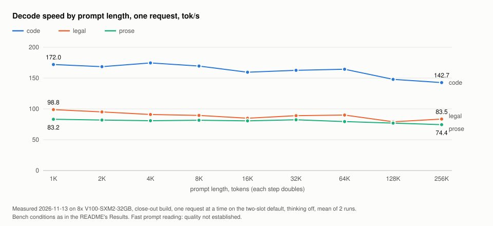
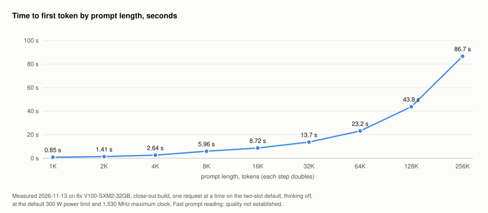
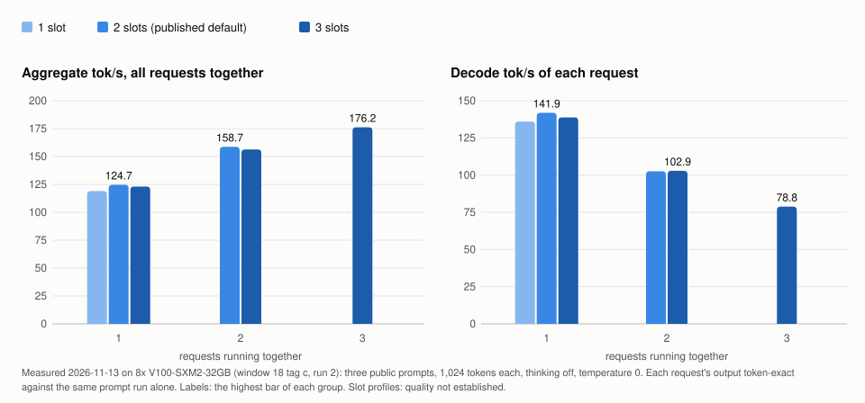

# Volta Max uPLIft: DeepSeek-V4.1-Flash-1017 on eight V100-SXM2 32 GB cards, as much of the routed work at NVIDIA's NVFP4 precision as fits, every routed expert on the cards (PP2 x TP4)

Built by **Nick Mermiges, Esq.**, founder of [PLI Labs](https://proprietarylegal.ai/labs.html) · [proprietarylegal.ai](https://proprietarylegal.ai)

Weights: the experts served at NVFP4 precision are [nvidia/DeepSeek-V4.1-Flash-1017-NVFP4](https://huggingface.co/nvidia/DeepSeek-V4.1-Flash-1017-NVFP4)
(MIT, revision `480550d3`), NVIDIA's NVFP4 pack of [deepseek-ai/DeepSeek-V4.1-Flash-1017](https://huggingface.co/deepseek-ai/DeepSeek-V4.1-Flash-1017)
(MIT), folded back to MXFP4 bit for bit. The other routed experts, the non-expert tensors and the Engram tables are the
[ISTA-DASLab GSQ-RCO GGUF](https://huggingface.co/ISTA-DASLab/DeepSeek-V4.1-Flash-1017-GSQ-RCO-GGUF) (MIT); the config,
the tokenizer and the DSpark drafter are DeepSeek's. Every file the build serves, the tier maps that say which experts
run at NVFP4 and the serving templates are one download, the
[hot_iq package on Hugging Face](https://huggingface.co/ProprietaryLegal/Volta-Max-uPLIft-FP4-DeepSeek-V4.1-Flash-1017-hot_iq-8xV100-SXM2-PP2xTP4)
(556 GB). This repository holds no weights, no packs and no compiled libraries, and it downloads nothing.

This repository is the build's record as of its fourth release (2026-11-13): the engine changes as nine new files and
five patches in [engine/](engine/), the launcher and serving templates in [engine/configs/](engine/configs/), the
source of the prompt-reading kernel library in [engine/kernels/prefill-rb4/](engine/kernels/prefill-rb4/README.md),
the pack builder with its checks and tests in [harness/benchmarks/nvfp4_8r/](harness/benchmarks/nvfp4_8r/), the
measurement scripts in [harness/run/](harness/run/), the closeness test with its receipts in
[quality/closeness-test/](quality/closeness-test/), every measurement in [docs/measurements.md](docs/measurements.md),
the rules fixed before each window in [docs/acceptance/](docs/acceptance/), the plans, the research and the history of
the steps before this build. The routing tally the tiers were planned from is private and not published; the package's
tier maps carry its result, which experts are hot, and nothing else.

The engine is PLI Labs' Volta sPLIt engine: [1CatAI/1Cat-vLLM](https://github.com/1CatAI/1Cat-vLLM), the SM70 fork of
vLLM, with the DeepSeek-V4.1-Flash package of [#1277](https://github.com/1CatAI/1Cat-vLLM/pull/1277) and Volta sPLIt's
patch series and production patches through 0059. This build adds the routed-expert path only. Its NVFP4 experts run on
the `sm70_skinny` QPN backend of [#742](https://github.com/1CatAI/1Cat-vLLM/pull/742) with Dennis Vertzyas'
[v100-skinny](https://github.com/dnv2003/v100-skinny) kernels; its compressed experts run on the engine's IQ expert op.
Attention, the dense layers, the shared expert, the Engram tables, the drafter and the two-stage split are served as the
engine serves them, from the same GGUF.

Every figure on this page is labelled or sits under a heading that labels it. **MEASURED** is a log, a probe or a
bench on our eight-card host, with its window or bench named (windows are short labels such as `15`, `rh` or `m32`;
their dates and rules are in [docs/measurements.md](docs/measurements.md) and [docs/acceptance/](docs/acceptance/)).
**ARITHMETIC** is computed from measured or read values. **ESTIMATE** is a model, with its basis. **UPSTREAM** is
someone else's number, with its source. **PREDICTED** was written before a window's data. The card power and clock
limits of each run are given once, under [Results](#results), as conditions A to E; a row names its conditions by
letter where they matter.

What it does:

- Eight V100-SXM2 32 GB cards as two pipeline stages of four tensor-parallel cards on two NVLink boards: layers 0 to 19
  and the Engram lookup on the first board, layers 20 to 39, the head and the DSpark drafter on the second.
- Every routed expert in card memory during decode, none read over PCIe. The compressed IQ2-class record of every
  expert goes on the cards first; then experts are promoted to their NVFP4 weights in order of use per byte, one by
  one, until the next one does not fit. In the two-slot default that is 5,936 of the 15,360 routed experts at exactly
  NVIDIA's NVFP4 values (3,691 on the first stage, 2,245 on the second) and 9,424 from IQ2-class records (ARITHMETIC).
- The promoted experts carry most of the decode work: 79.0 to 85.0 % of decode routes on the first release's tiers,
  measured by route counters on the kinds of text the tiers were chosen from (in-sample); about 78 to 85 % predicted
  for the two-slot default.
- 524,288 tokens of context a request. Two prompt slots by default (two conversations kept warm at once), one or
  three as options, and a one-slot option that reads prompts at full NVFP4 precision.
- A follow-up whose previous reply came back changed resumes from a snapshot of the slot instead of reading the whole
  chat again: first token 0.690 s against 30.987 s for a cold read at 100,340 tokens (MEASURED, window rh).
- One numbers-only log line per admitted request on the prompt-cache decision and its reason.
- DSpark speculative decoding with DeepSeek's drafter, five draft tokens.
- vLLM's OpenAI-compatible API server, with the Anthropic Messages endpoint, DeepSeek's tool-call and reasoning
  parsers, and a system message sent in the middle of a chat kept where it was sent, so the held prompt still matches.
- A launcher that refuses a template, tier map or kernel key that does not match the chosen option, and an engine that
  refuses a tier map whose digest differs or whose hot experts do not fit, naming the bytes it is short.

## Fourth release (2026-11-13, commit `17f62d3`): what changed

Measured by windows m32, px and rh (2026-11-12 and 2026-11-13, each under a rule fixed before its data, public prompts
only) and by the close-out bench (window 18 tags b and c, 2026-11-13, conditions E), against the bench of the third
release (window 18, 2026-11-12, conditions D). The two benches are not paired: they differ in the four changes below,
the second stage's tier map, the card limits and the day, so a cell's difference is not one change's alone. Every cell
is copied from [docs/measurements.md](docs/measurements.md) (the close-out bench, its comparison with window 18 and the
three windows) and [CHANGELOG.md](CHANGELOG.md). The Change column is ARITHMETIC from the two columns.

| | Third release (window 18) | Fourth release (close-out) | Change | Measured in |
|---|---|---|---|---|
| Build | two-slot default with fast prompt reading, the fused IQ tail, the SwiGLU kernel, the two request-path switches and the two prompt-reading kernels | the same plus the second stage's reserve +32 MiB, the cache log line, the snapshot hit and a new card order | | m32, px, rh |
| Experts at NVFP4, two-slot default | 5,949 of 15,360; second stage 2,258 hot, 5,422 compressed, digest `f67e73174ded` | 5,936 of 15,360; second stage 2,245 / 5,435, digest `5b2a5e7e493d` | -13 | m32 |
| Decode route share at NVFP4, mean of the two stages (PREDICTED by the planner, in-sample) | 82.8 % | 82.7 % | | m32 |
| Bench boot, highest sample on a second-stage card | 32,000 MiB, 2 MiB over the 31,998 MiB line: FAIL | 31,956 MiB: PASS | -44 MiB | [close-out bench](docs/measurements.md#speed-bench-2026-11-13-close-out) |
| A follow-up whose previous reply came back changed, 100,340 tokens, first token | read cold: 30.987 s | resumes from the snapshot: 0.690 s | | [rh](docs/measurements.md#snapshot-hit-window-rh) |
| Short sets, one request at a time, general / legal-style | 123.2 / 97.3 tok/s (25.10 / 24.92 ms per round) | 117.7 / 94.7 tok/s (26.36 / 25.98 ms) | -4.5 / -2.7 %: within the run-to-run spread of one boot (up to 9.7 % per round on 2026-11-12, 7.7 % on 2026-11-13) | close-out bench |
| First token after 1K / 32K / 128K / 256K, thinking off | 1.00 / 16.0 / 54.3 / 108.4 s | 0.85 / 13.7 / 43.8 / 86.7 s | 256K: -20.0 %; part of it is the card limits | close-out bench |
| Prompt reading at 256K, five kinds | 2,329 to 2,430 tok/s | 2,876 to 3,132 tok/s | | close-out bench |
| Decode 1K to 256K, thinking off, code / legal | 150 to 180 / 86 to 106 tok/s | 143 to 175 / 79 to 99 tok/s | | close-out bench |
| 216K tool loop: first read of 216,255 tokens | 86.87 s | 67.01 s | | close-out bench |
| 216K tool loop, follow-ups: first token median, decode mean | 3.54 s, 126.8 tok/s | 3.66 s, 109.9 tok/s | | close-out bench |
| One request on one slot, aggregate (run 2) | 118.9 tok/s | 119.0 tok/s | | [requests at once](docs/measurements.md#requests-at-once-on-the-close-out-build) |
| Two requests together on two slots | 159.0 tok/s (1.34x) | 158.7 tok/s (1.33x) | | requests at once |
| Three requests together on three slots | 192.3 tok/s (1.62x) | 176.2 tok/s (1.48x) | -8.4 % | requests at once |
| A short request 10 s into a 209,175-token read, two or three slots: first token; decode while the read goes on | 4.73 to 9.41 s; 9.4 to 9.7 tok/s | 4.11 to 4.32 s; 15.3 tok/s | | requests at once |

**The snapshot hit (window rh).** Window px's log line found that follow-ups in real chats with tools were read cold
with the reason `mismatch_beyond_rewind`: the streaming tool-call parser returns the model's two trailing line feeds as
text before a tool call, the chat template adds its own two when that turn comes back, and the previous reply no
longer matches token for token, so a 218,510-token chat was read again in full. Now, at the end of each prompt of
length N, each worker copies its slot's 256-row sliding-window rows to host memory (81.8 MB for two slots on all eight
cards, no card memory). A later request that holds that whole prompt resumes at h, the pool hit or N if smaller,
rounded down to a multiple of 16, if h is at least N - 124 and the slot is free; only what follows h is read again.

| Prompt (tokens) | Read again | Snapshot hit, first token | Cold, first token |
|---|---:|---:|---:|
| 100,340 | 340 | 0.690 s | 30.987 s |
| 40,550 | 550 | 0.706 s | 13.430 s |
| 8,118 | 118 | 0.384 s | 5.106 s |
| 8,200 | 216 | 0.420 s | 5.115 s |
| 8,340 | 340 | 0.454 s | 5.418 s |
| 8,400 | 400 | 0.534 s | 5.681 s |
| 20,000 | 12,016 | 4.512 s | 6.398 s |
| 8,521, whole request | 633 | 1.374 s | 6.560 s |

Identity: 193 readings, 0 differences against an ordinary cache hit at the same position in the same boot; peak
31,954 MiB on the second stage's cards. The rule was amended six times and two runs ended INCONCLUSIVE before the
fourth run was accepted; the amendments, the scheduler's admission cost and the cases the hit does not cover (a chat
with thinking on and no tools reads cold) are in [docs/measurements.md](docs/measurements.md#snapshot-hit-window-rh).
It is on by default on two to four slots (`VLLM_V41_SNAPSHOT_HIT=1`).

**The cache log line (window px).** With `VLLM_V41_PREFIX_LOG=1` the scheduler writes one numbers-only line for
each request it admits: whether the prompt cache was used, how much of it, and if not, why, in one of a fixed set of
reason words. Off, it costs an attribute test and an early return. The fields and reason words are in
[docs/measurements.md](docs/measurements.md#one-log-line-per-request-window-px).

**The second stage's reserve +32 MiB (window m32).** The third release's bench boot sampled 32,000 MiB on the second
stage's cards. The reserve went from 7,517,241,344 to 7,550,795,776 bytes (+33,554,432), nothing else: 13 fewer NVFP4
experts, and the code kind of the bench (37 requests) peaked at 31,956 MiB. The whole bench then ran on this profile
under the line. The one- and three-slot options carry the same 32 MiB since 2026-11-13: 6,203 and 5,650 experts at
NVFP4 (were 6,215 and 5,663).

**Card order `0,4,1,5,2,7,3,8`.** Since 2026-11-12 the host reports two NUMA nodes, and a direct peer transfer between
the two cards behind one PCIe host bridge hangs on it, so the stages now pair their cards across bridges. No speed claim
is made for the order.

The two benches ran under different card limits (conditions D and E), and part of the faster prompt reading is the
limits: on the close-out build under conditions D, measured after the bench, the tool loop's first read of 216,255
tokens took 70.6 s, against 67.0 s in this bench and 86.9 s in window 18.

Rejected in this release: choosing the prompt-reading chunk size by prompt length (the same output on 25 of 31 cases,
522 MiB more on the second stage's cards, for a timing effect only at about 6.5K to 9.5K uncached tokens).

No outside code is new in this release. The two engine patches (`v41_prefix_log.patch`, `v41_snapshot_hit.patch`) are
ours. The package's two-slot template and tier map carry the new reserve since its small-file update of 2026-11-13 (no
weights).

## Third release (2026-11-12, commit `83eb482`): what changed

Measured by windows 12 to 18 on 2026-11-11 and 2026-11-12, each under a rule fixed before its data, public prompts
only, all on the second release's tier budget and group-plan kernel. Window 18 ran the bench and the slot boots on the
installed build (conditions D); the second release's bench is the kernel build of 2026-11-11 (one slot, native prompt
reading, conditions C). Not paired: slots, tier map, prompt reading, kernels, switches, card limits and day differ at
once, so the table compares build with build, not the effect of one change. Every cell is from
[docs/measurements.md](docs/measurements.md) (the final-build bench and the windows' sections).

| | Second release (kernel build) | Third release (final build) | Change | Measured in |
|---|---|---|---|---|
| Profile | one slot, native prompt reading | two-slot default, fast prompt reading, fused IQ tail, SwiGLU kernel, both request-path switches, both prompt-reading kernels | | window 18 |
| Experts at NVFP4 | 6,292 of 15,360 | 5,949 of 15,360 | the price of the second slot | [window 15](docs/measurements.md#prompt-slots-window-15) |
| Short sets, general / legal-style | 101.1 / 81.1 tok/s (28.29 / 28.07 ms per round) | 123.2 / 97.3 tok/s (25.10 / 24.92 ms) | +21.9 / +20.0 % | [final-build bench](docs/measurements.md#speed-bench-2026-11-12-final-build) |
| First token after 1K / 32K / 128K / 256K | 5.49 / 31.4 / 105.7 / 207.9 s | 1.00 / 16.0 / 54.3 / 108.4 s | 256K: -47.9 % | final-build bench |
| Prompt reading at 256K, five kinds | 1,252 to 1,285 tok/s | 2,329 to 2,430 tok/s | | final-build bench |
| Decode 1K to 256K, thinking off, code / legal | 122 to 153 / 73 to 85 tok/s | 150 to 180 / 86 to 106 tok/s | | final-build bench |
| 216K tool loop: first read; follow-ups' first token median and decode mean | 165.55 s; 9.24 s, 107.8 tok/s | 86.87 s; 3.54 s, 126.8 tok/s | | final-build bench |
| Two requests together on two slots; three on three | one request at a time only | 159.0 tok/s (1.34x); 192.3 tok/s (1.62x); same token ids as alone 4 of 4, 8 of 8, 14 of 14 | | [window 18](docs/measurements.md#prompt-slots-and-the-final-bench-window-18) |
| Second read of a 215,847-token prompt | 93.741 and 94.237 s (old path) | 89.335 and 89.788 s (new kernels) | -4.428 s mean, noise floor 0.496 s | [window 17](docs/measurements.md#two-prompt-reading-kernels-window-17) |
| A follow-up turn that adds a system message to a 30,779-token chat | reused 0 tokens, 14.84 s | reused 30,752 tokens (99.9 %), 0.45 s | | [window 16](docs/measurements.md#two-request-path-switches-window-16) |
| Decode round, second runs, fused IQ tail and SwiGLU kernel each | | about 1.3 ms shorter each: -1.273 and -1.297 ms (tail), -1.279 and -1.288 ms (SwiGLU) | first-run rule: NO MEASURABLE CHANGE | windows 12, 14, 14c |
| Bench boot, highest sample on a second-stage card | | 32,000 MiB, 2 MiB over the line, 0 out-of-memory lines: FAIL by the window's rule | | window 18 |

**Two prompt slots are the default (windows 15 and 18).** Each slot keeps its own state and CUDA graphs, so fewer
experts fit at NVFP4: 6,215, 5,949, 5,663 and 5,376 for one to four slots in window 15. The engine runs one request per
step and the two pipeline stages hold two steps, so a second request fills the idle stage and further requests mostly
share the same two stages. Window 15, aggregate tok/s of run 2 (declared before the data): one slot 118.7; two together
on two slots 160.1 (1.35x); three on three 194.0 (1.63x); four on four 198.3 (1.67x). Every request with others running
gave the same token ids as the same prompt alone, 4 of 4, 8 of 8, 14 of 14 and 22 of 22, memory PASS on every arm, Xid 0.
The four-slot profile was measured before the prompt-reading kernels and is not shipped.

**Fast prompt reading is the default (window 13b).** Compressed experts are read from their IQ2-class records on the
cards during prompt reading, in place of their NVFP4 records staged from host RAM. Nine long chats of Python
standard-library source (191,812 to 319,936 tokens, a first read, six tool-call follow-ups and a final answer each,
thinking on) read with no fault: every final answer ended normally, 7 of 7 follow-ups kept the prompt in every chat,
first reads 85.71 to 118.90 s near 200K tokens and 139.75 and 147.12 s near 300K. The rule needed both arms and only
the fast arm ran, so it gave no verdict; its memory check FAILED (32,062 MiB on the second stage, no out-of-memory line)
and the window's decision line read "IQ STAYS OPT-IN". The maintainer made fast reading the default over that line; the
slot profiles answer the memory finding with 192 MiB more reserve on the second stage. Fast reading changes the output
from the first token, and no closeness test ran with it: **quality not established**. The `native-slots1` option keeps
native reading.

**Four kernels, each token-exact.** The SwiGLU kernel (window 12) computes V4.1's limited SwiGLU of the NVFP4 experts in
decode in one Triton launch; the fused IQ tail (windows 14 and 14c) does the weighted sum of the compressed experts'
step in one launch and idles 12 MiB lower per card. In prompt reading, the one-launch SwiGLU combines the gate and up
halves in one launch with the same rounding, and the RB 4 expert kernel handles 32 token rows per weight block instead
of 16, the order of every sum unchanged. Both prompt-reading kernels were bit-equal to the old path on one card in 90 of
90 cases each, then token-exact on eight; window 17 resolved the second-read gain but not a first-read one (NO
MEASURABLE CHANGE inside a noise floor of 11.640 s).

**Two request-path switches (window 16), from the engine's production patches 0058 and 0059.**
`VLLM_V41_SYSTEM_IN_PLACE=1` keeps a system message sent in the middle of a chat where it was sent, on the messages
endpoint, instead of joining it into the system block at the front, which changed the start of the prompt.
`VLLM_V41_TOPK_SEG=1024` sets the segment width of the decode top-k kernel, which does not change which tokens are
chosen. Token-exactness was a gate in four steps; decode speed showed no measurable change (second runs 121.4 and 121.8
tok/s off, 121.2 and 121.7 on).

What failed or closed in this release, each on a line written before its data:

- **The HOT-path decode kernel** was costed at up to 1.45 ms a round, an upper bound on headroom, not a prediction. On
  one card the bit-equal launch variants predicted 0.000 ms a round and the remaining cast fold 0.066 ms, below what an
  eight-card run resolves. Closed without an eight-card run.
- **RB 8 for prompt reading**: the same bits, but 204 registers per thread and 41,728 bytes of shared memory per block,
  and up to 1.39 times the old kernel's per-cycle time on the evenly routed prompt shape. Not shipped.
- **A tensor-core prompt-reading kernel whose output is not bit-equal**: on one card 21.8 % more time than the RB 4
  kernel (summed medians 5,914.97 ms against 4,856.16 ms), where its rule asked for 10 % less. No go.
- **A draft model on a separate GPU over the network**: one draft round took 42.6 ms at the median against a bar of
  4.5 ms; the local drafter costs 0.64 ms of a 25 ms round. Not admitted.

The package's small-file update of 2026-11-12 added one profile template and one tier map per option, no weights. The
package as uploaded on 2026-11-11 holds the first release's build, which does not boot on this engine without that
update. New engine files: `nvfp4_8r_swiglu.py`, `nvfp4_8r_iq_tail.py`, `nvfp4_8r_warm_prefill.py`,
`nvfp4_8r_tally_mix.py` and `nvfp4_8r_qpn_rb.py`, all ours; the RB 4 library is built from our launcher appended to
1Cat-vLLM's unchanged `sm70_skinny` QPN source.

## Second release (2026-11-11, commit `3e431aa`): what changed

Measured on 2026-11-11 under conditions C, one request at a time, against the first release's measurements of
2026-11-10 (conditions B). The speeds are one boot each at different clock ceilings. The repository changed; the package
as uploaded did not (it kept the 7.5 GiB reserve and the chain). Every cell is from
[docs/measurements.md](docs/measurements.md#2026-11-11-r1-tiers-and-the-group-plan-kernel) and its bench rerun section.

| | First release | Second release | Change | Measured in |
|---|---|---|---|---|
| Second stage's reserve, experts at NVFP4 | 7.5 GiB; 2,254 hot / 5,426 compressed (`5b09c0383a80`); 6,087 of 15,360 | 7.00 GiB (plan R1); 2,459 / 5,221 (`9473486077c6`); 6,292 of 15,360 | +205 experts | R1 |
| Decode routes on NVFP4 experts, general / legal-style / source loop / US Code loop (in-sample) | 79.04 / 83.26 / 85.02 / 84.31 % | 80.28 / 84.37 / 86.39 / 85.36 % | +1.0 to +1.4 points | R1, route counters |
| Decode round, the route plan as a chain of tensor operations against one Triton launch (window 11c) | 33.90 and 33.88 ms | 29.17 and 28.53 ms | mean -4.939 ms, noise floor 1.135: ACCEPT | [group plan](docs/measurements.md#the-group-plan-kernel-plan-03-part-b) |
| Whole request, the same arms | 85.5 to 85.9 tok/s | 98.3 to 101.2 tok/s | | window 11c |
| Bench, decode after a 1K / 256K prompt, code | 123.3 / 103.8 tok/s | 149.6 / 122.5 tok/s | | [bench rerun](docs/measurements.md#speed-bench-rerun-2026-11-11-kernel-build) |
| The same, legal | 71.9 / 61.8 tok/s | 84.7 / 78.5 tok/s | | bench rerun |
| First token after a 256K prompt | 209.6 s | 207.9 s | | bench rerun |
| Short sets on the bench boot, general / legal-style | 87.0 / 67.3 tok/s (34.73 / 34.41 ms per round) | 101.1 / 81.1 tok/s (28.29 / 28.07 ms) | | bench rerun |
| 498,099-token read, memory gate | | 403.0 s (kernel), 400.6 s (chain); peak 31,694 / 30,994 MiB: PASS | | R1, window 11 |

**The group-plan kernel (plan 03 part B).** Each decode step of a layer sorts its expert routes into groups before the
expert launches: a permutation, the group of each launch block and the group offsets, as int32 tensors. The kernel
builds the same tensors in one Triton launch, bit for bit, inside the decode CUDA graphs. Its acceptance test on one card
(random tier arrays of the four layer kinds, 22,000 random routings and 464 edge cases, expected values computed route
by route on the CPU) found 0 violations, and its real-weight check matched in 72 comparisons, eager and CUDA-graph
replay. Window 11 gave NO MEASURABLE CHANGE (mean -4.123 ms, noise floor 3.429 ms set by one slow kernel run whose
cause is not known); window 11c, the one replication declared before its data, gave ACCEPT. Both are reported. The
profile key `nvfp4_8r_group_plan` (`chain` or `kernel`) is required, with no default.

**R1.** The first reserve was set from the peaks of an early calibration boot, about 6.9 GiB needed plus 0.5 GiB of
margin. R1 checked the peaks again on this profile: the 498,099-token read and the 216K tool loop completed with no
out-of-memory line, peak 31,456 MiB. The closeness check on twelve prompts passed by its rule; the full closeness test
of 320 contexts was not rerun on these tiers. The rerun bench is not paired with the first: tier map, dispatch, clock and
day differ at once.

All code of this release is ours.

## First release (2026-11-10 and 2026-11-11, commits `c672630` and `6f61f96`): what it held

The `hot_iq` build on the mixed tally at one prompt slot, reserves 4.5 / 7.5 GiB, prompts read with the full NVFP4
records staged from host RAM (`native_staged`), with its Hugging Face package (upload complete on 2026-11-11), its
speed bench and its closeness test against NVIDIA's NVFP4 pack. Speeds MEASURED 2026-11-10 under conditions B; the
package boot and the closeness test under conditions C. Rows from
[docs/measurements.md](docs/measurements.md#hot_iq-on-the-mixed-tally-the-build-of-this-release), its first bench
section and the [closeness test](quality/closeness-test/).

| What | Figure | Measured in |
|---|---|---|
| Experts at NVFP4 | 6,087 of 15,360: 3,833 on the first stage, 2,254 on the second (digests `8e7829184090`, `5b09c0383a80`) | boot tier lines |
| Decode routes on compressed records | general 21.0 %, legal-style 16.7 %, source loop 15.0 %, US Code loop 15.7 % (in-sample) | route counters |
| Short sets, general / legal-style | 83.6 / 64.7 tok/s (36.25 / 35.78 ms per round); 87.0 / 67.3 on the bench boot | W9 boots |
| Tool loops at 31K tokens, source code / US Code Title 28 | 90.9 / 87.8 tok/s | W9 boots |
| Bench, decode after a 1K / 256K prompt, thinking off | code 123.3 / 103.8, legal 71.9 / 61.8, prose and chat 59.6 to 67.9 tok/s; greedy output byte-identical in 45 of 45 cells | [first bench](docs/measurements.md#speed-bench-1k-to-256k) |
| First token after 1K / 128K / 256K; prompt reading at 256K | 5.60 / 106.4 / 209.6 s; 1,243 to 1,276 tok/s | first bench |
| 216K tool loop, two runs | first read 168.72 and 166.22 s, 7 of 7 follow-ups kept the prompt, first token median 9.36 and 9.47 s | W9 boots |
| Long thinking chats 0, 1 and 2 (216,245, 198,307 and 204,871 tokens) | 0 of 3 at the 32,000-token limit (3,057, 1,262 and 1,592 tokens; 95 % Wilson interval 0.000 to 0.561) | termination test |
| Boot of the exported package | ready after 263 s, 0 tracebacks, tier lines and both digests equal on all eight ranks, 12 + 5 check prompts of 1,024 tokens identical token for token | package boot check |
| Same next token as the NVFP4 reference | 95.1 % (95 % interval 94.4 to 95.7 %) | closeness test |
| KL divergence from the reference, top 20 (lower bound) | 0.0794 nats (0.0687 to 0.0915) | closeness test |
| Multiple choice, 513 MMLU questions | 83.6 % against the reference's 83.8 %; answer differs from the reference's on 1.6 % | closeness test |

How it got there. Two-tier residency (hot experts on the cards, the rest read from pinned host RAM) was correct and
slow; dropping the host tier showed where the time went (general text 33.4 ms a round without it against 58.0 to
59.4 ms with it). The first no-host-tier profiles, on a first tally, ran the 216K tool loop's final thinking answer to the
32,000-token limit in both runs and were not accepted. The mixed tally weights four kinds of text equally in each layer,
one private and three made from this repository's public prompt sets, and the planner promotes in order of use per
byte: packing the cheapest promotions first would fit 6,377 to 6,379 experts at NVFP4 against 6,087, but less-used ones.

Contributors: the NVFP4 pack is NVIDIA's; its experts run through Peuqui's
[#742](https://github.com/1CatAI/1Cat-vLLM/pull/742) backend with Dennis Vertzyas'
[v100-skinny](https://github.com/dnv2003/v100-skinny) kernels; the engine descends from yangzhuxinyzx's
[#1277](https://github.com/1CatAI/1Cat-vLLM/pull/1277); the compressed records are ISTA-DASLab's. The fold, the native
path, the tier planner, the tier-map reader and the route counters are ours. Every source is in [CREDITS.md](CREDITS.md).

## Before the first release: the public snapshot of 2026-11-10 (commit `99ec2bb`)

The snapshot and its three result commits of the same day (`df8fe3b`, `d1a8326`, `79dc164`) published the work in
progress: the exact pack conversion (NVIDIA's NVFP4 routed experts folded to MXFP4 packs per layer and tensor-parallel
rank, 299,473,305,600 bytes, every value checked bit-equal), the native expert path (worst relative L2 4.78e-4 against
an FP32 reference on one card), the two- and three-tier residency, the termination test for long thinking answers, and
an earlier form of IQ records in prompt reading that was never accepted. These steps are dated rows of the measurement
log, with their tables in [docs/history.md](docs/history.md).

## Results

All numbers are ours, MEASURED with our own measurement scripts on the eight-card host, on the fourth release's build (the
close-out build: two-slot default, fast prompt reading, the 2026-11-13 tier maps), unless a row names another window.
One request at a time, thinking off, greedy, 1,024 tokens out on long prompts, unless a row says otherwise. Public
prompts only: the bench's code, structured, legal, prose and chat documents, the three short prompts of
[harness/run/tput_prompts.py](harness/run/tput_prompts.py), Python standard-library source and US Code Title 28; the
legal-style short set is a file of public prompts we do not publish.

The card limits of every run on this page, the only place they are given:

| Conditions | Runs | Card power and clock |
|---|---|---|
| A | the rows of 2026-11-09 | clock ceiling 1,522 MHz |
| B | the first release's measurements of 2026-11-10 | clock ceiling 1,425 MHz |
| C | 2026-11-11 until 22:46 UTC: the package boot check, the closeness test, R1, windows 11 and 11c, the bench rerun, windows 12 and 13b | clock ceiling 1,475 MHz; windows 12 and 13b at 150 W per card |
| D | from 2026-11-11 22:46 UTC: windows 14, 14c, 15, 16, 17 and 18 | 175 W per card, 1,522 MHz |
| E | the close-out bench of 2026-11-13 | each card's default 300 W power limit and 1,530 MHz maximum clock; the power cap was not in force |

### Speed

The bench: code, structured, legal, prose and chat documents of 1K to 256K tokens sent to `/v1/completions` as token
ids, a random cache salt each, two runs a cell; short prompts by kind, three runs each, up to 1,024 tokens with a natural
stop at temperature 0 and 1; four thinking-on prompts; the short sets and the 216K tool loop on the same boot. 169 of
169 requests, status DONE, bench VALID (conditions E). Decode = (tokens - 1) / (last token - first token), timed by the
benchmark program. "Prompt reading" is the prompt's tokens over the time to its first token. Each long-prompt cell is
the mean of two runs; the first-token column is the median of the five kinds and the prompt-reading column their range.

| Prompt | First token | Prompt reading (tok/s) | Code | Structured | Legal | Prose | Chat | Measured in |
|---|---:|---:|---:|---:|---:|---:|---:|---|
| 1K | 0.85 s | 949 to 1,416 | 172.0 | 171.5 | 98.8 | 83.2 | 83.8 | [close-out bench](docs/measurements.md#speed-bench-2026-11-13-close-out) |
| 2K | 1.41 s | 1,402 to 1,514 | 168.5 | 189.3 | 95.1 | 81.9 | 76.6 | [close-out bench](docs/measurements.md#speed-bench-2026-11-13-close-out) |
| 4K | 2.64 s | 1,502 to 1,658 | 174.6 | 161.0 | 90.9 | 80.8 | 85.8 | [close-out bench](docs/measurements.md#speed-bench-2026-11-13-close-out) |
| 8K | 5.96 s | 1,341 to 1,413 | 169.5 | 167.3 | 89.4 | 81.6 | 79.2 | [close-out bench](docs/measurements.md#speed-bench-2026-11-13-close-out) |
| 16K | 8.72 s | 1,851 to 1,994 | 159.5 | 166.1 | 84.8 | 80.6 | 87.3 | [close-out bench](docs/measurements.md#speed-bench-2026-11-13-close-out) |
| 32K | 13.7 s | 2,347 to 2,565 | 162.6 | 157.5 | 89.0 | 82.3 | 82.3 | [close-out bench](docs/measurements.md#speed-bench-2026-11-13-close-out) |
| 64K | 23.2 s | 2,753 to 3,012 | 164.3 | 157.0 | 90.0 | 79.4 | 74.8 | [close-out bench](docs/measurements.md#speed-bench-2026-11-13-close-out) |
| 128K | 43.8 s | 2,727 to 3,145 | 147.9 | 145.5 | 79.1 | 76.9 | 76.8 | [close-out bench](docs/measurements.md#speed-bench-2026-11-13-close-out) |
| 256K | 86.7 s | 2,876 to 3,132 | 142.7 | 140.2 | 83.5 | 74.4 | 69.0 | [close-out bench](docs/measurements.md#speed-bench-2026-11-13-close-out) |

Decode in tok/s, thinking off, 90 requests. Largest difference between the two runs of a cell 18.5 tok/s; greedy output
byte-identical in 45 of 45 cells. Thinking on (45 requests, one run a cell) the first token came 0.91 s after 1K and
87.1 s after 256K; its decode cells and the prompt reading of each kind are in the linked section.

<picture>
  <source media="(prefers-color-scheme: dark)" srcset="docs/charts/decode-by-length-closeout-dark.svg">
  
</picture>

<picture>
  <source media="(prefers-color-scheme: dark)" srcset="docs/charts/first-token-by-length-closeout-dark.svg">
  
</picture>

Short prompts by kind of output (up to 1,024 tokens, thinking off, median of three runs with range):

| Kind of output | Greedy (T=0), tok/s | Sampled (T=1), tok/s | Tokens per round, T=0 | Measured in |
|---|---:|---:|---:|---|
| code | 165.2 (162.6 to 171.7) | 161.2 (158.6 to 167.9) | 4.39 | close-out bench |
| structured (JSON) | 180.9 (175.4 to 180.9) | 169.1 (165.3 to 171.8) | 4.74 | close-out bench |
| legal | 97.9 (97.1 to 99.4) | 87.3 (85.0 to 93.8) | 2.58 | close-out bench |
| prose | 78.4 (78.4 to 81.7) | 78.6 (78.0 to 81.3) | 2.07 | close-out bench |
| chat | 77.7 (76.4 to 81.5) | 75.0 (72.0 to 77.6) | 2.05 | close-out bench |
| thinking on, 4 prompts, token-weighted | | 107.7 (94.5 to 158.8 per prompt) | | close-out bench |

Short sets on the bench boot: general 117.7 tok/s (26.36 ms per round) and legal-style 94.7 (25.98 ms), three prompts
each, output tokens over the whole request time.

**Requests at once.** One, two and three prompt slots, each on a fresh boot: each level runs the three public short
prompts together, thinking off, temperature 0, 1,024 tokens out a request, twice; run 2 is the reading, declared before
the data. Aggregate tok/s = all tokens over the time from the first start to the last end; the ratio is against one
slot, one stream (119.0 tok/s).

| Slots | 1 request: aggregate (ratio), decode a request, ms a round | 2 together | 3 together | Experts at NVFP4 | Measured in |
|---|---|---|---|---:|---|
| 1 | 119.0 (1.00x), 136.0, 24.87 | | | 6,203 | [requests at once](docs/measurements.md#requests-at-once-on-the-close-out-build) |
| **2 (default)** | 124.7 (1.05x), 141.9, 24.69 | **158.7 (1.33x)**, 102.6, 28.55 | | 5,936 | [requests at once](docs/measurements.md#requests-at-once-on-the-close-out-build) |
| 3 | 123.1 (1.03x), 138.8, 24.63 | 156.4 (1.31x), 102.9, 28.66 | **176.2 (1.48x)**, 78.8, 42.73 | 5,650 | [requests at once](docs/measurements.md#requests-at-once-on-the-close-out-build) |

<picture>
  <source media="(prefers-color-scheme: dark)" srcset="docs/charts/concurrency-closeout-dark.svg">
  
</picture>

The charts are drawn from the tables of [docs/measurements.md](docs/measurements.md) by
[tools/chart_decode_by_length.py](tools/chart_decode_by_length.py), [tools/chart_first_token.py](tools/chart_first_token.py)
and [tools/chart_concurrency.py](tools/chart_concurrency.py).

One long read and one short request: a 209,175-token prompt of Python standard-library source, then a short request
10 s later (48 tokens out on the long one, 1,024 on the short one).

| Slots | Long prompt: first token | Short request: first token | Short request: decode | Measured in |
|---|---:|---:|---|---|
| 1 | 65.8 s | 56.82 s (it waits for the read) | 85.1 tok/s, 25.05 ms a round | requests at once |
| 2 | 77.0 s | 4.11 s | 15.3 tok/s, 148.46 ms a round | requests at once |
| 3 | 77.0 s | 4.32 s | 15.3 tok/s, 146.89 ms a round | requests at once |

How to read these figures:

- **Decode depends on the kind of text, because the drafter does.** Code and JSON keep about 4.4 to 4.7 tokens a round,
  legal text 2.6, prose and chat 2.1, at a round of about 25 ms; the tok/s follows.
- **A second request fills the idle stage; a third mostly shares it.** The engine runs one request per step and the two
  stages hold two steps. On three slots two requests add 27.1 % to one and a third adds 12.7 % to two (run 2).
- **Slots do not help a short request during a long read.** With two or three slots it starts within seconds but
  decodes one round per read chunk until the read ends, and the read takes 11.2 s longer; both end later than with one
  slot.
- **Run 1 of a boot is slow.** One request alone on the same slot profile differed by up to 7.7 % in time per round
  between run 1 and run 2 on 2026-11-13 (9.7 % on 2026-11-12), so a difference smaller than that is not a result.
- **Each slot costs NVFP4 experts.** 6,203, 5,936 and 5,650 at NVFP4 for one, two and three slots. No route counter ran
  on a slot profile; the planner's predicted shares for two slots, about 78 to 85 % by kind, are in
  [docs/measurements.md](docs/measurements.md#prompt-slots-window-15).

### Long context and cached prompts

| Check | Result | Measured in |
|---|---|---|
| Context | 524,288 tokens a request (`max-model-len`) on every option | the templates |
| One cold read of 256K, thinking off | first token 86.7 s, 2,876 to 3,132 tok/s by kind | close-out bench |
| One cold read of 498,099 tokens | 403.0 s (kernel) and 400.6 s (chain) with no out-of-memory line, peak 31,694 / 30,994 MiB by stage | R1 and window 11 memory gates (conditions C, one slot, native reading) |
| Nine long chats, fast reading, one slot | first reads 85.71 to 118.90 s at 191,812 to 204,871 tokens, 139.75 s at 303,709, 147.12 s at 319,936; 9 of 9 final answers ended normally | window 13b |
| 216K tool loop (216,255 tokens, thinking on, Anthropic Messages format) | first read 67.01 s; 7 of 7 follow-ups kept the whole previous prompt, first token median 3.66 s, decode mean 109.9 tok/s | close-out bench |
| A follow-up whose previous reply came back changed | resumes from the slot's snapshot: 0.690 s at 100,340 tokens, 0.706 s at 40,550, 0.384 to 0.534 s near 8K (cold 30.987, 13.430 and 5.106 to 5.681 s) | rh |
| A system message sent in the middle of a 30,779-token chat | 30,752 tokens reused, 0.45 s (14.84 s with the switch off) | window 16 |
| Highest card sample, the bench boot (322 samples over the whole boot) | 31,956 MiB on the second stage, 31,736 MiB on the first; 0 out-of-memory lines | close-out bench |

### Gates

The judges are strict: a check that cannot decide is INCONCLUSIVE, never a pass.

- **The fold.** NVIDIA's NVFP4 routed experts folded to MXFP4: 44,696,862,720 values bit-equal to the NVFP4 formula in
  FP32, relative L2 error 0. The pack builder refuses to start without the `ALL-VERIFIED` log of the weight copy, which
  checks every pack file against its Hugging Face sha256.
- **The tiers.** Every boot logs its tiers per rank: two slots 3,691 hot and 3,989 compressed on the first stage
  (`0b6440ce205f`), 2,245 and 5,435 on the second (`5b2a5e7e493d`); one slot `8e7829184090` and `c15146b996eb`; three
  slots `a5d4b7a514d1` and `2be289273a5e`. The tier-map reader passed its CPU check on 2026-11-10 (the measured tiers
  and digests on all 40 layers; every expert record of layers 0 and 20 on the first rank byte-equal to the measured
  one), and the exported package booted on eight cards with the same tiers, digests and output token for token.
- **The memory line, 31,998 MiB** (the card's 32,510 MiB less 512) for the highest sample on any card over a whole
  boot: 31,956 MiB on the bench boot; 30,776 to 31,754 MiB on the three slot boots (10 to 14 samples each); 0
  out-of-memory lines on all four. Every card is sampled every 15 s.
- **Same output alone and together.** Every request with others running gave the same token ids as the same prompt
  alone on the same boot: 4 of 4, 8 of 8 and 14 of 14 on the close-out slot boots; 22 of 22 on window 15's four-slot
  arm.
- **Every kernel token-exact against the path it replaces**: the group plan (0 violations in 22,464 cases on one card,
  72 real-weight comparisons), the SwiGLU kernel, the fused IQ tail, both prompt-reading kernels (90 of 90 bit-equal
  cases each on one card), the two switches (four-step gate) and the snapshot hit (193 readings, 0 differences).
- **Closeness to NVIDIA's NVFP4 pack** (the first release's build, native prompt reading, one slot; conditions C; rules
  and script hashes fixed 2026-11-10 at 19:54 UTC before any capture). The reference is NVIDIA's NVFP4 pack served on the
  same cards with every routed expert at its own NVFP4 precision (`engine/configs/serve-nvfp4-pp2.yaml`). 320 contexts of
  code, prose, legal-style, structured and chat text from public sources, none used to choose the hot experts, 32 greedy
  tokens each, tokens 2 to 32 compared while the text still equals the reference's; 513 MMLU questions, 9 from each of
  57 subjects. The reference repeated itself exactly on 50 contexts and 50 questions, so the noise floor is zero.

| Measure | `hot_iq` | Reference repeat | Measured in |
|---|---|---|---|
| Tokens compared | 4,818 over 320 contexts | 1,550 over 50 | [score-v1.json](quality/closeness-test/score-v1.json) |
| Same next token as the reference | 95.1 % (94.4 to 95.7 %) | 100.0 % | score-v1.json |
| Mean log-probability gap on the reference's token | 0.1163 nats (0.1009 to 0.1342) | 0.0000 | score-v1.json |
| Mean KL divergence, top 20 (lower bound) | 0.0794 nats (0.0687 to 0.0915) | 0.0000 | score-v1.json |
| All 32 tokens identical | 25.6 % of contexts (20.9 to 30.0 %) | 100.0 % | score-v1.json |
| Median first differing token | 13.0 (10.0 to 15.5) | | score-v1.json |
| First token identical (prompt reading, a control) | 100.0 % | 100.0 % | score-v1.json |
| MMLU accuracy | 83.6 % (80.5 to 86.5 %); the reference 83.8 % (80.7 to 86.7 %) | | score-v1.json |
| Answer differs from the reference's | 1.6 % (0.6 to 2.7 %); on the 475 questions the reference answered, 8 answers (1.7 %), counted after scoring | | score-v1.json; [after-scoring](quality/closeness-test/after-scoring/) |

Intervals are 95 % bootstrap intervals, 2,000 resamples. By the rules fixed in advance, `hot_iq` DIFFERS FROM THE
REFERENCE by KL divergence, and its multiple-choice accuracy is NOT DISTINGUISHABLE FROM THE REFERENCE AT THIS SAMPLE
SIZE, which means the interval reaches the noise floor, not that the two are equal: with 513 questions a difference
under about 4 points cannot be resolved, which is why the share of changed answers is reported beside accuracy. The
test's other comparisons fixed in advance, the per-kind tables and the receipts (hashes, log-probabilities, counts and
timing, no text) are in [quality/closeness-test/](quality/closeness-test/) and the
[front-page archive](docs/front-page-archive-2026-11-14.md#how-close-to-nvfp4).

- **What the closeness test does not cover.** The unquantized model (the reference is NVIDIA's quantization), sampling
  above temperature 0, thinking and long answers, and fast prompt reading or the slot profiles' tiers: for the default,
  **quality is not established.** NVIDIA's own accuracy table for the pack is within run noise of the MXFP4 source, for
  example GPQA-D 92.93 against 92.77 and AA-LCR 80.19 against 80.41 (UPSTREAM, NVIDIA's model card, not this build).
- **Long thinking answers.** On the first release's build 0 of 3 long thinking chats ran to the 32,000-token limit; with
  fast reading 9 of 9 final answers ended normally (window 13b). The 216K tool loop's final request is the exception
  (What did not work).
- **The closeness check on twelve prompts** (greedy, thinking off, 1,024 tokens each, a rule of 8 of 12 on each part):
  PASS on the first release's tiers and on R1's, by the rule written before it
  ([docs/measurements.md](docs/measurements.md#hot_iq-on-the-mixed-tally-the-build-of-this-release)).

These figures say how closely the build tracks NVIDIA's NVFP4 pack on these cards. They do not by themselves say that its
answers are good enough for a given kind of work, and answer quality in use is not established by them.

### Run-time inputs

| Input | Value | Source |
|---|---|---|
| Card power and clock | conditions A to E above | Results |
| The memory line | 31,998 MiB for the highest sample on any card (the card's 32,510 MiB less 512) | the windows' rules |
| Reserves, two-slot default | 4,643,356,672 bytes on the first stage, 7,550,795,776 on the second (`nvfp4_8r_reserve_bytes`), plus the fast-reading workspace of 0.33 / 0.34 GiB per card | [hot_iq-slots2.yaml.template](engine/configs/hot_iq-slots2.yaml.template) |
| Tier maps | one per option in the package (`tier_maps/slots1.json`, `slots2.json`, `slots3.json`, `native-slots1.json`, the last with R1's tiers); the engine refuses a map whose digest differs and the first release's `tier_map.json` | package |
| NVFP4 pack | `nvidia/DeepSeek-V4.1-Flash-1017-NVFP4` revision `480550d349ede47a048eb65a276c5c01a06256e2`, every file checked against its Hugging Face sha256 | [harness/run/copy_weights.sh](harness/run/copy_weights.sh) |
| The load-time allocator setting | `VLLM_WEIGHT_LOAD_MAX_SPLIT_SCOPE=0`: under the engine's default scope the record build's freed blocks piled up as cache until a card was full (the second stage had 0.04 GiB free with the scope, 7.7 to 7.9 GiB without), and an eight-card boot died at load | [run_serve.sh](engine/configs/run_serve.sh) |
| The RB 4 library | `v41qpnrb4.so`, built from [engine/kernels/prefill-rb4/](engine/kernels/prefill-rb4/README.md); the engine pins the sha256 of the measured build (`2b893e7d...`) and refuses any other file | `nvfp4_8r_qpn_rb.py` |
| Host memory | the compressed experts' NVFP4 records, 180.8 GB, in pinned host RAM for native prompt reading, plus the Engram tables; the snapshot hit's 81.8 MB | What runs, rh |
| The hot experts against the official model | NVIDIA's NVFP4 expert values equal DeepSeek's official MXFP4 experts; the card says the conversion was lossless | UPSTREAM, NVIDIA's model card; the fold above |

### Earlier serving sets

| Serving set | Published | Short sets, general / legal-style (tok/s) | Decode after 256K, code (tok/s) | Measured in |
|---|---|---:|---:|---|
| First release: one slot, native reading, 6,087 at NVFP4 (the package as uploaded) | 2026-11-10 | 83.6 / 64.7 (87.0 / 67.3 on the bench boot) | 103.8 | first bench, conditions B |
| Second release: R1 tiers and the group-plan kernel, one slot, 6,292 at NVFP4 (repository only) | 2026-11-11 | 101.1 / 81.1 | 122.5 | bench rerun, conditions C |
| Third release: two-slot default, fast reading, four kernels, two switches, 5,949 at NVFP4 | 2026-11-12 | 123.2 / 97.3 | 154.6 | window 18, conditions D |
| Fourth release: the close-out build, 5,936 at NVFP4 | 2026-11-13 | 117.7 / 94.7 | 142.7 | close-out bench, conditions E |

The rows differ in build, card limits and day at once; none is a paired before-and-after. Every full table is in
[docs/measurements.md](docs/measurements.md); the first release's bench and the bench rerun are also in the
[front-page archive](docs/front-page-archive-2026-11-14.md).

## The served settings

The default is the package's two-slot template, started by [engine/configs/serve_hot_iq.sh](engine/configs/serve_hot_iq.sh)
with `NVFP4_OPTION=slots2`. vLLM's API server runs with pipeline parallel size 2 and tensor parallel size 4 over the
eight cards, `max-model-len 524288`, `max-num-seqs 2`, `max-num-batched-tokens 8192`, `kv-cache-memory-bytes 268435456`,
`gpu-memory-utilization 0.96`, prefix caching and chunked prefill on, CUDA graphs for 1 to 6 rows in full mode, the
GGUF loader for the non-expert tensors, the IQ4_NL Engram table, DSpark speculative decoding with the FP8 drafter and
five draft tokens, the `deepseek_v41` tool-call parser and the `deepseek_v4` reasoning parser. The routed experts come
from the loader keys:

```yaml
nvfp4_8r_packs: ${PKG}/experts-mxfp4
nvfp4_8r_tier_map: ${PKG}/tier_maps/slots2.json
nvfp4_8r_reserve_bytes: {'0': 4643356672, '20': 7550795776}
nvfp4_8r_residency: hot_iq
nvfp4_8r_prefill_warm: iq          # fast prompt reading; native_staged reads every expert at NVFP4
nvfp4_8r_group_plan: kernel
nvfp4_8r_swiglu: kernel
nvfp4_8r_prefill_swiglu: kernel
nvfp4_8r_prefill_rb: rb4
nvfp4_8r_iq_tail: fused
```

Every one of these keys is required, with no default: a profile without one is refused at boot. The launcher
[run_serve.sh](engine/configs/run_serve.sh) sets the engine's production switch set (listed in the script), the two
request-path switches `VLLM_V41_SYSTEM_IN_PLACE=1` and `VLLM_V41_TOPK_SEG=1024`, the cache log line
`VLLM_V41_PREFIX_LOG=1`, the snapshot hit `VLLM_V41_SNAPSHOT_HIT=1` and the load-time allocator setting
`VLLM_WEIGHT_LOAD_MAX_SPLIT_SCOPE=0`. On two to four slots it sets the engine's multi-slot mode
(`VLLM_V41_MULTI_SEQ=1` with its prompt budget, 16 decode turns and a prompt burst of 2); on one slot it unsets the
cache log line and the snapshot hit, which the engine accepts only in the multi-slot mode. The engine prints "Unknown
vLLM environment variable detected: VLLM_V41_SNAPSHOT_HIT" once per boot, which is expected.

The options: `slots1` and `slots3` (fast reading, one or three slots); `native-slots1` (one slot, native reading, R1's
tiers, `chain` and `rb2` for prompt reading: the reading of the closeness figures).

## Requirements

- Eight Tesla V100-SXM2 32 GB cards (32,510 MiB each) on two NVLink boards of four. Tensor parallelism stays inside a
  board; the pipeline hand-off between boards goes over PCIe. On our host four PLX switches each sit on their own x16
  Gen3 root port with two cards at Gen3 x8 (MEASURED from sysfs).
- Host memory for the package and the native records: the compressed experts' NVFP4 records take 180.8 GB of pinned host
  RAM for native prompt reading. Our host had 363 GiB available with no server running before 2026-11-12 and has 1 TB
  since (eight 128 GB modules at 2933 MT/s, two NUMA nodes); with the expert files held in RAM a stage loads in 127 and
  156 s.
- Volta has FP16 `mma.sync.m8n8k4` only: no FP4 or FP8 tensor cores, no `cp.async`, no `ldmatrix`. Every 4-bit format
  is decoded in software into FP16 operands, so low-bit experts pay by reading fewer bytes, not by faster math.
  v100-skinny measured a read ceiling of about 879 GB/s on a V100-SXM2 and its QPN kernel at 77 % of it at one row
  (UPSTREAM).
- The Volta sPLIt engine (1Cat-vLLM #1277 with Volta sPLIt's patch series and production patches through 0059) in its own
  source tree and venv (Python 3.12), with this repository's new files and patches applied, and its compiled libraries
  (`v41k.so`, `v41idx.so`, `v41pidx.so`, the sparse prefill library) built from that engine's source; the RB 4 library
  built from [engine/kernels/prefill-rb4/](engine/kernels/prefill-rb4/README.md), or `rb2` in the profile.
- The [hot_iq package](https://huggingface.co/ProprietaryLegal/Volta-Max-uPLIft-FP4-DeepSeek-V4.1-Flash-1017-hot_iq-8xV100-SXM2-PP2xTP4)
  (556 GB), with its `serve/` and `tier_maps/` folders as updated on 2026-11-13.
- For the measurement scripts, a checkout of the Volta sPLIt repository: they call its bench harness read-only.

## Running it

[RUNNING.md](RUNNING.md) gives the steps: the engine, the package and its check, the run directory, the start with
an option and the checks of the boot log, the stop, building from source with your own tally, and the measurement
scripts. [engine/README.md](engine/README.md) describes every engine file, patch and template the steps use.

## What did not work or is not yet good

- **The 216K tool loop's final request runs to the 32,000-token limit inside thinking.** On the close-out boot it gave
  no final answer (stop reason `max_tokens`). Counting it, that request has run to the limit in 3 of 4 runs with the
  group-plan kernel and 5 of 8 on every build of this repository so far. Separate long thinking chats ended normally (0
  of 3 at the limit on the first release's build, 9 of 9 with fast reading). The cause is not established; the test
  keeps no output text.
- **Fast prompt reading's quality is not established.** It changes the output from the first token, and every closeness
  figure was measured with native reading. Its earlier form faulted: the first read of one long chat stopped the host or
  a card three times out of three, until a change to the host's power delivery. Its first long-chat window failed its
  memory check by 64 MiB on the second stage, and the maintainer made it the default over the window's decision line.
- **The slot profiles' quality is not established.** They hold fewer NVFP4 experts than any configuration with a
  closeness or long-chat test, none of those tests ran on them, and no route counter measured their shares.
- **The third release's bench boot crossed the memory line**: 32,000 MiB on the second stage's cards in 38 of 359
  samples, all while prompts of 8K to 256K were served, 2 MiB over the line and 510 MiB below the card's capacity, with
  no out-of-memory line. The fourth release's +32 MiB answers it (31,956 MiB).
- **A short request during a long read gains nothing from more slots.** On the third release's build it started in
  4.73 to 9.41 s but decoded at 9.4 to 9.7 tok/s until the read ended, and the read took longer; on the close-out build
  4.11 to 4.32 s and 15.3 tok/s, the read 11.2 s longer. Both still end later than with one slot.
- **Host tiers were slow.** Reading experts from host RAM in decode cost 58.0 to 59.4 ms a round against 33.4 without a
  host tier on general text; copy-engine DMA, GPU gather and AVX2 host compute for host-RAM experts were measured and
  none came within about 10 ms a round of all experts on the cards (ESTIMATE from single-card measurements).
- **Compressed records are not official precision.** On synthetic inputs an expert's IQ2-class record is far from its
  official record (relative L2 0.60 to 0.69 in layers 5, 12 and 27, MEASURED 2026-11-09). The hot set is chosen once;
  text unlike the tally's four kinds may route more often to compressed records.
- **Rules that could not resolve small gains.** First runs of a boot carry 2 to 3 ms a round of noise, which hid the
  1.3 ms gains of the SwiGLU kernel and the fused tail from the first-run rule (installed on the second-run reading), and
  first reads in window 17 varied by up to 11.640 s on one build.
- **Three slots on the first accepted tiers** gave INCONCLUSIVE closeness by their rule and were not accepted.
- **The package as first uploaded does not boot on this engine**: it lacks the required kernel keys. Its `serve/` and
  `tier_maps/` folders must be downloaded again (small files).
- **Not established**: answer quality in use; decode on the close-out build under conditions D on the bench's sets; the
  speed of two requests together with the window-16 switches on, outside window 18's three prompts; 650K context.

## Next

Open since the close-out of 2026-11-13, each to be built and measured alone under a rule written before its data:

- 650K context: about 260 MiB more per card on the first stage and 180 MiB on the second (ESTIMATE), not built.
- A smaller draft model: the experts the drafter leaves unused would free 1.2 to 1.3 GB per card at 99 % of its routes
  (ESTIMATE, on a sample that needs to be larger before a build).
- A fused draft-step kernel, and one launch for the group plan, SwiGLU and tail (ESTIMATE 0.15 to 0.2 ms a round).
- The tool-call parser's trailing line feeds: fixing the round trip at the parser would make the reply come back token
  for token, so the ordinary cache would hit without the snapshot.
- A closeness test with fast reading and on the slot profiles' tiers, the open question of the third release.

The plans are in [docs/plans/](docs/plans/), the measured research on where the time goes in
[docs/research/LANE-RESEARCH.md](docs/research/LANE-RESEARCH.md). Our target is 80 to 100 tok/s at official expert
precision on these eight cards.

## Related builds

Other PLI Labs builds of DeepSeek-V4.1-Flash-1017 on V100 cards: [Volta 12X AmPLIfy](https://github.com/ProprietaryLegal/Volta-12X-AmPLIfy-DeepSeek-V4.1-Flash-1017-NVFP4-12xV100-SXM2-PP3xTP4) ·
[Volta Full NVFP4](https://github.com/ProprietaryLegal/Volta-Full-NVFP4-DeepSeek-V4.1-Flash-8xV100) ·
[Volta sPLIt](https://github.com/ProprietaryLegal/Volta-sPLIt-DeepSeek-V4.1-Flash-1017-8xV100-SXM2-PP2xTP4). The Volta
architecture and kernel research they stand on: [volta-v100-research](https://github.com/ProprietaryLegal/volta-v100-research).

## Work with PLI Labs

[PLI Labs](https://proprietarylegal.ai/labs.html) is the open research arm of Proprietary Legal Intelligence. PLI builds
AI around an organization's own work product: retrieval over its documents, staged workflows, validation of every output
and attorney review before anything goes out. This stack is how we run that privately, on hardware we own. If you want
private, on-prem LLM serving of your own, from choosing the hardware to the measured stack and the workflows on top, we
consult on exactly that: [proprietarylegal.ai](https://proprietarylegal.ai).

## Licence

Original documentation and code are Apache-2.0 ([LICENSE](LICENSE)); see [NOTICE](NOTICE). Patches against third-party
code keep that code's licence. No model weights, packs, wheels, compiled libraries, routing tallies or prompt corpora are
distributed here.

## Credits

This build stands on other people's work: DeepSeek (the model, its official MXFP4 experts, the DSpark drafter and the
Engram design), NVIDIA (the NVFP4 pack and its accuracy table), 1CatAI and the authors of 1Cat-vLLM's SM70 work
(yangzhuxinyzx's [#1277](https://github.com/1CatAI/1Cat-vLLM/pull/1277), Peuqui's
[#742](https://github.com/1CatAI/1Cat-vLLM/pull/742) backend and [#1282](https://github.com/1CatAI/1Cat-vLLM/pull/1282),
a candidate in our campaign; [#1387](https://github.com/1CatAI/1Cat-vLLM/pull/1387) is ours), Dennis Vertzyas
([v100-skinny](https://github.com/dnv2003/v100-skinny), the QPN kernels and the Volta bandwidth findings), ISTA-DASLab
(the GSQ-RCO GGUF), ggml (the GGUF and IQ formats), the vLLM project, and PLI Labs' Volta sPLIt build with every project
it credits. Every source, with what we took from it, is in [CREDITS.md](CREDITS.md). If you build on this repository,
please credit them as well.
