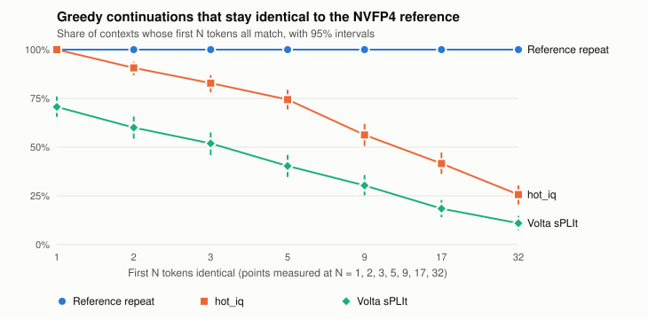
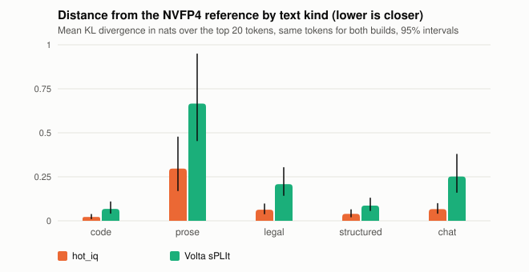
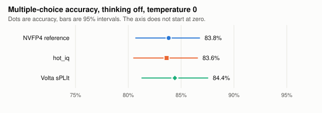

# Volta Max uPLIft FP4

DeepSeek-V4.1-Flash-1017 served on eight Tesla V100 cards from 2018, with as much of the routed work at NVIDIA's
NVFP4 precision as fits. Every routed expert is held on the cards in decode. The most-used experts run at exactly
NVFP4 precision and the rest from compressed IQ2-class records. It is slower than our earlier build, Volta sPLIt,
and closer to the NVFP4 pack.

**Speed.** Decode speed by prompt length, and throughput with requests at once (close-out build, 2026-11-13):


**Context.** Time to first token as the prompt grows (close-out build, 2026-11-13):


**Accuracy.** Closeness to NVIDIA's NVFP4 pack (MEASURED 2026-11-11, build of the first release):







[-1F6FEB?style=for-the-badge)](#requests-at-once)
[](#one-request-at-a-time)
[](#long-prompts-1k-to-256k)
[-0969DA?style=for-the-badge)](#prompt-cache)
[-76B900?style=for-the-badge)](#accuracy-how-close-to-nvfp4)
[](https://huggingface.co/ProprietaryLegal/Volta-Max-uPLIft-FP4-DeepSeek-V4.1-Flash-1017-hot_iq-8xV100-SXM2-PP2xTP4)

Built by **Nick Mermiges, Esq.**, founder of [PLI Labs](https://proprietarylegal.ai/labs.html) · [proprietarylegal.ai](https://proprietarylegal.ai)

[Speed](#speed-tokens-per-second) · [Context](#context) · [Accuracy](#accuracy-how-close-to-nvfp4) · [What this is](#what-this-is) · [Reproduce](#reproduce) · [What did not work](#what-did-not-work-or-is-not-yet-good) · [More detail](#more-detail)

## Speed: tokens per second

MEASURED 2026-11-13 on the close-out build. Each number in this section is from that bench unless it says
otherwise. "One request at a time" is the two-slot default. "Three requests together" is the three-slot option.
The older benches of 2026-11-10, 2026-11-11 and 2026-11-12 are in the
[front-page archive](docs/front-page-archive-2026-11-14.md) and in [docs/measurements.md](docs/measurements.md).

**Conditions.** Cards at the default 300 W power limit and 1,530 MHz maximum clock. The power cap was not in force
during this bench. The close-out build is window 18's build plus the stage-1 reserve of window m32, the cache log
line of window px, the snapshot hit of window rh and the new card order. 169 of 169 bench requests, status DONE.
In tag b the one-slot boot died at load, so the three slot boots ran again as tag c under the same rule.
Fast prompt reading changes the output from the first token: quality not established. Requests that repeat a
prompt without a cache salt can resume from the snapshot hit, so their first-token times can be shorter for that
reason alone. The full conditions, the rule and the tables against window 18 of 2026-11-12 are in
[docs/measurements.md](docs/measurements.md#speed-bench-2026-11-13-close-out).

**Bench boot (tag b): VALID**, 169 of 169 requests, and tag b's own window line reads INCONCLUSIVE only because its slot boots did not run (above). **Slot boots (tag c): VALID.**

**Memory on the bench boot: PASS.** The highest sample on the cards of stage 1 was 31,956 MiB and on stage 0 31,736 MiB, against the 31,998 MiB line this build is held to (the card's 32,510 MiB less 512), in 322 samples over the whole boot, with 0 out-of-memory lines. Window 18's bench boot reached 32,000 MiB on stage 1. Window m32's 32 MiB were meant for this.

### One request at a time

General 117.7 tok/s (26.36 ms per round) and legal-style 94.7 (25.98 ms) on the close-out bench boot (one request at a time on the two-slot default), against 123.2 (25.10 ms) and 97.3 (24.92 ms) in window 18. Three prompts each, output tokens over the whole request time.

Decode, thinking off, one request at a time, 1K to 256K: code 143 to 175 tok/s (window 18 150 to 180), legal 79 to 99 (86 to 106). First token after a 128K prompt 43.8 s (window 18 54.3 s), after 256K 86.7 s (108.4 s).

Short prompts by text type, close-out build, one request at a time on the two-slot default:

| kind of output | greedy (T=0) | sampled (T=1) | tokens per round, T=0 | Volta sPLIt greedy | Volta sPLIt sampled |
|---|---:|---:|---:|---:|---:|
| code | 165.2 (162.6-171.7) | 161.2 (158.6-167.9) | 4.39 | 213.1 | 196.8 |
| structured (JSON) | 180.9 (175.4-180.9) | 169.1 (165.3-171.8) | 4.74 | 209.4 | 205.4 |
| legal | 97.9 (97.1-99.4) | 87.3 (85.0-93.8) | 2.58 | 115.7 | 108.4 |
| prose | 78.4 (78.4-81.7) | 78.6 (78.0-81.3) | 2.07 | 98.0 | 87.2 |
| chat | 77.7 (76.4-81.5) | 75.0 (72.0-77.6) | 2.05 | 96.2 | 93.8 |
| thinking on, 4 prompts, token-weighted | - | 107.7 (94.5-158.8 per prompt) | - | - | 132.3 |

Up to 1,024 tokens with a natural stop, thinking off, median of 3 runs with range. A repeated identical prompt now resumes from the cache. In 5 of 5 kinds the second and third greedy answers were byte-identical to each other and differed from the first, cold answer (window 18: all three byte-identical in 5 of 5 kinds). The resumed request recomputes the end of the prompt on the decode path, so its greedy answer is repeatable from the second request on and can differ from the cold one. The figures are the medians of the three runs, the same method as window 18. Volta sPLIt's columns are its published bench of 2026-11-05.

The two benches ran at different power limits: window 18 of 2026-11-12 at 175 W and 1,522 MHz per card, the close-out bench at the default 300 W power limit and 1,530 MHz maximum clock (the power cap was not in force during this bench). With that difference, one request at a time, writing speed is unchanged within run-to-run spread: short sets 117.7 and 94.7 tok/s against 123.2 and 97.3 (26.36 and 25.98 ms per round against 25.10 and 24.92), while run 1 and run 2 of one request alone on the same slot profile differed by up to 9.7 % in time per round on 2026-11-12 and up to 7.7 % on 2026-11-13. Prompt reading measured faster: 2,876 to 3,132 tok/s at 256K against 2,329 to 2,430, and the first token after 256K came at 86.7 s against 108.4 s, but part of that is the power limit. On the close-out build with the 175 W cap back on, measured after the bench, the tool loop's first read of 216,255 tokens took 70.6 s, against 67.0 s in this bench at 300 W and 86.9 s in window 18 at 175 W. Decode on the close-out build at 175 W was not re-measured on the bench's sets.

### Requests at once

One, two and three prompt slots, each on a fresh boot, by window 15's procedure: each level runs the three public short prompts, thinking off, temperature 0, 1,024 tokens out per request, started together, twice. Run 2 of each level is the reading, declared before the data. Aggregate tok/s = all tokens over the time from the first start to the last end. Ratio = against one slot, one stream, run 2 (119.0 tok/s). NVFP4 experts on the three boots: 6,203, 5,936 and 5,650 for one, two and three slots. The two-slot boot's tier map is the published default's (window m32). The one- and three-slot boots used window 18's profiles with window m32's 32 MiB on stage 1 as well, and since 2026-11-13 they are the package's one- and three-slot options too.

The chart of this table is at the top of the page.

Run 2 (the reading): aggregate tok/s (ratio), mean decode tok/s of each request, ms per decode round:

| Slots | 1 request | 2 together | 3 together |
|---|---|---|---|
| 1 | 119.0 (1.00x), 136.0, 24.87 |  |  |
| **2 (default)** | 124.7 (1.05x), 141.9, 24.69 | **158.7 (1.33x)**, 102.6, 28.55 |  |
| 3 | 123.1 (1.03x), 138.8, 24.63 | 156.4 (1.31x), 102.9, 28.66 | **176.2 (1.48x)**, 78.8, 42.73 |

Three-slot profile, run 2: two requests add 27.1 % to one, a third adds 12.7 % to two.

- **Same output.** Every request with others running gave the same token ids as the same prompt alone on the same boot: 4 of 4, 8 of 8 and 14 of 14.
- **One long read and one short request.** A 209,175-token prompt, then a short request 10 s later. With one slot the short request waits 56.82 s for the read, then decodes at 85.1 tok/s. With two or three slots it starts in 4.11 to 4.32 s but decodes at 15.3 tok/s while the read goes on, and the read takes 11.2 s longer. Both end later than with one slot, so slots do not help a short request during a long read.

Memory, highest sample on any card of the stage over the whole boot, against the 31,998 MiB line:

| Boot | Stage 0 | Stage 1 | Samples | Out-of-memory lines | Verdict |
|---|---|---|---|---|---|
| bench (two slots) | 31,736 MiB (262 to the line) | 31,956 MiB (42) | 322 | 0 | PASS |
| 1 slot | 31,754 MiB (244 to the line) | 30,778 MiB (1,220) | 10 | 0 | PASS |
| 2 slots | 31,702 MiB (296 to the line) | 30,776 MiB (1,222) | 12 | 0 | PASS |
| 3 slots | 31,096 MiB (902 to the line) | 30,798 MiB (1,200) | 14 | 0 | PASS |

One long read and one short request (209,175-token prompt of Python standard-library source, a short request 10 s later):

| Slots | Long prompt: first token | Short request: first token | Short request: decode | Short finished before the long prompt's first token |
|---|---|---|---|---|
| 1 | 65.8 s | 56.82 s | 85.1 tok/s, 25.05 ms per round | no |
| 2 | 77.0 s | 4.11 s | 15.3 tok/s, 148.46 ms per round | no |
| 3 | 77.0 s | 4.32 s | 15.3 tok/s, 146.89 ms per round | no |

The run-1 table and the receipts are in [docs/measurements.md](docs/measurements.md#speed-bench-2026-11-13-close-out).

**The price in NVFP4 experts.** Each slot keeps its own state and CUDA graphs, so fewer experts fit at NVFP4:
6,203, 5,936 and 5,650 of the 15,360 routed experts for one, two and three slots on the close-out boots. The share
of decode routes that run at exactly NVFP4 precision falls with them. The prediction below was made on 2026-11-12
for the slot profiles of that day. PREDICTED (not measured) from the slope of that share per GiB of budget, method
error about ±1.3 points:

| Kind of text | 1 slot, R1 profile: measured | 1 slot (window 15) | **2 slots (default)** | 3 slots | 4 slots |
|---|---|---|---|---|---|
| general | 80.3 % | about 79.9 % | about 78.2 to 78.3 % | about 76.6 to 76.8 % | about 74.9 to 75.3 % |
| legal-style | 84.4 % | about 84.1 % | about 82.6 to 82.7 % | about 81.1 to 81.4 % | about 79.6 to 80.0 % |
| source loop | 86.4 % | about 85.7 % | about 84.5 to 84.6 % | about 83.4 to 83.5 % | about 82.2 to 82.5 % |
| US Code loop | 85.4 % | about 85.1 % | about 83.7 to 83.8 % | about 82.4 to 82.5 % | about 81.0 to 81.3 % |

The boots placed as many HOT experts as predicted or slightly more, so the measured shares should sit at or slightly
above these ranges. No route counter ran on a slot profile.

**Quality not established** for every slot profile: they hold fewer NVFP4 experts than any configuration with a
closeness or long-chat test, and none of those tests ran on them. They also read prompts the fast way.

### Long prompts: 1K to 256K

The decode chart of this table and the first-token chart are at the top of the page.

| prompt | first token | prompt reading | code | structured | legal | prose | chat |
|---|---:|---:|---:|---:|---:|---:|---:|
| 1K | 0.85 s | 949-1,416 tok/s | 172.0 | 171.5 | 98.8 | 83.2 | 83.8 |
| 2K | 1.41 s | 1,402-1,514 tok/s | 168.5 | 189.3 | 95.1 | 81.9 | 76.6 |
| 4K | 2.64 s | 1,502-1,658 tok/s | 174.6 | 161.0 | 90.9 | 80.8 | 85.8 |
| 8K | 5.96 s | 1,341-1,413 tok/s | 169.5 | 167.3 | 89.4 | 81.6 | 79.2 |
| 16K | 8.72 s | 1,851-1,994 tok/s | 159.5 | 166.1 | 84.8 | 80.6 | 87.3 |
| 32K | 13.7 s | 2,347-2,565 tok/s | 162.6 | 157.5 | 89.0 | 82.3 | 82.3 |
| 64K | 23.2 s | 2,753-3,012 tok/s | 164.3 | 157.0 | 90.0 | 79.4 | 74.8 |
| 128K | 43.8 s | 2,727-3,145 tok/s | 147.9 | 145.5 | 79.1 | 76.9 | 76.8 |
| 256K | 86.7 s | 2,876-3,132 tok/s | 142.7 | 140.2 | 83.5 | 74.4 | 69.0 |

Close-out build, one request at a time on the two-slot default. Thinking off, 90 requests, each cell the mean of
2 runs. Largest difference between the two runs of a cell 18.5 tok/s, greedy output byte-identical in 45 of 45
cells. Thinking on and prompt reading by kind are in
[docs/measurements.md](docs/measurements.md#speed-bench-2026-11-13-close-out).

### Beside Volta sPLIt

Each cell is close-out (at the default 300 W power limit and 1,530 MHz) / Volta sPLIt's published bench of 2026-11-05 at a 1,522 MHz ceiling, thinking off, mean of 2 runs.

| prompt | first token | prompt reading | code | legal |
|---|---:|---:|---:|---:|
| 1K | 0.85 s / 1.22 s | 949-1,416 / 820-948 | 172.0 / 215.0 | 98.8 / 117.6 |
| 2K | 1.41 s / 1.95 s | 1,402-1,514 / 1,024-1,082 | 168.5 / 203.6 | 95.1 / 114.8 |
| 4K | 2.64 s / 3.26 s | 1,502-1,658 / 1,245-1,264 | 174.6 / 194.9 | 90.9 / 111.6 |
| 8K | 5.96 s / 6.94 s | 1,341-1,413 / 1,178-1,188 | 169.5 / 207.9 | 89.4 / 109.1 |
| 16K | 8.72 s / 10.4 s | 1,851-1,994 / 1,574-1,583 | 159.5 / 201.8 | 84.8 / 105.6 |
| 32K | 13.7 s / 17.2 s | 2,347-2,565 / 1,894-1,913 | 162.6 / 200.5 | 89.0 / 116.5 |
| 64K | 23.2 s / 30.9 s | 2,753-3,012 / 2,111-2,132 | 164.3 / 194.1 | 90.0 / 108.3 |
| 128K | 43.8 s / 59.2 s | 2,727-3,145 / 2,198-2,220 | 147.9 / 182.8 | 79.1 / 110.9 |
| 256K | 86.7 s / 118.7 s | 2,876-3,132 / 2,197-2,222 | 142.7 / 160.0 | 83.5 / 103.1 |

### The 216K tool loop

One request at a time on the two-slot default. First read 67.01 s for 216,255 tokens (window 18 86.87 s). Follow-ups that kept the previous prompt: 7 of 7, first token median 3.66 s (3.54 s), decode mean 109.9 tok/s over the 7 (126.8). On the close-out boot the tool loop's final request ran to the 32,000-token limit (stop reason `max_tokens`) and gave no final answer. Counting it, that request has run to the limit in 3 of 4 runs with the group-plan kernel and 5 of 8 on every build of this repository so far.

## Context

The server runs with max-model-len 524,288. The two-slot default keeps two requests' prompts at once. One and
three slots ship as options ([What runs](#what-runs)).

**Speed as the prompt grows.** On the close-out build, one request at a time, code decodes at 172.0 tok/s after a
1K prompt and 142.7 tok/s after 256K. The first token comes 0.85 s after a 1K prompt, 13.7 s after 32K, 43.8 s
after 128K and 86.7 s after 256K. Prompt reading rises with length to 2,876 to 3,132 tok/s at 256K. Every row is
in [Long prompts: 1K to 256K](#long-prompts-1k-to-256k). In the 216K tool loop the first read of 216,255 tokens
took 67.01 s ([The 216K tool loop](#the-216k-tool-loop)).

**Prompt slots and a long read.** With two or three slots a short request sent during a long read starts sooner
but decodes slowly until the read ends, and both end later than with one slot
([Requests at once](#requests-at-once)).

### Prompt cache

- **A follow-up keeps its cache when the previous reply comes back changed (window rh).** In a chat with tools, the
  streaming tool-call parser returns the model's two trailing line feeds as text before a tool call, and the chat
  template adds its own two when that turn comes back. The previous reply does not come back token for token, and
  the server used to read the whole prompt again: a 218,510-token chat was read again in full. The server now keeps a
  copy of each prompt slot's sliding-window rows in host memory at the end of each prompt (81.8 MB for two slots,
  no card memory). A later request that holds that whole prompt resumes there and reads only the reply and the new
  turn. Time to first token, against a cold read of the same prompt: **0.690 s against 30.987 s at 100,340 tokens**,
  0.706 against 13.430 s at 40,550 tokens, and 0.384 to 0.534 s against 5.106 to 5.681 s at 8,118 to 8,400 tokens.
  A request that reads 12,016 tokens again took 4.512 against 6.398 s. A chat-shaped request took 1.374 against
  6.560 s from start to end. Token for token the same output as an ordinary cache hit at the same position in the
  same boot (193 readings, 0 differences). Peak memory on the fullest card 31,954 MiB, under the build's line of
  31,998. It is on by default (`VLLM_V41_SNAPSHOT_HIT=1`) on two to four slots. The one-slot option runs without it
  and without the log line below, because the engine accepts both only in its multi-slot mode.
- **One log line per request on the cache decision (window px).** With `VLLM_V41_PREFIX_LOG=1` (on by default) the
  scheduler writes one line for each request it admits: numbers and reason words only, no token ids, no text. It
  says whether the prompt cache was used, how much of it, and if not, why. Find the lines with
  `grep "VLLM_V41_PREFIX_LOG request"` in the server log. The fields are in
  [docs/measurements.md](docs/measurements.md#one-log-line-per-request-window-px).
- **Two request-path switches from Volta sPLIt (window 16).** The launcher exports `VLLM_V41_SYSTEM_IN_PLACE=1`,
  so a system message sent in the middle of a chat stays where it was sent and the server keeps the prompt it
  holds: a follow-up turn that adds one to a 30,779-token chat reused 30,752 tokens and took 0.45 s, against
  14.84 s with the switch off. And `VLLM_V41_TOPK_SEG=1024`, the segment width of the decode top-k kernel. Token
  for token the same output with the switches off and on, decode speed no measurable change ([details](docs/measurements.md#two-request-path-switches-window-16)).

**A finding about token-exact tests.** At near-tied tokens (top-two logit gaps of 0.125 to 0.47 in the cases seen) a
greedy reply can differ between a cold read of a prompt and a read that resumes from a cache hit, and between hits
at different positions. This holds on the engine without any of these changes. A token-exact test of cache reuse
should compare a hit with a hit at the same position in the same boot. Window rh's rule was amended to do that.

## Accuracy: how close to NVFP4

`hot_iq` runs the experts that carry most of the decode work (79 to 85 % of decode routes, in-sample) at exactly
NVIDIA's NVFP4 precision and the rest from smaller IQ2-class records, so every routed expert fits on eight 32 GB
Tesla V100 cards. This section measures how far that moves the model's output from the NVFP4 pack, and compares it
with Volta sPLIt, the build that runs every routed expert from IQ2-class records. The reference throughout is **NVIDIA's NVFP4 pack**
served on the same cards with every routed expert at its own NVFP4 precision. That pack is itself a quantization of
the original model, so these figures say how close `hot_iq` is to the NVFP4 pack, not to the unquantized model.

**How close to NVIDIA's NVFP4 pack** (MEASURED 2026-11-11, 320 contexts and 513 MMLU questions, rules fixed before
any capture, [details](docs/front-page-archive-2026-11-14.md#how-close-to-nvfp4)). `hot_iq` picks the same next token as the NVFP4 reference on 95.1 % of
compared tokens, Volta sPLIt on 92.2 %. Its KL divergence from the reference is 0.079 nats against Volta sPLIt's
0.196, and on the tokens both builds still share with the reference it removes 63 % of Volta sPLIt's KL divergence.
It changes 1.6 % of the multiple-choice answers, Volta sPLIt 15.4 %. 37 of Volta sPLIt's 79 changed answers are on
the 38 questions the reference left unanswered: on the 475 it answered, the changed shares are 1.7 % and 8.8 %
(counted after scoring, outside the preregistered rules).

The three closeness charts are at the top of the page.

These figures are for the build of the first release: native prompt reading and one slot. The two-slot default
reads prompts the fast way and holds fewer NVFP4 experts. No closeness test has run on it: quality not
established. The full method, the per-kind tables and the multiple-choice details are in the
[front-page archive](docs/front-page-archive-2026-11-14.md#how-close-to-nvfp4).

### What is exact by construction

| Fact | Value | Evidence |
|---|---|---|
| Experts kept at NVFP4 precision (hot) | layers 0 to 19: 3,833 of 7,680. Layers 20 to 39: 2,254 of 7,680 | boot log tier lines on all four ranks of each stage of the exported package's boot (2026-11-11), tier digests 8e7829184090 and 5b09c0383a80 |
| Hot experts equal NVIDIA's values | the NVFP4 to MXFP4 fold is exact: 44,696,862,720 values bit-equal, relative L2 error 0 | the fold check ([Volta Full NVFP4](https://github.com/ProprietaryLegal/Volta-Full-NVFP4-DeepSeek-V4.1-Flash-8xV100#what-this-is)) |
| Decode routes that land on hot experts (the share of the work done at exactly NVFP4 precision) | general text 79.0%, legal-style 83.3%, source code loop 85.0%, US Code loop 84.3% | route counters while serving the texts the hot experts were chosen from (in-sample) |
| Prompt reading, native (the first release and the `native-slots1` option) | every expert, hot or not, is computed from its full NVFP4 record | the engine's prompt-reading path |
| Prompt reading, fast (the default since 2026-11-12) | hot experts from their NVFP4 records, compressed experts from their IQ2-class records | the engine's prompt-reading path |

With native reading, the reading of every figure in this section, the first token of every answer comes from the
same weights as the reference. Only later tokens can be touched by the IQ records, on the 15 to 21% of expert
routes that are not hot. With fast reading the IQ records also touch the prompt and the first token, and no
closeness test has run with it: quality not established.

### Next-token closeness

| Measure | hot_iq | Volta sPLIt | Reference repeat (noise floor) |
|---|---|---|---|
| Contexts | 320 | 320 | 50 |
| Tokens compared (after the first, up to the first difference) | 4818 | 2455 | 1550 |
| Same next token as the reference | 95.1% (94.4% to 95.7%) | 92.2% (90.7% to 93.4%) | 100.0% (100.0% to 100.0%) |
| Mean log-probability gap on the reference's token (nats) | 0.1163 (0.1009 to 0.1342) | 0.2451 (0.2053 to 0.2959) | 0.0000 (0.0000 to 0.0000) |
| Mean KL divergence from the reference, top 20 (nats, lower bound) | 0.0794 (0.0687 to 0.0915) | 0.1958 (0.1648 to 0.2329) | 0.0000 (0.0000 to 0.0000) |
| All 32 tokens identical | 25.6% (20.9% to 30.0%) | 10.9% (7.8% to 14.4%) | 100.0% (100.0% to 100.0%) |
| First token identical (prompt reading, control) | 100.0% (100.0% to 100.0%) | 70.6% (65.9% to 75.6%) | 100.0% (100.0% to 100.0%) |

`hot_iq` removes 63.3% (95% interval 55.0% to 70.5%) of Volta sPLIt's KL divergence from the NVFP4 reference, and
56.0% (95% interval 47.3% to 63.8%) of its log-probability gap.

### Multiple choice

| Build | Accuracy | Minus the reference | Answer differs from the reference | No answer |
|---|---|---|---|---|
| NVFP4 reference | 83.8% (80.7% to 86.7%) |  |  | 38 |
| hot_iq | 83.6% (80.5% to 86.5%) | -0.2% (-1.4% to 0.8%) | 1.6% (0.6% to 2.7%) | 38 |
| Volta sPLIt | 84.4% (81.3% to 87.5%) | 0.6% (-2.3% to 3.5%) | 15.4% (12.3% to 18.5%) | 1 |

The reference answered 83.8% (95% interval 80.7% to 86.7%) correctly. `hot_iq`'s answer differed from the
reference's on 1.6% (95% interval 0.6% to 2.7%) of the questions, Volta sPLIt's on
15.4% (95% interval 12.3% to 18.5%). Against the reference, `hot_iq`'s accuracy is
NOT DISTINGUISHABLE FROM THE REFERENCE AT THIS SAMPLE SIZE, and Volta sPLIt's is NOT DISTINGUISHABLE FROM THE REFERENCE AT THIS SAMPLE SIZE.

### Verdicts, by the rules fixed in advance

| Question | Verdict |
|---|---|
| Is `hot_iq` closer to the NVFP4 reference than Volta sPLIt (KL divergence, shared tokens)? | HOT_IQ CLOSER |
| The same, by log-probability gap | HOT_IQ CLOSER |
| The same, by next-token disagreement | HOT_IQ CLOSER |
| Does `hot_iq` change fewer multiple-choice answers than Volta sPLIt? | HOT_IQ CLOSER |
| `hot_iq` against the reference's own repeat (KL divergence) | DIFFERS FROM THE REFERENCE |
| Volta sPLIt against the reference's own repeat (KL divergence) | DIFFERS FROM THE REFERENCE |

"Indistinguishable at this sample size" means the 95% interval reaches the noise floor. It does not mean equal. A
difference smaller than this test can resolve may still exist.

### What these numbers show and what they do not

They show how often `hot_iq` picks the same next token as NVIDIA's NVFP4 pack on these cards, how far its
probabilities move, how long its greedy output stays the same, and how many multiple-choice answers change, each
next to the same figures for Volta sPLIt and next to the reference's own repeatability.

They do not show closeness to the unquantized model (the reference is NVIDIA's quantization). They do not cover
sampling at a temperature above 0, thinking, or long answers, because every test here is greedy, without thinking,
and at most 32 tokens. The KL divergence is computed over each build's top 20 tokens, so it is a lower bound of the
full value. The prompts are short (about 100 to 250 tokens). The figures come from one hardware layout, eight V100
cards in two pipeline stages, where the reference's NVFP4 weights are computed by this engine, not by NVIDIA's own
hardware path. With 513 questions, an accuracy difference of less than about 4 points
cannot be resolved, which is why the share of changed answers is reported beside accuracy.

The earlier check on the replaced 12-prompt set, which this build passed, is in [Quality](docs/front-page-archive-2026-11-14.md#quality).

The hot experts are value-exact to DeepSeek's official MXFP4 experts ([the fold](https://github.com/ProprietaryLegal/Volta-Full-NVFP4-DeepSeek-V4.1-Flash-8xV100#what-this-is)). NVIDIA's own
accuracy table for the pack, measured with vLLM on 4x GB300 (UPSTREAM), is within run noise of the MXFP4 source, for
example GPQA-D 92.93 against 92.77 and AA-LCR 80.19 against 80.41. Those figures are NVIDIA's, on NVIDIA's serving
stack, not this build.

## What this is

**Volta Max uPLIft is the build that puts as much of the routed work at NVIDIA's NVFP4 precision as fits on eight V100
cards, with every routed expert held on the cards.** The configuration key is `hot_iq`. Every routed expert's compressed
IQ2-class record is placed on the cards first. Then experts are promoted to their NVFP4 weights in order of use per
byte, one by one, until the next one does not fit. This maximizes use, not the count. Packing the cheapest promotions
first would fit 6,377 to 6,379 experts at NVFP4 against 6,087, but less-used ones, so it could not carry more of the
work at NVFP4 (to within one expert's share on each pipeline stage, [below](docs/front-page-archive-2026-11-14.md#hot_iq-on-the-mixed-tally-the-build-of-this-release)). Use and work here are the mixed
tally's counts of decode routes, measured in-sample. On the mixed tally of this release that puts 6,087 of the 15,360 routed experts at exactly the
precision of NVIDIA's [DeepSeek-V4.1-Flash-1017-NVFP4](https://huggingface.co/nvidia/DeepSeek-V4.1-Flash-1017-NVFP4) pack,
unchanged. In the measured sets 79.0 to 85.0 % of decode routes ran on those experts (route counters, in-sample,
[below](docs/front-page-archive-2026-11-14.md#hot_iq-on-the-mixed-tally-the-build-of-this-release)). The other 15.0 to 21.0 % ran on ISTA-DASLab's IQ2-class
records. In decode all experts are in VRAM: no routed expert is read over PCIe. In the first release prompt reading
read the compressed experts at NVFP4 precision from records staged in host RAM (`native_staged`). Since
2026-11-12 the default reads them from their IQ2-class records on the cards (fast prompt reading, quality not
established) and serves two prompt slots, which places 5,936 experts at NVFP4 since the stage-1 reserve
went up 32 MiB ([update of 2026-11-12](docs/front-page-archive-2026-11-14.md#update-2026-11-12-two-prompt-slots-by-default-fast-prompt-reading-and-four-kernels),
[update of 2026-11-13](docs/front-page-archive-2026-11-14.md#update-2026-11-13-the-prompt-cache-survives-a-changed-reply)).

The pack is served on eight V100-SXM2-32GB cards (two 4-card NVLink boards, pipeline parallel 2 x tensor parallel 4).
The promoted ("hot") routed experts run at the precision of DeepSeek's official weights: NVFP4 folds exactly to MXFP4 (4.25 bits
per weight), which the v100-skinny QPN kernel runs as W4A16. Two related builds serve the same model on the same
cards ([Related builds](#related-builds)). [Volta Full NVFP4](https://github.com/ProprietaryLegal/Volta-Full-NVFP4-DeepSeek-V4.1-Flash-8xV100) runs every routed expert at NVFP4
precision, the less-used ones from host RAM over PCIe, and is slower. Our earlier build,
[Volta sPLIt](https://github.com/ProprietaryLegal/Volta-sPLIt-DeepSeek-V4.1-Flash-1017-8xV100-SXM2-PP2xTP4), runs every routed
expert from a compressed IQ2-class record and is faster. The three-tier mode was an earlier step on the way to this
build, with part of the experts in host RAM. Its measurements are in the [history](docs/history.md).

**One download:** the [hot_iq package on Hugging Face](https://huggingface.co/ProprietaryLegal/Volta-Max-uPLIft-FP4-DeepSeek-V4.1-Flash-1017-hot_iq-8xV100-SXM2-PP2xTP4) (556 GB) holds
every weight file this build serves, the tier map that says which experts are hot, and the serving profile. Its
upload was complete on 2026-11-11, and its small-file update of 2026-11-12 ([package history](https://huggingface.co/ProprietaryLegal/Volta-Max-uPLIft-FP4-DeepSeek-V4.1-Flash-1017-hot_iq-8xV100-SXM2-PP2xTP4/commits/main))
added the serving files of this build: one profile template and one tier map per option. Start it with
[engine/configs/serve_hot_iq.sh](engine/configs/serve_hot_iq.sh) as [Reproduce](#reproduce) describes.

This repository is a public record of work in progress: the measurements, the code of the build as measured, what
worked and what did not. The steps that led to this build, the three-tier mode and the first `hot_iq` profiles
on the first tally (2026-11-09 and the earlier results of 2026-11-10), are dated rows of the
[measurement log](docs/front-page-archive-2026-11-14.md#measurement-log), with their tables and checks in [docs/history.md](docs/history.md). They stay
as published.
The build is slower than Volta sPLIt in decode speed and in prompt reading speed. We publish it now because
the method works, the numbers are measured, and the next steps are planned piece by piece. New results are added as
dated rows in the [measurement log](docs/front-page-archive-2026-11-14.md#measurement-log).

**The question.** DeepSeek-V4.1-Flash-1017 has 384 routed experts in each of 40 layers. At the official MXFP4
precision they take about 269 GiB (ESTIMATED: 384 x 35.4M weights x 40 x 4.25 / 8 bytes). Eight 32 GB V100s have
256 GiB of HBM in total, before attention weights, KV cache and the drafter. Volta sPLIt fits the model by serving
compressed IQ2-class experts. This build asks how much of the routed work can run at the official precision with every routed expert still on the cards.

**The pack.** NVIDIA's NVFP4 pack stores the routed experts in NVFP4 (FP8 scale per 16 values). Its card says the
conversion from DeepSeek's MXFP4 was lossless. We fold it back to MXFP4 (one power-of-two scale per 32 values) and
check the folded values against the NVFP4 formula: they are bit-equal. The check, its counts and the pack recipe are
stated in [Volta Full NVFP4](https://github.com/ProprietaryLegal/Volta-Full-NVFP4-DeepSeek-V4.1-Flash-8xV100#what-this-is), which serves every expert from these packs. The
pack builder and its checks are also in this repository ([harness/benchmarks/nvfp4_8r/](harness/benchmarks/nvfp4_8r/)).

**No host tier: Max uPLIft (`hot_iq`), the build of this release.** The three-tier step and Volta Full NVFP4 keep
experts in host RAM.
This build keeps every routed expert on the cards in decode: every compressed record goes on the cards first, and
experts are promoted to official precision in order of use per byte until the next one does not fit
([above](docs/front-page-archive-2026-11-14.md#hot_iq-on-the-mixed-tally-the-build-of-this-release)).

**Everything else is Volta sPLIt's.** Attention, the dense layers, the shared expert, the Engram tables, the DSpark
drafter, the PP2 x TP4 split and the switch set are served exactly as in Volta sPLIt (same engine, same GGUF for the
non-expert tensors). Only the routed-expert path is new.

<!-- pli:blurb:start -->

> Published by [PLI Labs](https://proprietarylegal.ai/labs.html), the open research arm of [Proprietary Legal Intelligence](https://proprietarylegal.ai). PLI builds AI systems around a legal organization's own work product, combining retrieval, staged workflows, validation, and attorney review. Visit [proprietarylegal.ai](https://proprietarylegal.ai) to explore our work and discuss what your organization needs.

<!-- pli:blurb:end -->

## What runs

| | |
|---|---|
| GPUs | 8x V100-SXM2-32GB on two 4-card SXM2 boards, NVLink inside each board; four PLX switches, each on its own x16 Gen3 root port, two cards per switch at Gen3 x8 (MEASURED from sysfs) |
| Host RAM | 363 GiB available with no server running (MEASURED). `hot_iq` keeps the compressed experts' official records, 180.8 GB, in pinned host RAM for prompt reading, plus the Engram tables |
| Routed experts | [nvidia/DeepSeek-V4.1-Flash-1017-NVFP4](https://huggingface.co/nvidia/DeepSeek-V4.1-Flash-1017-NVFP4) @ `480550d3`, folded to MXFP4 (E8M0 scale per 32) packs per layer and TP rank for the hot experts. Compressed experts: the GSQ-RCO records below |
| Other weights | as Volta sPLIt: [ISTA-DASLab GSQ-RCO GGUF](https://huggingface.co/ISTA-DASLab/DeepSeek-V4.1-Flash-1017-GSQ-RCO-GGUF) for attention, dense and shared-expert tensors (Q5_K 4.76 GiB, Q8_0 0.36 GiB, BF16 0.26 GiB, F32 0.15 GiB by tensor bytes, MEASURED from the file header) and the IQ4_NL Engram tables; its routed-expert records are IQ1_M 55.37 GiB, IQ2_XXS 45.68 GiB and IQ2_XS 21.95 GiB; config, tokenizer and DSpark drafter (FP8) from [deepseek-ai/DeepSeek-V4.1-Flash-1017](https://huggingface.co/deepseek-ai/DeepSeek-V4.1-Flash-1017) |
| Expert kernel | v100-skinny's QPN kernel as packaged in 1Cat-vLLM ([#742](https://github.com/1CatAI/1Cat-vLLM/pull/742)): `skinny_moe_qpn_sm70`, E8M0 scale mode, W4A16, FP16 `mma.sync`, V4.1's limited SwiGLU and the weighted sum in FP32, CUDA graphs for 1 to 6 rows. Since 2026-11-12 the prompt-reading path runs it at RB 4 (32 token rows per weight load, same output bits, [engine/kernels/prefill-rb4/](engine/kernels/prefill-rb4/README.md)) |
| Prompt reading | default since 2026-11-12: fast, the compressed experts from their IQ2-class records on the cards, with a prompt-reading workspace of 0.33 / 0.34 GiB per card (quality not established). Option `native-slots1` and the first release: the compressed experts' official records in pinned host RAM, staged into two 32-expert HBM buffers on a copy stream, one staging pair per card |
| Compressed experts | Volta sPLIt's IQ expert op over the IQ2-class records kept on the cards |
| Engine | the Volta sPLIt engine (1Cat-vLLM #1277 + its patch series and production patches) plus this build: nine new files (the native expert path with the tier-map reader, the tier planner, the route counters, the group-plan kernel, the SwiGLU kernels of decode and prompt reading, the fused IQ tail, fast prompt reading, the RB 4 prompt-reading launcher and tally mixing) and three changed files ([engine/](engine/)) |
| Layout | PP2 x TP4: layers 0-19 and the Engram lookup on one board, layers 20-39, the head and the drafter on the other |
| Card reserve | per stage, from measured peaks plus about 0.5 GiB: 4.5 GiB per card on stage 0, 7.5 GiB on stage 1 (the package as uploaded). The two-slot default keeps 4.32 / 7.03 GiB (4,643,356,672 / 7,550,795,776 bytes) plus the fast-reading workspace of 0.33 / 0.34 GiB: the one-slot fast-reading reserves, 160 MiB more per extra slot on both stages for its CUDA graphs, 192 MiB more on stage 1 for the fast-reading peak and, since window m32, 32 MiB more on stage 1 ([templates](engine/configs/)) |
| Context | max-model-len 524,288. Default since 2026-11-12: two prompt slots (`max-num-seqs 2`), options one and three. The first release served one request at a time |
| Serving profiles | the published default since 2026-11-12: the [package profile template](engine/configs/hot_iq.yaml.template), a copy of [two slots](engine/configs/hot_iq-slots2.yaml.template) (`hot_iq` on the mixed tally, fast prompt reading, group-plan kernel, SwiGLU kernel, fused IQ tail, the two prompt-reading kernels, tiers from the package's `tier_maps/slots2.json`), started by [serve_hot_iq.sh](engine/configs/serve_hot_iq.sh). Options: [one slot](engine/configs/hot_iq-slots1.yaml.template), [three](engine/configs/hot_iq-slots3.yaml.template) and [`native-slots1`](engine/configs/hot_iq-native-slots1.yaml.template) (one slot, native reading, the R1 tiers, the prompt-reading kernels' fallbacks `chain` and `rb2`). Quality of the slot profiles and of fast reading: not established. The package carries the same templates since its small-file updates of 2026-11-12 and 2026-11-13 (the two-slot reserve of window m32). Earlier steps, whose profiles read a tally: [three-tier](engine/configs/serve-nvfp4-pp2-t3.yaml) (`hot_iq_host`), [`hot_iq`](engine/configs/serve-nvfp4-pp2-t3n.yaml) (no host tier, first tally, speeds measured, quality not established, not accepted), [three prompt slots](engine/configs/serve-nvfp4-pp2-t3-a3.yaml) (`max-num-seqs 3`, reserves 5.3 / 8.1 GiB), [its one-slot control](engine/configs/serve-nvfp4-pp2-t3-a1r.yaml) (same reserves, one slot), and [no host tier with three prompt slots](engine/configs/serve-nvfp4-pp2-t3n-a3.yaml) (`hot_iq`, `max-num-seqs 3`, reserves 5.3 / 8.1 GiB, measured, not accepted). The first-tally `hot_iq` profiles are not accepted (see above). The two host-tier slot profiles are measured (rows of 2026-11-10 in the [measurement log](docs/front-page-archive-2026-11-14.md#measurement-log)): three slots on the accepted tiers are not accepted (quality not established), and the one-slot control ran the traced tool loop. The all-NVFP4 profile [serve-nvfp4-pp2.yaml](engine/configs/serve-nvfp4-pp2.yaml) is Volta Full NVFP4's ([Related builds](#related-builds)). It stays here because the closeness test boots it as the reference |

## What worked

MEASURED on the dates given.

| Item | Result |
|---|---|
| Prompt slots (2026-11-12, windows 15 and 18) | two requests together 159.0 tok/s on two slots (1.34x one stream), three together 192.3 on three slots (1.62x), four together 198.3 on four (1.67x, window 15, before the prompt-reading kernels). Same token ids as each prompt alone on every boot, memory PASS on every slot boot. Quality not established ([details](docs/front-page-archive-2026-11-14.md#serving-several-requests-at-once-window-18)) |
| Fast prompt reading (2026-11-11, window 13b) | nine long chats of 191,812 to 319,936 tokens read with no fault, every final answer ended normally, first read 86 to 119 s near 200K tokens. Quality not established, memory check failed by 64 MiB ([update](docs/front-page-archive-2026-11-14.md#update-2026-11-12-two-prompt-slots-by-default-fast-prompt-reading-and-four-kernels)) |
| Two request-path switches from Volta sPLIt (2026-11-12, window 16), exported by the launcher: `VLLM_V41_SYSTEM_IN_PLACE=1` and `VLLM_V41_TOPK_SEG=1024` | the first keeps a system message that arrives in the middle of a chat where it was sent, so the prompt the server already holds still matches and is not read again. The second sets the segment width of the decode top-k kernel to 1024. Result: token-exact with the switches off and on. A follow-up turn that adds a system message to a 30,779-token chat reused 30,752 of those tokens (99.9 %) and took 0.45 s. With the switch off it reused none and took 14.84 s. Decode speed: no measurable change ([details](docs/measurements.md#two-request-path-switches-window-16)) |
| Two prompt-reading kernels (2026-11-12, window 17): one-launch SwiGLU and the RB 4 expert kernel | Same output bits as before (checked on one card, then token-exact on eight). Second reads of a 215,847-token prompt took 4.43 s less (89.3 to 89.8 s against 93.7 to 94.2 s). The first-read rule found no measurable change because first reads are noisy (noise floor 11.6 s). Peak memory on the fullest card 31,736 MiB against 31,688 MiB. Both run only while a prompt is read. Two new required profile keys: `nvfp4_8r_prefill_swiglu: kernel` and `nvfp4_8r_prefill_rb: rb4` ([details](docs/measurements.md#two-prompt-reading-kernels-window-17)) |
| Fused IQ tail and SwiGLU kernel (2026-11-11 and 11-12, windows 12, 14 and 14c) | token for token the same output, about 1.3 ms less per decode round each on second runs. No measurable change by the first-run rule |
| `hot_iq` on the mixed tally (2026-11-10) | the build of this release: closeness PASS on the replaced 12-prompt set, 0 of 3 long thinking chats at the limit, 64.7 tok/s legal-style and 83.6 general on the short sets (in-sample, [above](docs/front-page-archive-2026-11-14.md#hot_iq-on-the-mixed-tally-the-build-of-this-release)) |
| The native expert path | the exact NVFP4 to MXFP4 fold, the scale range on Volta, the QPN expert layer on one card and the bit-equal hot and host split (MEASURED 2026-11-09) are shared with Volta Full NVFP4 and stated there ([What worked](https://github.com/ProprietaryLegal/Volta-Full-NVFP4-DeepSeek-V4.1-Flash-8xV100#what-worked)) |
| Dropping the host tier (2026-11-09) | the host-tier profile's slow general text was host-RAM reads: without a host tier (`hot_iq`) general text decodes at 33.4 ms per round against 58.0 to 59.4 ms with it. Speed only: that profile is not accepted (its quality is not established) |
| Earlier steps | the three-tier mode, the first-tally profiles and three prompt slots: [history](docs/history.md#what-worked) |

## Hardware

Eight V100-SXM2-32GB on two NVLink quad boards, the same host and settings as the Volta sPLIt measurements of the
same day. Each of the four PCIe switches has its own x16 Gen3 root port and two cards at Gen3 x8. Volta has FP16
`mma.sync.m8n8k4` only: no FP4 or FP8 tensor cores, no `cp.async`, no `ldmatrix`. Every 4-bit format is decoded in
software into FP16 operands, so low-bit experts pay by reading fewer bytes, not by faster math. v100-skinny measured
a read ceiling of about 879 GB/s on a V100-SXM2 and its QPN kernel at 77 % of it at 1 row (UPSTREAM).

Since 2026-11-12 the host has 1 TB of RAM (eight 128 GB modules at 2933 MT/s) and reports two NUMA nodes. A direct
peer transfer between the two cards behind one PCIe host bridge hangs on it, so the two pipeline stages pair their
cards across bridges (see the card order in the [2026-11-13 update](docs/front-page-archive-2026-11-14.md#update-2026-11-13-the-prompt-cache-survives-a-changed-reply)).
The expert files are held in RAM, and a stage loads in 127 and 156 s.

## Reproduce

### From the Hugging Face package (`hot_iq`)

The package holds the weights, the MXFP4 expert files and the tier map, so no tally and no pack build is needed.
The tier-map reader passed the CPU check on 2026-11-10 (the tier map gives the measured tiers and digests on all
40 layers, and every expert record of layers 0 and 20 on the first rank is byte-equal to the measured one). On
2026-11-11 the exported package booted on eight cards and gave the measured build's output token for token
([measurement log](docs/front-page-archive-2026-11-14.md#measurement-log)).

1. Build the engine as step 1 of [From source](#from-source-with-your-own-tally) describes, and the RB 4
   prompt-reading library as [engine/kernels/prefill-rb4/](engine/kernels/prefill-rb4/README.md) describes. Or
   change the line `nvfp4_8r_prefill_rb: rb4` of the template you use to `rb2`: same output bits, without the
   second-read gain of window 17.
2. Download and check the package (556 GB): `hf download ProprietaryLegal/Volta-Max-uPLIft-FP4-DeepSeek-V4.1-Flash-1017-hot_iq-8xV100-SXM2-PP2xTP4 --local-dir /path/to/pkg`,
   then `cd /path/to/pkg && sha256sum -c SHA256SUMS`. Its card: [Hugging Face](https://huggingface.co/ProprietaryLegal/Volta-Max-uPLIft-FP4-DeepSeek-V4.1-Flash-1017-hot_iq-8xV100-SXM2-PP2xTP4).
3. Lay out the run directory as step 5 there describes.
4. Start: `cd "$LANE/run" && CUDA_VISIBLE_DEVICES=... bash serve_hot_iq.sh /path/to/pkg 8000`, the first board's four
   indices, then the second board's. On a host with two NUMA nodes pair each card with the one four places later
   across two PCIe host bridges (ours: `0,4,1,5,2,7,3,8`, [update of 2026-11-13](docs/front-page-archive-2026-11-14.md#update-2026-11-13-the-prompt-cache-survives-a-changed-reply)). The launcher writes
   `serve-hot_iq.yaml` from the package's profile template of the chosen option and starts `run_serve.sh` with that
   option's slot count (`run_serve.sh` sets the load-time allocator setting the measurements ran with).
   `NVFP4_OPTION` picks the option: `slots2` (the default), `slots1`, `slots3` (fast prompt reading) or
   `native-slots1` (one slot, native reading, the reading of the closeness figures). Each option needs the package's
   `serve/hot_iq-OPTION.yaml.template` and `tier_maps/OPTION.json`, in the package since its small-file update of
   2026-11-12, again on 2026-11-13 (the first release's `tier_map.json` stays as its record,
   and this engine refuses it). At load each rank
   logs its tiers. Two slots: stage 0 3,691 hot and 3,989 compressed experts with tier digest `0b6440ce205f`, stage 1
   2,245 and 5,435 with `5b2a5e7e493d`. One slot: `8e7829184090` and `c15146b996eb`. Three:
   `a5d4b7a514d1` and `2be289273a5e`. With a tier map the engine does not plan tiers: a card
   with less free memory after the dense weights than the measured cards had refuses to load and names the bytes it
   is short.

### From source, with your own tally

1. Build the Volta sPLIt engine as its
   [Reproduce section](https://github.com/ProprietaryLegal/Volta-sPLIt-DeepSeek-V4.1-Flash-1017-8xV100-SXM2-PP2xTP4#reproduce)
   describes, with its production patches through 0059. Then apply [engine/patches/](engine/patches/) in the engine source root (`patch -p1`; each header gives
   the sha256 of the base file and of the result) and copy the new files from [engine/src/](engine/src/) into
   the same paths of the vllm tree. See [engine/README.md](engine/README.md).
2. Download NVIDIA's NVFP4 pack (revision `480550d3`), the ISTA-DASLab GSQ-RCO GGUF and the DeepSeek config,
   tokenizer and DSpark drafter. [harness/run/copy_weights.sh](harness/run/copy_weights.sh) checks every pack file
   against the Hugging Face sha256; the pack builder refuses to start without its `ALL-VERIFIED` log.
3. Provide a decode routing tally: routing counts per layer and expert from your own traffic, in the array layout
   that `choose_residency` and `choose_tiers` read (see the engine files). Ours derives from private use and is not
   published.
4. Build and check the packs on CPU: `build_packs` then `accept_p1` (bit equality), as in
   [harness/benchmarks/nvfp4_8r/run_p1.sh](harness/benchmarks/nvfp4_8r/run_p1.sh).
5. Lay out the run directory. The scripts were measured in this layout and find each other there, not in this
   repository's folders. `$LANE` is this build's root (with `engine/venv/`, `engine/src/`, `models/` and `packs/`),
   `$PROD` the Volta sPLIt checkout (its bench5 harness scripts). From this repository's root:

   ```bash
   export LANE=/path/to/build PROD=/path/to/volta-split
   mkdir -p "$LANE/run/state" "$LANE/run/cache" "$LANE/logs/baseline" "$LANE/engine/src/benchmarks/nvfp4_8r"
   cp engine/configs/* harness/run/* "$LANE/run/"
   cp harness/benchmarks/nvfp4_8r/* "$LANE/engine/src/benchmarks/nvfp4_8r/"
   ```

   Copy Volta sPLIt's run tools into `$LANE/run/tools/` (`env.sh` puts them on the Python path), and replace `$LANE`
   in the profiles with your path. When `LANE` or `PROD` is not set, the shell scripts that read it stop with a
   message and the Python files stop with a `KeyError` naming the variable.
6. Start with `cd "$LANE/run" && PROFILE=serve-nvfp4-pp2-t3n.yaml CUDA_VISIBLE_DEVICES=... bash run_serve.sh nvfp4` (the last word names the server's log and pid files).
   That profile plans `hot_iq` tiers from your tally: no host tier, every compressed record on the cards, the
   most-used experts promoted until the next does not fit. Tiers from another tally are not the measured tiers, and
   their quality is yours to establish. The other profiles of [What runs](#what-runs) start the same way. A profile
   with more than one slot (`max-num-seqs` 2, 3 or 4) also needs `NVFP4_SLOTS` set to that number on the command line,
   for example `NVFP4_SLOTS=3` for the three-slot profiles `serve-nvfp4-pp2-t3-a3.yaml` and
   `serve-nvfp4-pp2-t3n-a3.yaml`: `run_serve.sh` refuses a profile whose `max-num-seqs` differs from it.
7. Measure with `$LANE/run/`[measure_boot.sh](harness/run/measure_boot.sh) (short sets, long prompts, repeat),
   [ctx_tput.py](harness/run/ctx_tput.py) (context rows) and [harness_loop.py](harness/run/harness_loop.py) (tool
   loop). The legal-style prompt file is not published; any file of one public prompt per line works, saved as
   `$LANE/logs/baseline/legal-public-prompts.txt`.

## What did not work or is not yet good

MEASURED on the dates given.

| Item | Result |
|---|---|
| Slower than Volta sPLIt | on the mixed tally 64.7 tok/s legal-style and 83.6 general (2026-11-10, 1,425 MHz) against Volta sPLIt's 118 to 119 and 137 to 138 (2026-11-09, 1,522 MHz) ([How it compares](docs/front-page-archive-2026-11-14.md#hot_iq-on-the-mixed-tally-the-build-of-this-release)). In the speed bench, slower in every thinking-off cell, every prompt-reading cell and every short-prompt row against Volta sPLIt's bench of 2026-11-05 at 1,522 MHz ([Beside Volta sPLIt](docs/front-page-archive-2026-11-14.md#beside-volta-split)). On the final build (2026-11-12, 1,522 MHz) decode is still slower in every code and legal cell and every short-prompt row, and the first token comes sooner than Volta sPLIt's at every length ([final bench](docs/measurements.md#speed-bench-2026-11-12-final-build)) |
| Slow prompt reading (first release) | 1,243 to 1,276 tok/s at 256K, first token 5.60 s after a 1K prompt, 106.4 s after 128K and 209.6 s after 256K (speed bench, 2026-11-10, 1,425 MHz, [Tokens per second](docs/front-page-archive-2026-11-14.md#tokens-per-second)). On the final build (2026-11-12, 1,522 MHz): 2,329 to 2,430 tok/s at 256K, first token 54.3 s after 128K and 108.4 s after 256K ([final bench](docs/measurements.md#speed-bench-2026-11-12-final-build)) |
| The 216K tool loop's final request | ran to the 32,000-token limit inside thinking on the bench boot, ended normally on the earlier boot: 1 of 2 runs at the limit (2026-11-10, [The 216K tool loop](docs/front-page-archive-2026-11-14.md#the-216k-tool-loop)). It ran to the limit again on the final build's bench boot of 2026-11-12: 2 of 3 runs with the group-plan kernel, 4 of 7 on every build so far |
| Prompt reading | in the first release prompts were read with the official records of all experts, and the faster variant's first read of one long chat stopped the host or a card three times out of three. After a change to the host's power delivery it read nine of nine long chats with no fault (2026-11-11), and it is the default since 2026-11-12. Its quality is not established, and its first long-chat window failed its memory check by 64 MiB on stage 1 ([update of 2026-11-12](docs/front-page-archive-2026-11-14.md#update-2026-11-12-two-prompt-slots-by-default-fast-prompt-reading-and-four-kernels)) |
| Slots and a long read | on the build of 2026-11-12, with two or three slots a short request sent during a 209K-token read starts in about 7 s but decodes at about 9.6 tok/s until the read ends, and the read takes about 35 s longer. Both end later than with one slot ([window 18](docs/front-page-archive-2026-11-14.md#serving-several-requests-at-once-window-18)). On the close-out build (MEASURED 2026-11-13, cards at the default 300 W power limit and 1,530 MHz) it starts in 4.11 to 4.32 s and decodes at 15.3 tok/s until the read ends (2026-11-12: 4.73 to 9.41 s and 9.4 to 9.7 tok/s), the read takes 11.2 s longer (30.9 to 39.3 s), and both still end later than with one slot. See the [close-out bench](#speed-tokens-per-second). |
| HOT-path decode kernel (2026-11-12, closed, not done) | the earlier 1.45 ms per round was an upper bound on headroom, not a prediction. Measured on one card, the candidate launch variants predicted 0.000 ms per round by a rule fixed before the data, and the remaining cast fold 0.066 ms per round, below what an eight-card run can resolve. No eight-card run was spent on it ([details](docs/measurements.md#hot-path-decode-kernel-closed-not-done)) |
| RB 8 for prompt reading (2026-11-12, one card) | 64 rows per weight load gives the same bits but is slower: the kernel needs 204 registers per thread and 41,728 bytes of shared memory per block, and on the evenly routed prompt shape its second timed half ran up to 1.39 times the old kernel's per-cycle time. Not shipped ([details](docs/measurements.md#two-prompt-reading-kernels-window-17)) |
| Memory on the final bench boot (2026-11-12, two slots) | the cards of stage 1 reached 32,000 MiB, 2 MiB over the build's 31,998 MiB line and 510 MiB below the card's capacity, during prompts of 8K to 256K tokens, with no out-of-memory line in any of the 169 requests. The one-, two- and three-slot boots stayed under the line ([final bench](docs/measurements.md#speed-bench-2026-11-12-final-build)) |
| Prompt-reading chunk size chosen by prompt length (2026-11-12): rejected | same output on 25 of 31 cases and 522 MiB more on the stage-1 cards. A run of the unchanged build against itself showed its timing effect only at about 6.5K to 9.5K uncached tokens, too narrow for its cost |
| A tensor-core prompt-reading kernel whose output is not bit-equal (2026-11-12): no go | on one card it took 21.8 % more time than the RB 4 kernel it would replace (summed medians 5,914.97 ms against 4,856.16 ms), and its rule asked for 10 % less |
| A draft model on a separate GPU over the network: not admitted | one draft round took 42.6 ms at the median against a bar of 4.5 ms. The draft head alone runs in 1.7 ms on that GPU, so the network round trip, not the head, is the cost. On an earlier two-machine build the remote drafter was a memory win and not a speed win, and here the local drafter costs 0.64 ms of a 25 ms round, so a remote step of even 2.8 ms would cost about 8 percent of decode speed |
| Compressed records are not official precision | on synthetic inputs an expert's IQ2-class record is far from its official record (relative L2 0.60 to 0.69 in layers 5, 12 and 27, MEASURED 2026-11-09) |
| The hot set is fixed | it is chosen once, from the mixed tally. Text unlike the tally's four kinds may route more often to compressed records |
| Earlier steps | what did not work in the three-tier mode, the first-tally profiles and the prompt-reading variant: [history](docs/history.md#what-did-not-work-or-is-not-yet-good) |

## Next

Since the update of 2026-11-13 (the close-out of this round of work), open:

- 650K context: about 260 MiB more per card on stage 0 and 180 MiB on stage 1, estimated, not built.
- A smaller draft model: the experts the drafter leaves unused would free 1.2 to 1.3 GB per card at 99 % of its
  routes, on a sample that needs to be larger before a build.
- A fused draft-step kernel and one launch for the group plan, SwiGLU and tail (estimated 0.15 to 0.2 ms per round).
- The tool-call parser's trailing line feeds: fixing the round trip at the parser would make the reply come back token
  for token, so the ordinary cache would hit without the snapshot.

Since the update of 2026-11-12: two prompt slots, fast prompt reading, the fused IQ tail, the SwiGLU kernel, the
two request-path switches and the two prompt-reading kernels are done ([update](docs/front-page-archive-2026-11-14.md#update-2026-11-12-two-prompt-slots-by-default-fast-prompt-reading-and-four-kernels)). The HOT-path decode kernel is closed without a change
([What did not work](#what-did-not-work-or-is-not-yet-good)). Their open
questions are quality: a closeness test with fast reading and on the slot profiles' tiers.
The speed bench on the final build has run (window 18, [speed bench](docs/measurements.md#speed-bench-2026-11-12-final-build)), and so has
the close-out bench ([speed bench](#speed-tokens-per-second)).

Earlier, as published on 2026-11-11: the ranked campaign and the research notes behind it follow in the next update. Each piece is built and measured
alone, biggest expected improvement first. Done so far: three prompt slots work (no host tier, "What worked"; on the
accepted tiers they are measured but not accepted, quality not established), our router now sends earlier thinking
back unchanged, the termination test for long thinking answers exists and has run, the load failure of the
prompt-reading variant of plan 04 is fixed, and `hot_iq` on the mixed tally passed its closeness check on the
replaced 12-prompt set and its long thinking chats and is the build of this release ([above](docs/front-page-archive-2026-11-14.md#hot_iq-on-the-mixed-tally-the-build-of-this-release)). The full speed bench
of that build has run ([Tokens per second](docs/front-page-archive-2026-11-14.md#tokens-per-second)), and so has the closeness test against the NVFP4
reference ([How close to NVFP4](#accuracy-how-close-to-nvfp4)). Next, first: that reading variant at the accepted tiers on eight cards,
with the fix for its memory shortfall (built, checked on one card, in this snapshot's engine file), the cause of its
faults on one long chat, and a fused kernel for SwiGLU. The fused kernel for route grouping is done (plan 03 part B, [update of 2026-11-11](docs/front-page-archive-2026-11-14.md#update-2026-11-11-a-faster-route-plan-kernel-and-a-larger-nvfp4-tier-map)). The detailed plans are in [docs/plans/](docs/plans/), and the measured research on
where the time goes is [docs/research/LANE-RESEARCH.md](docs/research/LANE-RESEARCH.md). Our target is 80 to 100
tok/s at official expert precision on these eight cards.

## Repository layout

| Path | What it is |
|-|-|
| `docs/` | [measurements](docs/measurements.md), [history](docs/history.md) (the steps that led to this build), [acceptance rules](docs/acceptance/) of the group-plan kernel, [plans](docs/plans/), [research](docs/research/LANE-RESEARCH.md) (where the time goes); [index](docs/README.md) |
| `engine/src/` | the nine new engine files: the native expert path (with the tier-map reader), the tier planner, the route counters, the group-plan kernel, the SwiGLU kernels, the fused IQ tail, fast prompt reading, the RB 4 prompt-reading launcher and tally mixing |
| `engine/kernels/prefill-rb4/` | source and build script of the RB 4 prompt-reading library (the compiled library is not in this repository) |
| `engine/patches/` | one patch per changed engine file (loader, GGUF MoE method, Engram reader). The two request-path switches come with the Volta sPLIt engine's production patches 0058 and 0059 |
| `engine/configs/` | launcher, environment and serving profiles: the `hot_iq` package's profile template with its launcher `serve_hot_iq.sh`, the earlier steps' profiles, and Volta Full NVFP4's profile, the closeness reference |
| `harness/run/` | measurement scripts: boots, short sets, long prompts, context rows, harness-shaped tests, card memory |
| `harness/benchmarks/nvfp4_8r/` | pack builder, acceptance checks, single-card benches and CPU tests |
| `tools/` | `check_data_boundary.sh` (pre-publication scan) |
| `.publication/SOURCE.json` | what each file came from and what was left out |

## Related builds

Same model, same eight cards, same engine.

| Build | Routed experts | Serving profile |
|---|---|---|
| Volta Max uPLIft (this repository) | as much of the routed work at NVIDIA's NVFP4 precision as fits, in order of use per byte, every routed expert on the cards in decode, the rest from IQ2-class records | `hot_iq.yaml.template` and `serve_hot_iq.sh` in [engine/configs/](engine/configs/) |
| [Volta Full NVFP4](https://github.com/ProprietaryLegal/Volta-Full-NVFP4-DeepSeek-V4.1-Flash-8xV100) | every routed expert at exactly NVIDIA's NVFP4 precision, the most-used on the cards and the rest served from host RAM over PCIe. Slower than this build. It is the reference of this build's closeness test | `serve-nvfp4-pp2.yaml`, in that repository and in this one's [engine/configs/](engine/configs/serve-nvfp4-pp2.yaml) |
| [Volta sPLIt](https://github.com/ProprietaryLegal/Volta-sPLIt-DeepSeek-V4.1-Flash-1017-8xV100-SXM2-PP2xTP4) | every routed expert from a compressed IQ2-class record, all on the cards. Faster than this build, and the yardstick of its closeness test | in its own repository |

Volta Full NVFP4 carries the engine as released here at commit `79dc164`. Its first commit is
[`fabfca1`](https://github.com/ProprietaryLegal/Volta-Full-NVFP4-DeepSeek-V4.1-Flash-8xV100/commit/fabfca16eed9193e418affce87ba01496045dc94). This repository carries the current engine,
with the tier-map reader.

## Work with PLI Labs

[PLI Labs](https://proprietarylegal.ai/labs.html) is the open research arm of Proprietary Legal Intelligence. PLI builds
AI around an organization's own work product: retrieval over its documents, staged workflows, validation of every output
and attorney review before anything goes out. This stack is how we run that privately, on hardware we own. If you want
private, on-prem LLM serving of your own, from choosing the hardware to the measured stack and the workflows on top, we
consult on exactly that: [proprietarylegal.ai](https://proprietarylegal.ai).

## Licence

Original documentation and code are Apache-2.0 ([LICENSE](LICENSE)); see [NOTICE](NOTICE). Patches against third-party
code keep that code's licence. No model weights, packs, wheels, compiled libraries, routing tallies or prompt corpora are
distributed here.

## Credits

This build stands on other people's work:

- **DeepSeek**: DeepSeek-V4.1-Flash-1017, its official MXFP4 experts, the DSpark drafter and the Engram design.
- **NVIDIA**: the DeepSeek-V4.1-Flash-1017-NVFP4 pack whose experts this build serves, and its accuracy table.
- **1CatAI / 1Cat-vLLM**: the Volta vLLM fork; [#1277](https://github.com/1CatAI/1Cat-vLLM/pull/1277) (yangzhuxinyzx),
  the DeepSeek-V4.1 package Volta sPLIt ports; [#742](https://github.com/1CatAI/1Cat-vLLM/pull/742) (Peuqui), the
  `sm70_skinny` QPN MoE backend this build calls; [#1282](https://github.com/1CatAI/1Cat-vLLM/pull/1282) (Peuqui),
  tensor-core Triton prefill, a candidate in our campaign; [#1387](https://github.com/1CatAI/1Cat-vLLM/pull/1387) (ours),
  the grouped prefill GEMM for IQ experts that the warm tier's prompt-reading work builds on.
- **Dennis Vertzyas (dnv2003), [v100-skinny](https://github.com/dnv2003/v100-skinny)**: the QPN kernels and the Volta
  bandwidth findings.
- **ISTA-DASLab**: the GSQ-RCO GGUF used for the non-expert tensors and the warm tier. **ggml**: the GGUF and IQ formats.
- **The vLLM project**: the serving engine.
- **Volta sPLIt** (PLI Labs), and every project it credits: the engine, switch set and harness underneath.

Every source, with what we took from it, is in [CREDITS.md](CREDITS.md). If you build on this repository, please credit
them as well.

## More detail

- [Front-page archive of 2026-11-14](docs/front-page-archive-2026-11-14.md): the sections moved off this page on 2026-11-14, word for word. The
  older introduction and badges, the dated updates of 2026-11-11, 2026-11-12 and 2026-11-13, the full closeness
  method and tables, the build section of 2026-11-10, the first speed bench and its rerun of 2026-11-11, the
  quality checks and the measurement log.
- [docs/measurements.md](docs/measurements.md): every published number, with how it was measured, including the
  speed benches of 2026-11-12 and 2026-11-13 with their tables against the previous bench.
- [docs/history.md](docs/history.md): the steps that led to this build.
- [docs/acceptance/](docs/acceptance/): the rules fixed before each measurement window.
- [docs/plans/](docs/plans/) and [docs/research/LANE-RESEARCH.md](docs/research/LANE-RESEARCH.md): the plans and
  where the time goes.
- [CHANGELOG.md](CHANGELOG.md): what changed, by date.
